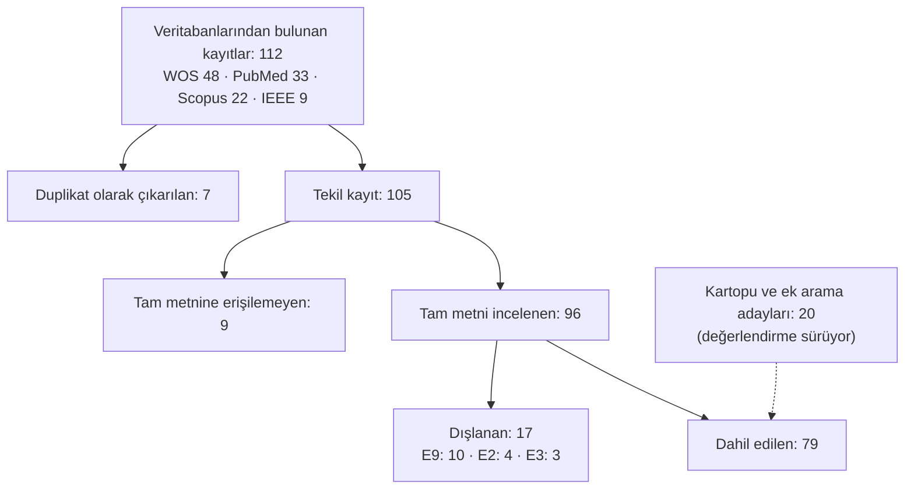

# TMS Nöronavigasyonunda Hedefleme, Kafa Modeli ve Kayıt Yöntemleri
## Sistematik Literatür Taraması — SENG491 Bitirme Projesi

| | |
| --- | --- |
| **Proje** | TMS Nöronavigasyon Destek Sistemi (hastane işbirlikli) |
| **Ekip** | Ahmet, İlayda, Mert, Berke |
| **Tarama aralığı** | 2022–2026 |
| **Veritabanları** | Web of Science, Scopus, PubMed, IEEE Xplore |
| **Dahil edilen çalışma** | 79 |
| **Belge tarihi** | 21 Ekim 2026 |

> Bu belge, ekibin tam metin inceleme tablosundan (SENG491_BEMEAHİL) otomatik olarak üretilmiş ve sentez bölümleriyle tamamlanmıştır. Ek A'daki çalışma bilgileri gözden geçiricilerin tabloya girdiği metinlerdir (İngilizce).

## İçindekiler

1. Özet
2. Giriş ve Motivasyon
3. Araştırma Soruları
4. Yöntem
5. Seçim Süreci ve Sonuçları
6. Genel Bulgular
7. Araştırma Sorularının Cevapları
8. Bizimki Gibi Bir Çalışma Var mı?
9. Modüllere Göre En Önemli Çalışmalar
10. Sayısal Referans Değerleri
11. Boşluklar ve Projenin Konumu
12. Taramanın Sınırlılıkları
13. Kartopu (Snowball) Adayları
- Ek A — Dahil edilen 79 çalışmanın ayrıntılı kataloğu
- Ek B — Dışlanan çalışmalar
- Ek C — Tam metnine erişilemeyen çalışmalar
- Ek D — Duplikatlar ve düzeltmeler
- Ek E — Terimler

## 1. Özet

Bu tarama, transkraniyal manyetik stimülasyonda (TMS) nöronavigasyon, hedef belirleme, kortikal haritalama, kişiye özgü kafa modeli, kafa–görüntü kaydı ve bobin konumlandırma üzerine 2022–2026 yılları arasında yayımlanmış çalışmaları inceler. Amaç, hastanede kurulu nöronavigasyon iş akışını hızlandıracak ve otomatikleştirecek bir sistemin (öncelikle kafa modeli oluşturma — Modül A) literatürdeki yerini belirlemektir.

**Temel bulgular:**

- Dört veritabanından 112 kayıt bulundu; 7 duplikat çıkarıldıktan sonra 105 tekil kayıt kaldı. 9 çalışmanın tam metnine erişilemedi, 96 tam metin incelendi, **79 çalışma dahil edildi**.
- Yayın sayısı yıllara göre artıyor; alan hızla gelişiyor.
- **Projemizle birebir aynı çalışma bulunmadı.** Rutin T1 MR'dan hızlı kafa modeli, otomatik landmark ve otomatik hedef üretip ticari bir navigasyon sistemine aktaran bütünleşik bir çalışma yok; parçalar ayrı ayrı mevcut.
- Kafa modeli ve segmentasyon en az çalışılan tema (3 çalışma). MR'dan otomatik landmark tespiti yapan çalışma hiç yok.
- Navigasyon başlık (cap) yöntemine göre çok daha isabetli (0,30 mm'ye karşı 10,66 mm, #19); navigasyondaki en büyük hata kaynağı kafa ile MR'ın eşleştirilmesi (#74).
- Navigasyonun klinik üstünlüğü tartışmalı (#70); bu nedenle projenin gerekçesi yalnız doğruluk değil, güvenilirlik ve otomasyon olmalı.
- Veri ve kod paylaşımı düşük: 79 çalışmanın 5'i (%6) veri, 15'i (%19) kod bağlantısı paylaşmış.
- Çalışmaların 21'i projemiz için yüksek, 35'i orta, 23'i düşük öneme sahip.

## 2. Giriş ve Motivasyon

Nöronavigasyonlu TMS, bobinin hastanın kendi MR görüntüsündeki hedefe göre konumlandırılmasını sağlar. İş birliği yapılan hastanede Brainsight nöronavigasyon sistemi ve Deymed DuoMAG XT stimülatörü kullanılmaktadır (kurulu sürüm ve iş akışı yerinde doğrulanacaktır). Hastanenin bildirdiği sorunlar şunlardır:

1. Kafa derisi ve beyin yüzeyinin rekonstrüksiyonu zaman zaman bozuk çıkıyor ve elle düzeltme gerektiriyor.
2. Landmark ve hedef noktaları doktor tarafından elle işaretleniyor.
3. Uygulama alanı yalnız dil bozukluğu değil; motor, ağrı ve depresyon gibi farklı endikasyonları kapsıyor.

Proje dört modül olarak tasarlanmıştır: **A** hızlı ve güvenilir kafa modeli (segmentasyon), **B** otomatik landmark tespiti ve kayıt, **C** otomatik hedef belirleme, **D** navigasyon sistemine entegrasyon. Bitirme projesi kapsamında öncelik Modül A'dadır. Bu tarama, dört modülün de literatürdeki karşılığını ortaya koymak için yapılmıştır.

## 3. Araştırma Soruları

| No | Soru |
| --- | --- |
| RQ1 | TMS hedeflemesinde hangi yöntemler kullanılıyor ve bu yöntemlerin uzamsal doğruluğu nedir? |
| RQ2 | Kişiye özgü kafa modeli ve segmentasyon nasıl yapılıyor; ne kadar otomatik ve hızlı? |
| RQ3 | Kafa–görüntü kaydı ve takip için hangi yöntemler kullanılıyor; en büyük hata kaynakları neler? |
| RQ4 | Nöronavigasyon iş akışının hangi adımları otomatikleştirilmiş, hangileri hâlâ elle yapılıyor? |
| RQ5 | Çalışmalar verilerini ve kodlarını ne ölçüde paylaşıyor; hangi cihaz ve yazılımlar kullanılıyor? |

## 4. Yöntem

### 4.1 Veritabanları ve sorgular

Aynı üç bloklu sorgu (TMS terimleri × nöronavigasyon terimleri × hedefleme terimleri) dört veritabanına uyarlanmıştır.

**Web of Science**
```
(TS=("transcranial magnetic stimulation" OR TMS OR rTMS OR "repetitive transcranial magnetic stimulation")
AND TS=(neuronavigation OR "neuronavigated TMS" OR "navigated TMS" OR "navigated transcranial magnetic stimulation"
        OR "MRI-guided TMS" OR "MRI guided TMS" OR "image-guided TMS" OR "image guided TMS")
AND TS=(targeting OR "target localization" OR "targeting accuracy" OR "spatial accuracy" OR "spatial precision"
        OR "coil positioning" OR "coil placement" OR "cortical targeting")) AND PY=(2022-2027)
```

**Scopus**
```
TITLE-ABS-KEY("transcranial magnetic stimulation" OR TMS OR rTMS OR "repetitive transcranial magnetic stimulation")
AND TITLE-ABS-KEY(neuronavigation OR "neuronavigated TMS" OR "navigated TMS" OR "navigated transcranial magnetic stimulation"
        OR "MRI-guided TMS" OR "MRI guided TMS" OR "image-guided TMS" OR "image guided TMS")
AND TITLE-ABS-KEY(targeting OR "target localization" OR "targeting accuracy" OR "spatial accuracy" OR "spatial precision"
        OR "coil positioning" OR "coil placement" OR "cortical targeting")
AND PUBYEAR > 2021 AND PUBYEAR < 2027
```

**IEEE Xplore** (filtre: 2022–2026)
```
(("transcranial magnetic stimulation" OR TMS OR rTMS OR "repetitive transcranial magnetic stimulation")
AND (neuronavigation OR "neuronavigated TMS" OR "navigated TMS" OR "navigated transcranial magnetic stimulation"
     OR "MRI-guided TMS" OR "MRI guided TMS" OR "image-guided TMS" OR "image guided TMS")
AND (targeting OR "target localization" OR "targeting accuracy" OR "spatial accuracy" OR "spatial precision"
     OR "coil positioning" OR "coil placement" OR "cortical targeting"))
```

**PubMed** (filtre: 2022–2026)
```
("Transcranial Magnetic Stimulation"[Mesh] OR "transcranial magnetic stimulation"[Title/Abstract] OR TMS[Title/Abstract]
 OR rTMS[Title/Abstract] OR "repetitive transcranial magnetic stimulation"[Title/Abstract])
AND (neuronavigation[Title/Abstract] OR "neuronavigated TMS"[Title/Abstract] OR "navigated TMS"[Title/Abstract]
     OR "navigated transcranial magnetic stimulation"[Title/Abstract] OR "MRI-guided TMS"[Title/Abstract]
     OR "MRI guided TMS"[Title/Abstract] OR "image-guided TMS"[Title/Abstract] OR "image guided TMS"[Title/Abstract])
AND (targeting[Title/Abstract] OR "target localization"[Title/Abstract] OR "targeting accuracy"[Title/Abstract]
     OR "spatial accuracy"[Title/Abstract] OR "spatial precision"[Title/Abstract] OR "localization accuracy"[Title/Abstract]
     OR "localization error"[Title/Abstract] OR "targeting error"[Title/Abstract] OR "positioning error"[Title/Abstract]
     OR "coil positioning"[Title/Abstract] OR "coil placement"[Title/Abstract] OR "cortical targeting"[Title/Abstract]
     OR deviation[Title/Abstract] OR "target deviation"[Title/Abstract] OR "distance error"[Title/Abstract]
     OR "spatial error"[Title/Abstract])
```

### 4.2 Uygunluk kriterleri

Bir çalışma aşağıdaki beş gruptan en az biriyle doğrudan ilişkiliyse dahil edilmiştir:

| Grup | Kapsam |
| --- | --- |
| **G1 — Nöronavigasyon ve hedefleme** | MR güdümlü TMS, nöronavigasyon/nTMS, stereotaktik hedefleme, hedef lokalizasyonu, kişiye özgü hedef seçimi, motor hotspot bulma |
| **G2 — Kortikal haritalama** | Motor, dil, yüz, el ve bacak haritalama; TMS ile fonksiyonel kortikal haritalama |
| **G3 — Kişiye özgü modelleme** | TMS/nöronavigasyon amacıyla MR'dan beyin, kafa, kafa derisi veya yüz modeli; segmentasyon, yüzey/mesh rekonstrüksiyonu, otomatik kafa modeli |
| **G4 — Kayıt ve takip** | MR/kafa modelinin gerçek kafayla eşleştirilmesi; landmark/yüzey kaydı, optik veya markersız takip, RGB-D/derinlik kamerası/yüz taraması |
| **G5 — Bobin konumlandırma, düşük maliyetli ve otomatik navigasyon** | Bobin konumu/yönelimi/takibi, E-alan güdümlü bobin optimizasyonu, robotik TMS, otomatik konumlandırma, MR'sız veya şablon/atlas tabanlı navigasyon |

Dışlama kodları:

| Kod | Anlamı |
| --- | --- |
| E1 | Yalnız klinik etkinlik / tedavi sonucu |
| E2 | Hastalık veya biyobelirteç çalışması; navigasyon yalnız araç olarak kullanılmış |
| E3 | Nöronavigasyon/hedefleme/haritalama bileşeni yok |
| E4 | İlgili görüntüleme/modelleme/kayıt bileşeni yok |
| E5 | TMS-navigasyon ilişkisi olmayan genel görüntü işleme/segmentasyon |
| E6 | TMS-navigasyon ilişkisi olmayan genel robotik/mühendislik |
| E7 | Hedefleme/konumlandırma ilişkisi olmayan E-alan çalışması |
| E8 | Tam metne erişilemedi |
| E9 | Özgün veya ilgili araştırma türü değil (derleme, protokol vb.) |
| E10 | Diğer (belirtilmeli) |

### 4.3 Seçim süreci

Kayıt sayısı yönetilebilir olduğu için ayrı bir özet (abstract) eleme aşaması uygulanmamış, tüm kayıtlar doğrudan tam metin üzerinden değerlendirilmiştir. Her kayıt dört ekip üyesinden biri tarafından incelenmiştir; tam metin incelemesi ve veri çıkarımında büyük dil modeli tabanlı asistanlardan (Claude, Gemini) yardım alınmış, kararlar gözden geçiricilerce verilmiştir. Çelişkili kararlar ekip içi hakemlikle çözülmüştür (Ek D).

### 4.4 Veri çıkarımı

Her çalışma için şu alanlar toplanmıştır: künye, yöntem, sonuçlar, sınırlılıklar, kullanılan cihazlar, kullanılan yazılımlar, veri seti bağlantısı, kod bağlantısı, yazarlar, DOI, kaynak veritabanı, yayın tarihi, başlık, gözden geçirici, durum ve dışlama kodu.

### 4.5 Kartopu taraması

Sorgunun gözden kaçırdığı çalışmaları bulmak için incelenen makalelerin kaynakçaları ve tamamlayıcı aramalar taranmıştır. Bulunan adaylar tabloya ayrı bir durumla (SNOWBALL) eklenmektedir (Bölüm 13).

## 5. Seçim Süreci ve Sonuçları



| Aşama | Sayı |
| --- | --- |
| Veritabanlarından bulunan kayıt | 112 |
| Duplikat olarak çıkarılan | 7 |
| Tekil kayıt | 105 |
| Tam metnine erişilemeyen | 9 |
| Tam metni incelenen | 96 |
| Dışlanan (E9: 10, E2: 4, E3: 3) | 17 |
| **Dahil edilen** | **79** |

**Gözden geçiriciler arası uyum.** Aynı makalenin farklı veritabanlarından gelen kayıtları (duplikat çiftleri) farklı ekip üyelerince bağımsız incelenmiştir. Karar verilen 6 çiftin 5'inde (%83) aynı karar çıkmıştır; tek çelişki (#50/#83) hakemlikle INCLUDED olarak çözülmüştür. Örneklem küçük olduğu için bu yalnız bir gösterge olarak verilmektedir.

## 6. Genel Bulgular

### 6.1 Yıllara göre dağılım

| Yıl | 2022 | 2023 | 2024 | 2025 | 2026 | Tarih belirsiz |
| --- | --- | --- | --- | --- | --- | --- |
| Çalışma | 11 | 12 | 14 | 18 | 21 | 3 |

2026 yılı henüz tamamlanmamıştır; buna rağmen en kalabalık yıl olması alanın hızla büyüdüğünü göstermektedir.

### 6.2 Kaynak veritabanına göre (dahil edilenler)

| Veritabanı | Çalışma |
| --- | --- |
| PUBMED | 29 |
| WOS | 28 |
| SCOPUS | 15 |
| IEEE | 7 |

### 6.3 Temalara göre dağılım

Dahil edilen çalışmalar içeriklerine göre sekiz temaya ayrılmıştır (uygunluk gruplarından daha ayrıntılı bir sınıflandırma).

| Tema | Konu | Sayı | Projemiz için önemi |
| --- | --- | --- | --- |
| T1 | Hedefleme doğruluğu ve yöntem karşılaştırması | 13 | Yüksek — doğruluk referansları |
| T2 | Navigasyonsuz ve düşük maliyetli hedefleme | 10 | Yüksek — alternatif yaklaşımlar |
| T3 | Kafa modeli ve segmentasyon | 3 | Çok yüksek — Modül A |
| T4 | Navigasyon yazılımı, robotik ve AR sistemleri | 11 | Yüksek — Modül D |
| T5 | Kortikal haritalama | 15 | Orta — doğrulama yöntemi |
| T6 | Bireysel hedef seçimi (yapay zekâ, fMRI, bağlantısallık) | 14 | Orta — Modül C |
| T7 | Navigasyonlu klinik uygulamalar | 9 | Düşük — klinik etkinlik |
| T8 | Elektrik alan hesaplama | 4 | Düşük — kapsam dışı |

### 6.4 Veri ve kod paylaşımı

| Durum | Veri seti | Kod |
| --- | --- | --- |
| URL | 5 | 15 |
| Ek materyal | 1 | 1 |
| Talep üzerine | 16 | 0 |
| Paylaşılmamış | 42 | 51 |
| Uygulanamaz | 1 | 1 |
| Belirtilmemiş | 14 | 11 |
| **Toplam** | **79** | **79** |

"Belirtilmemiş", gözden geçiricinin alanı boş bıraktığı kayıtları gösterir. Açık veri paylaşımının düşüklüğü, karşılaştırmalı çalışmayı zorlaştırmakta ve projemizin genel amaçlı açık kafa MR veri setlerine yönelmesini gerekçelendirmektedir.

Veri bağlantısı paylaşan çalışmalar:

- **#3** — Real-Time Tractography-Assisted Neuronavigation for Transcranial Magnetic Stimulation: http://www.tractometer.org/ismrm_2015_challenge/data
- **#14** — Quantifying and reporting the precision of transcranial magnetic stimulation targeting: https://github.com/HermillerLab/LocaliteQA
- **#66** — RGBD-Based Head Models Enable Precise MRI-Free Robotic Transcranial Magnetic Stimulation: https://osf.io/5hysb
- **#77** — Real world demonstration of hand motor mapping using the structural connectivity atlas: https://openneuro.org/datasets/ds000030
- **#110** — A generic, rapid and robust platform for personalized functional circuit-guided…: https://doi.org/10.57760/sciencedb.27339

### 6.5 Cihaz ve yazılımlar

Dahil edilen çalışmaların cihaz ve yazılım alanlarında geçen başlıca sistemler (bir çalışma birden fazla sistem kullanabilir):

| Sistem | Çalışma sayısı |
| --- | --- |
| MATLAB | 21 |
| SimNIBS | 18 |
| MagVenture | 15 |
| Brainsight | 14 |
| SPM | 13 |
| Localite | 11 |
| NDI Polaris (kamera) | 11 |
| Magstim | 10 |
| Python | 10 |
| FSL | 7 |
| Nexstim | 6 |
| InVesalius | 5 |
| FreeSurfer | 5 |
| Visor (ANT Neuro) | 2 |
| NaviNIBS | 1 |
| Deymed DuoMAG | 1 |
| 3D Slicer | 1 |

Sayılar alanlardaki metinden otomatik çıkarılmıştır; alanı boş bırakılan kayıtlar sayılmamıştır.

## 7. Araştırma Sorularının Cevapları

### RQ1 — Hedefleme yöntemleri ve doğrulukları

Literatürde üç yöntem ailesi öne çıkıyor: kafa derisi ölçümüne dayalı yöntemler (5 cm kuralı, 10-20 sistemi, Beam-F3), görüntü güdümlü nöronavigasyon ve MR'sız/şablon tabanlı ara çözümler. Navigasyon, başlık yöntemine göre çok daha isabetli bulunmuştur (0,30 mm ve 10,66 mm, #19); görüntü güdümlü hedefleme hedef parseline %95, 5 cm kuralı %58 isabet etmiştir (#107). Kafa derisi formülleri F3'ten 21–37 mm farklı noktalar verebilmektedir (#71). Atlas koordinatları ise bireysel düzeyde güvenilir değildir: Talairach koordinatı katılımcıların yarısında el alanını bulamamıştır (#96). Bununla birlikte dört merkezli bir randomize çalışmada navigasyon 5 cm kuralına göre klinik üstünlük göstermemiştir (%31,8 ve %35,6 yanıt, #70).

### RQ2 — Kafa modeli ve segmentasyon

Yalnız üç çalışma doğrudan kafa modeli üretimine odaklanmıştır. Segmentasyonsuz bir kafa modeli tümörlü hastalarda segmentasyon tabanlı modellerden daha doğru bulunmuştur (3,23 mm, #56). RGB-D kameradan elde edilen kafa modelleri MR tabanlı modellere yakın kayıt hatası vermiştir (2,53 ve 2,02 mm, #66). MR'dan kafa derisi ve korteks geometrisi çıkarılarak bobin pozu otomatik planlanabilmektedir (#105). Hiçbir çalışma segmentasyon süresini kısaltmayı veya ticari navigasyon sistemlerine otomatik kafa modeli hazırlamayı hedeflememiştir. Bu tür çalışmalar (ör. hızlı tam kafa segmentasyonu) "TMS" kelimesini içermedikleri için sorguya takılmamış; kartopu taramasıyla eklenmektedir.

### RQ3 — Kayıt ve takip

Navigasyonun toplam ko-registrasyon hatası 2,2–3,6 mm düzeyindedir ve en büyük pay kafa ile MR'ın eşleştirilmesindedir (#74). Navigasyonun gösterdiği bobin konumu bağımsız bir 3B tarayıcıyla ölçüldüğünde yaklaşık 10 mm fark bulunmuş; 1 mm landmark hatasının yaklaşık 1,8 mm bobin hatasına dönüştüğü gösterilmiştir (#67). Saç ve deri konum hatasını 2,0 mm'den 4,1 mm'ye çıkarmaktadır (#102). Düşük maliyetli alternatifler gelişmektedir: web kamerası ve basılı etiketlerle 4,94 mm hedef hatası (#47), telefon ve lazerle navigasyon (#108), AR gözlükle kamerasız navigasyon (#75).

### RQ4 — Otomasyon

Otomasyon en çok bobin konumlandırma ve haritalamada ilerlemiştir: robotik asistanlar (#49, #105), seans içi bobin hareketinin çevrimiçi telafisi (#41), açık kaynak robot platformları (#68), otomatik hedef planlama platformları (#110). Yapay zekâ ile hedef bulma örneği sınırlıdır: MR'da DLPFC'nin Mask R-CNN ile otomatik bulunması (Dice 0,80, #1). Landmark işaretleme ve kafa modelinin hazırlanması incelenen çalışmalarda hâlâ büyük ölçüde elle veya yarı otomatik yapılmaktadır.

### RQ5 — Veri, kod, cihaz ve yazılım

Veri bağlantısı paylaşan çalışmaların oranı %6 (5/79), kod bağlantısı paylaşanların oranı ise %19'dur (15/79; Bölüm 6.4). #24'te verilen bağlantı bir web hesaplayıcısı olduğu, #53'teki bağlantı ise çalışmanın kendi kodu değil kullandığı bir kütüphane olduğu için paylaşım sayılmamıştır. Navigasyon sistemleri arasında ticari sistemler (Brainsight, Localite, Nexstim, Visor) ile açık kaynak sistemler (InVesalius, NaviNIBS) birlikte kullanılmaktadır; E-alan ve kafa modeli için SimNIBS yaygın referanstır (Bölüm 6.5).

## 8. Bizimki Gibi Bir Çalışma Var mı?

Kısa cevap: **hayır, ama yakın parçalar var.** Aşağıdaki çalışmalar projemizin bir veya iki adımını yapıyor; hiçbiri hepsini birlikte yapmıyor.

| No | Ne yapıyor | Bizden farkı |
| --- | --- | --- |
| #110 | UNITE: T1 ve fMRI'dan uçtan uca otomatik hedef planlama, navigasyona aktarım | 20–30 dakikalık fMRI şart; kafa modeli ve landmark ele alınmıyor |
| #1 | MR kesitlerinde DLPFC'yi Mask R-CNN ile otomatik bulma | Tek hedef; kafa modeli ve kayıt yok; veri ve kod paylaşılmamış |
| #66 | RGB-D kameradan kafa modeli; MR'sız robotik haritalama | MR'ı ortadan kaldırıyor — yaklaşımımıza alternatif; 8 denek |
| #105 | MR'dan kafa derisi ve korteks geometrisi, otomatik bobin pozu, robot | Robot odaklı; segmentasyon hızı ve landmark incelenmiyor |
| #62 | MR'dan kafa derisi hedefi, CPC koordinatıyla navigasyonsuz uygulama | Navigasyonu atlıyor; otomatik landmark yok |
| #97 | Üç kafa ölçümüyle MNI kafa modelini kişiselleştirme | Kişiye özgü anatomi yok; yalnız simülasyon |
| #56 | Segmentasyonsuz kafa modeli; tümörlü hastada daha doğru | Segmentasyonu gereksiz kılabileceğini savunuyor — karşı görüş |
| #23 | Açık kaynak nöronavigasyon yazılımı (NaviNIBS) | Otomasyon değil altyapı; kafa modelini SimNIBS'ten alıyor |

**Projenin özgün katkısı** bu parçaların birleşimindedir: (1) yalnız rutin T1 MR ile çalışmak, (2) kafa modelini elle ayar gerektirmeden ve güvenilir biçimde üretmek, (3) landmarkları MR'dan otomatik bulmak, (4) sonucu hastanede kurulu ticari sisteme doğrudan aktarmak. Taranan çalışmalar arasında ticari otomatik navigasyon ürünlerini bağımsız olarak değerlendiren bir çalışma bulunmamıştır.

## 9. Modüllere Göre En Önemli Çalışmalar

### Modül A — Kafa modeli ve segmentasyon

| No | Başlık | Projemiz için anlamı |
| --- | --- | --- |
| #56 | Accurate localization of motor function using transcranial magnetic stimulation… | Segmentasyonsuz kafa modeli tümörlü hastada daha doğru (3,23 mm). Modül A'ya karşı görüş. |
| #66 | RGBD-Based Head Models Enable Precise MRI-Free Robotic Transcranial Magnetic… | RGB-D kameradan kafa modeli; kayıt hatası MR'a yakın (2,53 ve 2,02 mm); veri OSF'de. |
| #105 | An Image-Guided Robotic System for Transcranial Magnetic Stimulation: System… | MR'dan kafa derisi ve korteks geometrisiyle otomatik 6 serbestlik dereceli bobin pozu ve robot. |
| #62 | Expanding access to personalized TMS: An MRI-guided scalp-based targeting… | MR tabanlı CPC kafa derisi yöntemi; 4,37 mm hata, navigasyon E-alanının %99,4'ü; Brainsight kullanılmış. |

### Modül B — Landmark ve kayıt

| No | Başlık | Projemiz için anlamı |
| --- | --- | --- |
| #74 | Accuracy and precision of navigated transcranial magnetic stimulation | Hata bütçesi: toplam 2,2-3,6 mm; en büyük kaynak kafa-MR kaydı. |
| #67 | Verification of neuronavigated TMS accuracy using structured-light 3D scans | 3D tarayıcıyla bağımsız doğrulama: navigasyonla yaklaşık 10 mm fark; 1 mm landmark hatası yaklaşık 1,8 mm bobin hatası. |
| #102 | 3D-printed helmet-type neuro-navigation approach (I-Helmet) for transcranial… | 3D baskılı kask; saç ve deri hatayı artırıyor (2,0'dan 4,1 mm'ye); landmark rehberliği hatayı azaltıyor. |
| #47 | Optical Tag-Based Neuronavigation and Augmentation System for Non-Invasive… | Yaklaşık 60 sterlinlik web kamerası ve AprilTag ile düşük maliyetli navigasyon; hedef hatası 4,94 mm. |
| #14 | Quantifying and reporting the precision of transcranial magnetic stimulation… | Navigasyon kayıtlarından vuruş bazında hassasiyet hesaplayan açık araç (LocaliteQA). |
| #35 | A landmark-based approach to locate symptom-specific transcranial magnetic… | Landmark tabanlı DLPFC; bireysel düzeyde %52-64'ünde 5 mm üstü hata; seans içi bobin kayması yaklaşık 6 mm. |

### Modül C — Hedef belirleme

| No | Başlık | Projemiz için anlamı |
| --- | --- | --- |
| #1 | A Novel Approach for Personalized DLPFC Localization in Neuroimaging and Brain… | Mask R-CNN ile MR'da DLPFC'yi otomatik bulma; Dice 0,80. Modül C'ye en yakın yapay zekâ çalışması. |
| #96 | How accurate are coordinate systems being used for transcranial magnetic… | Talairach atlas koordinatı katılımcıların yarısında el alanını bulamadı; atlas tabanlı hedefin sınırı. |
| #107 | Comparison of consistency between image guided and craniometric transcranial… | Görüntü güdümlü hedefleme 5-cm ve Beam-F3'e göre çok daha tutarlı (parsel isabeti %95 ve %58). |
| #110 | A generic, rapid and robust platform for personalized functional circuit-guided… | UNITE: uçtan uca otomatik hedef planlama platformu; dinlenim-hali fMRI gerektiriyor. |
| #57 | Targeting Lower Limb, Upper Limb, and Face Representation in the Primary Motor… | Bacak, kol ve yüz motor alanları için MR tabanlı standart hedefler. |

### Modül D — Entegrasyon ve sistemler

| No | Başlık | Projemiz için anlamı |
| --- | --- | --- |
| #23 | NaviNIBS: a comprehensive and open-source software toolbox for neuronavigated… | Açık kaynak Python nöronavigasyon (NaviNIBS); ticari sistemle benzer kayıt hatası. |
| #68 | Robotic–electronic platform for autonomous and accurate transcranial magnetic… | Açık kaynak robot + mTMS + InVesalius platformu; kod GitHub'da. |
| #108 | Intra-rater reliability and validity of neuro-mobinavigation: A mobile app and… | Telefon ve lazerle düşük maliyetli navigasyon; hastanedeki DuoMAG XT ve 70BF bobinle yapılmış. |
| #41 | Reducing target E-field variability in repetitive TMS through online motion… | Seans içi bobin hareketini çevrimiçi telafi; hedef E-alan değişkenliğini %41-74 azaltıyor. |
| #49 | Transcranial Magnetic Stimulation Robotic Assistant: towards a fully automated… | Ticari nTMS sistemine robotik asistan; otomatik bobin yerleştirme. |
| #3 | Real-Time Tractography-Assisted Neuronavigation for Transcranial Magnetic… | InVesalius'a gerçek zamanlı traktografi eklentisi; açık kaynak navigasyon referansı. |

## 10. Sayısal Referans Değerleri

Değerler farklı ölçüm yöntemleriyle elde edildiği için doğrudan karşılaştırılmamalıdır; projenin kendi sonuçlarını konumlandırmak için kullanılmalıdır.

| Ölçülen | Değer | Kaynak |
| --- | --- | --- |
| Navigasyon ile başlık yöntemi arasındaki hedef sapması | 0,30 mm ve 10,66 mm | #19 |
| Toplam ko-registrasyon doğruluğu | 2,2–3,6 mm | #74 |
| Navigasyon ile 3B tarayıcı arasındaki bobin konumu farkı | yaklaşık 10,2 mm | #67 |
| Saç ve derinin konum hatasına etkisi | 2,0 mm'den 4,1 mm'ye | #102 |
| RGB-D ve MR tabanlı kafa modelinin kayıt hatası | 2,53 mm ve 2,02 mm | #66 |
| Segmentasyonsuz kafa modeli | 3,23 mm | #56 |
| MR tabanlı kafa derisi (CPC) yöntemi | 4,37 mm | #62 |
| Üç kafa ölçümüyle MR'sız model | 4,92 mm | #97 |
| Web kamerası tabanlı düşük maliyetli navigasyon | 4,94 mm | #47 |
| Mask R-CNN ile DLPFC segmentasyonu | Dice 0,80; 5 cm kuralı 11,3 mm sapma | #1 |
| Hedef parseline isabet: görüntü güdümlü ve 5 cm kuralı | %95 ve %58 | #107 |
| Landmark tabanlı DLPFC'de 5 mm'yi aşan denek oranı | %52–64 | #35 |
| Seans içi bobin hareketinin telafisiyle E-alan değişkenliğindeki azalma | %41–74 | #41 |
| Klinik yanıt: navigasyon ve 5 cm kuralı | %31,8 ve %35,6 | #70 |

## 11. Boşluklar ve Projenin Konumu

1. **MR'dan otomatik landmark tespiti yok.** Markersız kamera yöntemleri var (#47, #66, #76), ama MR görüntüsünden nasion ve kulak noktalarını otomatik bulan çalışma çıkmadı.
2. **Kafa modeli üretim süresi ve güvenilirliği ele alınmıyor.** Kafa modeliyle ilgilenen üç çalışma doğruluğa odaklanıyor; elle ayar gerektirmeyen, hızlı ve hata tespit eden bir hat önerilmemiş.
3. **Ticari sistemlere otomatik girdi üreten çalışma yok.** Açık sistemler (InVesalius, NaviNIBS) gelişiyor; yaygın ticari sistemlere otomatik hazırlık yapan bir araç bulunmuyor.
4. **Teknik doğrulamalar çoğunlukla sağlıklı gönüllülerde.** Yaşlı ve lezyonlu beyinlerde doğrulama sınırlı.
5. **Veri ve kod paylaşımı düşük.** Karşılaştırmalı çalışmayı zorlaştırıyor.
6. **Doğruluk artışının klinik karşılığı belirsiz (#70).** Projenin temel iddiası güvenilirlik, otomasyon ve tekrarlanabilirlik olmalı; doğruluk ikincil kazanım olarak sunulmalı.

## 12. Taramanın Sınırlılıkları

- **Sorgu kapsamı:** Sorgu "TMS" terimini zorunlu tuttuğu için genel kafa segmentasyonu, markersız takip ve landmark tespiti üzerine TMS'e özgü olmayan çalışmalar sorguya takılmamıştır. Bu açık kartopu taramasıyla kısmen kapatılmaktadır.
- **Geniş hedefleme terimi:** "targeting" terimi çok sayıda klinik etkinlik çalışmasını getirmiştir; bunların bir kısmı dahil edilmiş ama düşük önemde işaretlenmiştir (T7).
- **Tek gözden geçirici:** Her kayıt bir kişi tarafından incelenmiştir; uyum yalnız duplikat çiftleri üzerinden sınırlı ölçüde gözlenebilmiştir.
- **Asistan kullanımı:** Tam metin incelemesi ve veri çıkarımında büyük dil modeli asistanlarından yararlanılmıştır; kararlar ekip tarafından verilmiş olsa da çıkarılan metinlerde hata olasılığı vardır.
- **Kalite değerlendirmesi yapılmamıştır:** Çalışmaların metodolojik kalitesi puanlanmamıştır; bu tarama bir kapsam/haritalama taraması niteliğindedir.
- **Erişim:** 9 çalışmanın tam metnine erişilememiştir.
- **Tarih aralığı:** 2022 öncesi temel çalışmalar (ör. charm, GeodesicSlicer) taramaya dahil değildir; arka plan olarak anılmaktadır.

## 13. Kartopu (Snowball) Adayları

Aşağıdaki 20 aday tabloya **SNOWBALL** durumuyla 113–132 numaralarıyla eklenmek üzere hazırlanmıştır; tam metin değerlendirmeleri sürmektedir. Önerilen kararlar özet bilgisine dayanır.

| No | Yıl | Başlık | DOI | Önerilen grup | Önerilen karar |
| --- | --- | --- | --- | --- | --- |
| 113 | 2026 | Toward Accurate and Accessible Markerless Neuronavigation | 10.48550/arXiv.2602.07052 | G4 | INCLUDED |
| 114 | 2024 | Scalp surface estimation and head registration using sparse sampling and 3D… | 10.1016/j.compbiomed.2024.108689 | G3, G4 | INCLUDED |
| 115 | 2023 | Automatic Neurocranial Landmarks Detection from Visible Facial Landmarks… | 10.1007/978-3-031-45249-9_2 | G3, G4 | INCLUDED |
| 116 | 2023 | MarLe: Markerless estimation of head pose for navigated transcranial magnetic… | 10.1007/s13246-023-01263-2 | G4 | INCLUDED |
| 117 | 2023 | Precise motor mapping with transcranial magnetic stimulation | 10.1038/s41596-022-00776-6 | G2 | INCLUDED |
| 118 | 18.12.2023 | Semi-automated motor hotspot search (SAMHS): a framework toward an optimised… | 10.3389/fnhum.2023.1228859 | G1, G2, G5 | INCLUDED |
| 119 | 17.02.2026 | Efficient Gaussian process-based motor hotspot hunting with concurrent… | 10.1371/journal.pcbi.1013994 | G2, G5 | INCLUDED |
| 120 | 2025 | Fast and standardized motor-hotspot determination with automated TMS mapping | 10.1101/2025.09.24.678288 | G2, G5 | INCLUDED |
| 121 | 11.09.2025 | Scaling Personalized TMS: A Scalp-Based MRI-guided Alternative to… | 10.1101/2025.09.05.673388 | G3, G5 | INCLUDED |
| 122 | 21.08.2024 | Real-time estimation of the optimal coil placement in transcranial magnetic… | 10.1038/s41598-024-70367-w | G5 | INCLUDED |
| 123 | 2026 | Real-time electric-field neuronavigation on realistic head models for… | Doğrulanacak (PII S1935861X26000902) | G5 | INCLUDED |
| 124 | 2026 | Optimal Pre-Experimental Coil Sequence Selection for TMS Motor Mapping | 10.64898/2026.05.26.727891 | G2 | INCLUDED |
| 125 | 2026 | Deep-Learning-Based Prediction of TMS-Induced Motor Evoked Responses from… | 10.3390/ai7080285 | G2 | INCLUDED |
| 126 | 2026 | A Multi-Camera Optical Tag Neuronavigation and AR Augmentation Framework for… | 10.48550/arXiv.2601.20663 | G4, G5 | UNDECIDED |
| 127 | 2022 | A scalp-measurement based parameter space: towards locating TMS coils in a… | 10.1016/j.brs.2022.06.001 | G5 | INCLUDED |
| 128 | 2025 | MRI free targeting of deep brain structures based on facial landmarks | Doğrulanacak (PII S1935861X25000026) | G4, G5 | UNDECIDED |
| 129 | 2026 | Neuronavigation-free and MRI-free Localization of Deep Brain Targets | 10.64898/2026.02.04.703768 | G5 | UNDECIDED |
| 130 | 2024 | Precise and Rapid Whole-Head Segmentation from Magnetic Resonance Images of… | Doğrulanacak (PMID 38465203) | G3 | UNDECIDED |
| 131 | 17.09.2025 | Full-head segmentation of MRI with abnormal brain anatomy: model and data… | 10.1117/1.JMI.12.5.054001 | G3 | UNDECIDED |
| 132 | 2022 | Database of 25 validated coil models for electric field simulations for TMS | 10.1016/j.brs.2022.04.017 | G5 / E7 | UNDECIDED |

**Not:** #121'in ("Scaling Personalized TMS" preprint'i) dergi versiyonu tabloda #62 olarak, #126'nın (optik etiket navigasyonu) muhtemel karşılığı #47 olarak zaten mevcuttur; bu iki aday duplikat olarak ele alınmalıdır. 2020–2021 tarihli kaynakça adayları (Fleischmann 2020, Badran 2020, Briend 2020, Gomez 2021, DeepNavNet 2021) tarih aralığı dışında kaldığı için tabloya eklenmemiş, arka plan kaynağı olarak tutulmuştur.

---

## Ek A — Dahil Edilen 79 Çalışmanın Ayrıntılı Kataloğu

Çalışmalar temalara göre gruplandırılmış, her temada önem derecesine göre sıralanmıştır. Yöntem, sonuç ve sınırlılık alanları gözden geçiricilerin tabloya girdiği metinlerdir.

### T1 — Hedefleme doğruluğu ve yöntem karşılaştırması (13 çalışma)

#### #14 — Quantifying and reporting the precision of transcranial magnetic stimulation targeting

- **Yazarlar:** Burns, M. R.; Hermiller, M. S.
- **Yıl:** 2025 · **Kaynak:** PUBMED · **Gözden geçiren:** Ahmet
- **DOI:** [10.1016/j.brainres.2024.149350](https://doi.org/10.1016/j.brainres.2024.149350)
- **Önem (projemiz için):** Yüksek — Navigasyon kayıtlarından vuruş bazında hassasiyet hesaplayan açık araç (LocaliteQA).
- **Yöntem:** The authors developed an open-source MATLAB pipeline ("LocaliteQA") to retrospectively extract 3D spatial transformation matrices (4×4 affine matrices) of individual TMS pulses recorded by an optical MRI-guided neuronavigation system. The algorithm computes the Euclidean distance between actual and predefined scalp coil coordinates, calculates Euler angles (pitch, roll, yaw) via Procrustes analysis to capture coil orientation deviations, and projects vectors along the coil normal to quantify Euclidean distance errors relative to intended cortical targets. The methodology was validated using exemplar training datasets contrasting novice vs. experienced operators, multi-session longitudinal datasets (5-day parietal rTMS), and simulated multi-condition trials.
- **Sonuçlar:** The toolbox objectively quantified pulse-by-pulse spatial displacement, rotational eccentricity, and off-target stimulation events relative to predefined thresholds (e.g., >3 mm). An experienced operator maintained coil targeting precision within 2 mm throughout an entire 800-pulse session, whereas a novice operator demonstrated substantial drift with 350 off-target pulses exceeding 3 mm. In a multi-day protocol, the framework demonstrated consistent longitudinal tracking quality across sessions (mean coil position variance = 0.85 mm, SD = 0.14 mm), confirming its utility for quality assurance, operator certification, and trial-specific data censoring.
- **Sınırlılıklar:** The initial implementation was developed and tailored specifically for log outputs from the Localite TMS navigation system, requiring script adaptation for alternative platforms (e.g., Brainsight). It performs retrospective quality assurance rather than real-time automated coil repositioning or active robotic correction. Cortical target projection relies on linear depth extrapolation rather than subject-specific numerical E-field boundary-element modeling.
- **Cihazlar:** Localite TMS Navigation System with optical infrared stereotaxic tracking (Localite GmbH, Bonn, Germany), MagVenture MagPro X100 and R30 magnetic stimulators (MagVenture, Farum, Denmark).
- **Yazılımlar:** MATLAB (Image Processing Toolbox, Statistics and Machine Learning Toolbox), Localite TMS Navigator software.
- **Veri seti:** URL
- **Kod:** URL: https://github.com/HermillerLab/LocaliteQA

#### #19 — Neuronavigation maximizes accuracy and precision in TMS positioning: Evidence from 11,230 distance, angle, and electric field modeling measurements

- **Yazarlar:** Caulfield, K. A.; Fleischmann, H. H.; Cox, C. E.; Wolf, J. P.; George, M. S.; McTeague, L. M.
- **Yıl:** 2022 · **Kaynak:** PUBMED · **Gözden geçiren:** Ahmet
- **DOI:** [10.1016/j.brs.2022.08.013](https://doi.org/10.1016/j.brs.2022.08.013)
- **Önem (projemiz için):** Yüksek — Başlık (cap) 10,66 mm, navigasyon 0,30 mm; temel doğruluk referansı.
- **Yöntem:** A prospective comparison between elastic cap-based targeting and optical MRI-guided neuronavigation was conducted across 42 participants (28 healthy, 14 chronic stroke) receiving accelerated rTMS protocols over multiple sessions (up to 50 sessions per participant). In Experiment 1, six operators recorded 3,408 distance and 6,816 angle (roll/pitch and yaw) measurements relative to an on-target prefrontal Beam F3 coordinate saved in Brainsight. In Experiment 2, 1,106 individual finite element method (FEM) E-field models were simulated in SimNIBS (headreco pipeline using dual T1w/T2w scans) from recorded cap and neuronavigation coil XYZ coordinates in 12 participants to quantify cortical E-field magnitude and motor threshold percentage equivalence at the DLPFC target.
- **Sonuçlar:** Cap-based targeting resulted in significant positional displacement, averaging 10.66 mm off-target (SEM = 0.19 mm) compared to 0.30 mm (SEM = 0.03 mm) for neuronavigation (p < 0.0001). Cap targeting also deviated substantially in angle, averaging 7.79° in roll/pitch and 5.99° in yaw off-target, compared to 0.34° and 0.22° for neuronavigation (p < 0.0001). Significant inter-operator placement variability was observed for cap positioning (up to 5.83 mm difference between operators, p = 0.003), whereas neuronavigation eliminated distance operator differences (p = 0.079). In E-field simulations, cap targeting delivered significantly lower E-field magnitudes (mean 88.36 V/m vs. 95.83 V/m, p < 0.0001), equating to only 110.7% MT (range: 58.3%–127.4%) compared to 119.9% MT (range: 115%–123.3%) for neuronavigation at an intended 120% MT intensity.
- **Sınırlılıklar:** The study measured physical and computational targeting error metrics but did not directly compare clinical/therapeutic symptom outcomes between arms. Accelerated delivery schedules (up to 10 sessions/day) were utilized rather than standard once-daily clinical protocols. E-field simulations were evaluated exclusively on healthy head anatomies rather than stroke-lesioned brains.
- **Cihazlar:** 3T Siemens Prisma MRI scanner (32-channel head coil), MagVenture MagPro R30 magnetic stimulator with Cool B65 A/P figure-8 coil, Brainsight neuronavigation system (v2.4.7) with Polaris infrared optical tracking camera.
- **Yazılımlar:** Brainsight (v2.4.7), SimNIBS (v3.2.3, headreco), SPM12, CAT12, MATLAB, IBM SPSS (v27.0).
- **Veri seti:** Paylaşılmamış
- **Kod:** Paylaşılmamış

#### #35 — A landmark-based approach to locate symptom-specific transcranial magnetic stimulation targets of depression

- **Yazarlar:** Du, R.; Zhou, Q.; Hu, T.; Sun, J.; Hua, Q.; Wang, Y.; Zhang, Y.; He, K.; Tian, Y.; Ji, G. J.; Wang, K.
- **Yıl:** 2022 · **Kaynak:** PUBMED · **Gözden geçiren:** Ahmet
- **DOI:** [10.3389/fpsyg.2022.919944](https://doi.org/10.3389/fpsyg.2022.919944)
- **Önem (projemiz için):** Yüksek — Landmark tabanlı DLPFC; bireysel düzeyde %52-64'ünde 5 mm üstü hata; seans içi bobin kayması yaklaşık 6 mm.
- **Yöntem:** In a discovery cohort (n=24), two symptom-specific left DLPFC targets ("anxiosomatic" MNI: [-37, 22, 54] and "dysphoric" MNI: [-32, 44, 34]) were identified using the Brainsight neuronavigation system and structural MRI. Geodesic scalp distance ratios (r x,r y) relative to nasion-inion (distance N−I) and vertex-tragus (distance V−T) landmarks were formulated to create a neuronavigation-free landmark-based targeting method. The approach was validated in an independent cohort (n=25) by two raters assessing inter-/intra-rater reliability and comparing Euclidean distances between landmark-based and MRI-personalized targets against a 5 mm TMS spatial resolution threshold. Additionally, initial coil misplacement (60 trials) and dynamic coil displacement during 10-min sham rTMS sessions without neuronavigation (24 sessions) were recorded.
- **Sonuçlar:** At the group level, mean Euclidean distance between personalized and landmark-based targets was not significantly larger than the 5 mm spatial resolution threshold on the cortex (0.58±0.21 cm for anxiosomatic, 0.54±0.23 cm for dysphoric targets). However, individual distances exceeded 5 mm in 52% of anxiosomatic and 64% of dysphoric cases. During 10-min rTMS without neuronavigation, average dynamic coil misplacement significantly exceeded the 5 mm threshold (mean 6.31±5.14 mm, p<0.0001), driven by involuntary participant head movements.
- **Sınırlılıklar:** The study sample consisted primarily of young participants (aged 17–28 years), which limits generalizability to older clinical populations with cerebral atrophy. The targeting protocol relies on manual tape-measure scalp markings, introducing manual human operator measurement errors. The landmark method was only formulated for two specific prefrontal targets and has not yet been generalized to other cortical areas.
- **Cihazlar:** Magstim Rapid2 magnetic stimulator with a 70 mm air-cooled figure-8 coil, Brainsight neuronavigation system (Rogue Research Inc.), 3.0T GE Discovery 750 MRI scanner.
- **Yazılımlar:** Brainsight neuronavigation software, SPM12, TMS target software, GraphPad Prism / SPSS.
- **Veri seti:** Talep üzerine
- **Kod:** Paylaşılmamış

#### #67 — Verification of neuronavigated TMS accuracy using structured-light 3D scans

- **Yazarlar:** Matilainen, N; Kataja, J; Laakso, I
- **Yıl:** — · **Kaynak:** WOS · **Gözden geçiren:** Mert
- **DOI:** [10.1088/1361-6560/ad33b8](https://doi.org/10.1088/1361-6560/ad33b8)
- **Önem (projemiz için):** Yüksek — 3D tarayıcıyla bağımsız doğrulama: navigasyonla yaklaşık 10 mm fark; 1 mm landmark hatası yaklaşık 1,8 mm bobin hatası.
- **Yöntem:** Ten healthy participants underwent three-landmark nTMS registration. Coil position was recorded simultaneously by Visor2/Polaris optical neuronavigation and an Artec Leo structured-light 3D scanner; position/orientation discrepancies, landmark sensitivity and subject-specific FEM electric/magnetic-field errors were calculated.
- **Sonuçlar:** Neuronavigated and 3D-scanned coil centers differed by about 10.2 mm, with 2-3° orientation errors. Misplacement produced mean relative errors of 29% in E-field (9-51%) and 33% in magnetic field (10-58%); 1 mm landmark error could yield about 1.8 mm coil-location error.
- **Sınırlılıklar:** Ten-participant sample and one three-landmark workflow; 3D scan/MRI surface registration is affected by mutable facial soft tissue and hair/cap handling. Field errors are computational estimates rather than direct physiological measurements.
- **Cihazlar:** Magstim 2002 with D70 Alpha Flat Coil; Visor2 (ANT Neuro) and Polaris Vicra tracking; Artec Leo structured-light scanner; Siemens Magnetom Skyra 3-T MRI.
- **Yazılımlar:** FreeSurfer; Visor2; custom FEM solver; MATLAB-related analysis tools.
- **Veri seti:** Talep üzerine
- **Kod:** URL: https://version.aalto.fi/gitlab/ilaakso/vgm-fem

#### #74 — Accuracy and precision of navigated transcranial magnetic stimulation

- **Yazarlar:** Nieminen, A. E.; Nieminen, J. O.; Stenroos, M.; Novikov, P.; Nazarova, M.; Vaalto, S.; Nikulin, V.; Ilmoniemi, R. J.
- **Yıl:** 2022 · **Kaynak:** PUBMED · **Gözden geçiren:** Ahmet
- **DOI:** [10.1088/1741-2552/aca71a](https://doi.org/10.1088/1741-2552/aca71a)
- **Önem (projemiz için):** Yüksek — Hata bütçesi: toplam 2,2-3,6 mm; en büyük kaynak kafa-MR kaydı.
- **Yöntem:** Comprehensive simulation study decomposing the error budget of image-guided TMS neuronavigation. Navigation errors were estimated separately for MRI geometric distortion, head-to-MRI registration (landmark-based versus surface-based), localization and movement of the head tracker, and localization of the coil tracker. These errors were then propagated into coil-head coregistration accuracy and precision, and into the estimated induced electric field computed with both simplistic (spherical) and realistic head models, so that the contribution of each factor to peak E-field location, orientation and magnitude could be quantified.
- **Sonuçlar:** Average total coregistration accuracy was 2.2-3.6 mm and about 1 degree, with precision roughly half the accuracy values. Errors were dominated by head-to-MRI registration (accuracy 1.5-1.9 mm / 0.2-0.4 degrees, precision 0.5-0.8 mm / 0.1-0.2 degrees, with surface-based registration outperforming landmark-based) and by head-tracker movement (accuracy 1.5 mm, precision 1.1 mm). Average accuracies of peak E-field location, orientation and magnitude ranged from 1.5-5.0 mm, 0.9-4.8 degrees and 4.4-8.5% across E-field models, with the largest errors from landmark-based registration. Using the most realistic E-field model as reference, accuracy improved from roughly 10 mm / 15 degrees / 25% to about 2 mm / 2 degrees / 5% as model realism increased. The authors recommend surface-based head-to-MRI registration and realistic E-field models.
- **Sınırlılıklar:** The analysis is simulation-based rather than an empirical measurement of navigation error in participants, so results depend on the assumed error distributions and on the specific hardware and registration workflow modelled. No physiological (MEP) or clinical validation was performed, and hair, cap thickness and soft-tissue deformation were not separately modelled.
- **Cihazlar:** Modelled optical neuronavigation trackers, TMS coil and MRI acquisition; no TMS was physically delivered.
- **Yazılımlar:** In-house simulation framework for coregistration error propagation; spherical and realistic (FEM/BEM-class) E-field models.
- **Veri seti:** Paylaşılmamış
- **Kod:** Paylaşılmamış

#### #96 — How accurate are coordinate systems being used for transcranial magnetic stimulation?

- **Yazarlar:** Uehara, M. A.; Jacobson, N.; Moussavi, Z.
- **Yıl:** 2024 · **Kaynak:** PUBMED · **Gözden geçiren:** Ahmet
- **DOI:** [10.3389/fnhum.2024.1342410](https://doi.org/10.3389/fnhum.2024.1342410)
- **Önem (projemiz için):** Yüksek — Talairach atlas koordinatı katılımcıların yarısında el alanını bulamadı; atlas tabanlı hedefin sınırı.
- **Yöntem:** Brief research report evaluating the fitness of the Talairach coordinate system, the most commonly used coordinate framework for guiding neuronavigated TMS. An average Talairach coordinate for the hand area of the primary motor cortex was derived from 50 healthy individuals and then tested in six older participants (aged 61-82). Single TMS pulses were delivered to that coordinate after individual adjustment using each participant's own MRI in the neuronavigation system, and responses were verified by observed involuntary twitch and by electromyography of the abductor pollicis brevis and first dorsal interosseous muscles at resting motor threshold intensity.
- **Sonuçlar:** Only three of the six participants showed an involuntary twitch with corroborating EMG response when stimulated at the atlas-derived Talairach coordinate; the remaining three showed no consistent physical response. For these three non-responders the true hand area was subsequently located by trial-and-error, revealing substantial deviation from the atlas coordinate. Group-average Talairach coordinates are therefore not reliably accurate for individual-level TMS targeting even when adjusted to the individual's MRI.
- **Sınırlılıklar:** Very small sample (n=6), all older adults, so results may not generalize to younger participants or other cortical targets. Brief-report design without E-field modelling or systematic mapping; deviation was quantified only for the participants who failed to respond at the atlas coordinate.
- **Cihazlar:** TMS stimulator with figure-of-eight coil; MRI-based neuronavigation system; surface EMG (abductor pollicis brevis and first dorsal interosseous).
- **Yazılımlar:** Neuronavigation software using Talairach-Tournoux atlas coordinates; EMG acquisition and analysis software.
- **Veri seti:** Paylaşılmamış
- **Kod:** Paylaşılmamış

#### #107 — Comparison of consistency between image guided and craniometric transcranial magnetic stimulation coil placement

- **Yazarlar:** Young, I.M.; Osipowicz, K.; Mackenzie, A.; Clarke, O.; Taylor, H.; Nicholas, P.; Ryan, M.; Holle, J.; Tanglay, O.; Doyen, S.; Sughrue, M.E.
- **Yıl:** 2022 · **Kaynak:** SCOPUS · **Gözden geçiren:** Berke
- **DOI:** [10.1016/j.brs.2022.10.008](https://doi.org/10.1016/j.brs.2022.10.008)
- **Önem (projemiz için):** Yüksek — Görüntü güdümlü hedefleme 5-cm ve Beam-F3'e göre çok daha tutarlı (parsel isabeti %95 ve %58).
- **Yöntem:** Systematically tested between-technician consistency and targeting variance of three TMS coil placement approaches (the 5-cm rule, Beam-F3, and an image-guided approach using personalized brain maps derived via machine learning for Brodmann area 46) across 12 healthy adult subjects evaluated by experienced TMS treatment technicians.
- **Sonuçlar:** The image-guided approach substantially decreased variability in target location compared to craniometric approaches on both the left and right sides (p < .001), achieving a target parcel accuracy of 95% (left) and 89% (right) compared to 58%/33% for the 5-cm rule and 33%/31% for Beam-F3.
- **Sınırlılıklar:** Evaluated technician placement variance on healthy subjects without evaluating clinical outcomes.
- **Cihazlar:** Localite neuronavigation system, soft measuring ruler.
- **Yazılımlar:** Localite neuronavigation software, machine-learning-derived parcel software.
- **Veri seti:** Belirtilmemiş
- **Kod:** Belirtilmemiş

#### #5 — Comparison between conventional and neuronavigated strategies to assess corticospinal responsiveness in unfatigued and fatigued knee-extensor muscles

- **Yazarlar:** Barbi, C; Vernillo, G; Andani, ME; Giuriato, G; Laginestra, FG; Cavicchia, A; Aloisi, GF; Martignon, C; Pedrinolla, A; Schena, F; Venturelli, M
- **Yıl:** 2023 · **Kaynak:** WOS · **Gözden geçiren:** İlayda
- **DOI:** [10.1016/j.neulet.2023.137351](https://doi.org/10.1016/j.neulet.2023.137351)
- **Önem (projemiz için):** Orta — Manuel ve navigasyonlu bobin konumlandırma karşılaştırması (diz ekstansörleri).
- **Yöntem:** Compared standardized function-guided manual coil positioning with optical neuronavigated TMS across unfatigued and fatigued knee-extensor conditions; assessed spatial dispersion and corticospinal responses.
- **Sonuçlar:** Manual-versus-navigated target offsets showed narrow dispersion (reported mean coordinate differences around millimeters), and group-level MEP/silent-period responses were similar; trained manual positioning was sufficiently stable under tested conditions.
- **Sınırlılıklar:** Manual method depends on an adequately trained operator; physiological variability may mask small positioning effects; findings are specific to knee-extensor testing and the tested protocol.
- **Cihazlar:** Magstim TMS; surface EMG; Polaris optical neuronavigation.
- **Yazılımlar:** MATLAB/statistical analysis; neuronavigation software.
- **Veri seti:** Talep üzerine
- **Kod:** Paylaşılmamış

#### #28 — Comparison of coil placement approaches targeting dorsolateral prefrontal cortex in depressed adolescents receiving repetitive transcranial magnetic stimulation: an electric field modeling study

- **Yazarlar:** Deng, Z. D.; Robins, P. L.; Dannhauer, M.; Haugen, L. M.; Port, J. D.; Croarkin, P. E.
- **Yıl:** 2023 · **Kaynak:** PUBMED · **Gözden geçiren:** Ahmet
- **DOI:** [10.1101/2023.02.06.23285526](https://doi.org/10.1101/2023.02.06.23285526)
- **Önem (projemiz için):** Orta — Ergenlerde dört DLPFC hedefleme yönteminin E-alan karşılaştırması.
- **Yöntem:** In 10 depressed adolescents receiving open-label 10 Hz rTMS to the left DLPFC, four coil placement strategies (5-cm rule, Beam F3, structural MRI-guided DLPFC scalp target via Medtronic StealthStation, and computational E-field optimization via TAP) were compared using finite element E-field modeling in SimNIBS (mri2mesh). E-field magnitudes and normal components within individual L-DLPFC gray matter masks were simulated for the Neuronetics figure-8 coil and correlated with clinical depression changes (CDRS-R).
- **Sonuçlar:** Significant differences in induced E-field strength were found across all four targeting methods (χ 2 =24.7, p<0.001). The 5-cm rule produced the lowest E-field (46.0±17.4 V/m), followed by Beam F3 (87.4±35.4 V/m, showing the largest variance), MRI guidance (112.1±14.6 V/m), and computational optimization (130.1±18.1 V/m). In treatment completers, median E-field magnitude linearly correlated with depression symptom reduction (r=−0.77, p<0.05).
- **Sınırlılıklar:** medRxiv preprint with a small sample size (n=10) and participant dropouts. Head models used standard adult isotropic tissue conductivities that did not account for age-dependent myelination/skull changes in adolescents. Open-label trial design without a sham control arm.
- **Cihazlar:** NeuroStar TMS Therapy System with figure-8 iron-core coil (Neuronetics), Medtronic StealthStation S7 neuronavigation system (AxiEM frameless localization), 3T GE DV750 MRI scanner.
- **Yazılımlar:** SimNIBS 3.0/2.0 (mri2mesh, msh2nii, msh2cortex), TAP (Targeting and Analysis Pipeline), FSL (FLIRT), MRIcroGL, ImageJ, MATLAB, Synergy Cranial (v2.2.6).
- **Veri seti:** Paylaşılmamış
- **Kod:** Paylaşılmamış

#### #29 — Optimizing TMS Coil Placement Approaches for Targeting the Dorsolateral Prefrontal Cortex in Depressed Adolescents: An Electric Field Modeling Study

- **Yazarlar:** Deng, Z. D.; Robins, P. L.; Dannhauer, M.; Haugen, L. M.; Port, J. D.; Croarkin, P. E.
- **Yıl:** 2023 · **Kaynak:** PUBMED · **Gözden geçiren:** Ahmet
- **DOI:** [10.3390/biomedicines11082320](https://doi.org/10.3390/biomedicines11082320)
- **Önem (projemiz için):** Orta — #28 ile aynı kohortun ikinci raporu.
- **Yöntem:** In 10 depressed adolescents receiving open-label 10 Hz rTMS to the left DLPFC (3000 pulses/session, 120% SMT over 6–8 weeks), four coil placement strategies were modeled and compared: the 5-cm rule, the Beam F3 method, structural MRI neuronavigation (Medtronic StealthStation), and computational E-field optimization via the TAP pipeline. Individual tetrahedral head models were generated from T1w MRIs using SimNIBS (mri2mesh), and finite element method (FEM) simulations were executed for a figure-8 iron-core coil (Neuronetics) to evaluate median induced E-field magnitude and normal components within an anatomically delineated L-DLPFC gray matter mask.
- **Sonuçlar:** Significant differences in induced E-field magnitude were observed across all four targeting methods (χ 2=24.7, p<0.001). The 5-cm rule produced the lowest E-field (46.0±17.4 V/m), followed by Beam F3 (87.4±35.4 V/m, exhibiting the largest sample variance), MRI guidance (112.1±14.6 V/m), and computational optimization (130.1±18.1 V/m). Mean distance from the E-field maximum to the DLPFC centroid was 31.9 mm for the 5-cm rule, 18.9 mm for F3, 8.2 mm for MRI guidance, and 4.1 mm for computational placement. In treatment completers, median E-field magnitude correlated linearly with depression symptom reduction on the CDRS-R (r=−0.77, p=0.044).
- **Sınırlılıklar:** Small sample size (n=10) with participant dropouts limiting statistical power for clinical associations. The computational head models applied adult isotropic conductivities without incorporating adolescent age-specific tissue changes or myelination differences. The underlying clinical study lacked a sham-controlled arm.
- **Cihazlar:** NeuroStar TMS Therapy System with figure-8 iron-core coil (Neuronetics, Inc.), Medtronic StealthStation navigation system, 3T GE Signa HDxt / DV750 MRI scanner.
- **Yazılımlar:** SimNIBS (mri2mesh, msh2nii, msh2cortex), TAP (Targeting and Analysis Pipeline), FSL (FLIRT), MRIcroGL, ImageJ, SCIRun 4.7, MATLAB.
- **Veri seti:** Talep üzerine
- **Kod:** Paylaşılmamış

#### #54 — A comparative study of the dorsolateral prefrontal cortex targeting approaches for transcranial magnetic stimulation treatment: Insights from the healthy control data

- **Yazarlar:** Kinjo, M; Honda, S; Wada, M; Nakajima, S; Koike, S; Noda, Y
- **Yıl:** 2024 · **Kaynak:** WOS · **Gözden geçiren:** İlayda
- **DOI:** [10.1016/j.brainres.2024.148989](https://doi.org/10.1016/j.brainres.2024.148989)
- **Önem (projemiz için):** Orta — Dört DLPFC hedefleme yönteminin 57 kişide karşılaştırması.
- **Yöntem:** Compared four left-DLPFC targeting approaches in 57 healthy participants: individualized rs-fMRI connectivity neuronavigation, structural-MRI coordinates, EEG/Beam F3, and fixed coordinates; assessed location, dispersion and sgACC connectivity.
- **Sonuçlar:** rs-fMRI produced the most dispersed individualized targets and the strongest anticorrelation with sgACC; conventional approaches clustered more closely and did not differ materially from one another in sgACC anticorrelation.
- **Sınırlılıklar:** Healthy Japanese/Asian sample limits clinical and population generalizability; rs-fMRI method is burdensome; some non-rs-fMRI connectivity values were approximated using nearest voxels; fixed-distance method was not included.
- **Cihazlar:** 3 T MRI/fMRI; TMS neuronavigation setup; head measurements/EEG F3 landmarks.
- **Yazılımlar:** Brainsight; MRI/fMRI analysis tools reported in paper.
- **Veri seti:** Talep üzerine
- **Kod:** Paylaşılmamış

#### #71 — Updated scalp heuristics for localizing the dorsolateral prefrontal cortex based on convergent evidence of lesion and brain stimulation studies in depression

- **Yazarlar:** Mir-Moghtadaei, A; Siddiqi, SH; Mir-Moghtadaei, K; Blumberger, DM; Vila-Rodriguez, F; Daskalakis, ZJ; Fox, MD; Downar, J
- **Yıl:** 2022 · **Kaynak:** WOS · **Gözden geçiren:** Mert
- **DOI:** [10.1016/j.brs.2022.01.013](https://doi.org/10.1016/j.brs.2022.01.013)
- **Önem (projemiz için):** Orta — DLPFC için güncellenmiş kafa derisi formülleri; F3'ten 21-37 mm fark.
- **Yöntem:** Four depression-related anterior/posterior DLPFC MNI targets were projected to the nearest scalp points on the MNI ICBM152 template using SimNIBS. Nasion-inion, tragus-tragus and head-circumference arcs were measured repeatedly in Horos to derive proportional equations and a spreadsheet calculator.
- **Sonuçlar:** The study produced separate X/Y scalp equations for left/right anterior and posterior DLPFC targets. The updated left targets differed substantially from F3 (approximately 21.4 mm for anterior and 37 mm for posterior), providing reproducible low-cost heuristics for circuit-informed targets.
- **Sınırlılıklar:** Template-based derivation without prospective subject-level or clinical validation; manual landmark/arc measurement and head-shape variability may affect accuracy. Targets are based on prior lesion/stimulation maps and do not replace individualized neuronavigation.
- **Cihazlar:** No TMS delivered; MNI ICBM152 MRI/head template used for computational scalp localization.
- **Yazılımlar:** SimNIBS; Horos 4; supplementary locked Excel calculator.
- **Veri seti:** Paylaşılmamış
- **Kod:** Ek materyal

#### #87 — Improving cerebellar TMS targeting: MRI-neuronavigation and landmark-based approaches assessed by E-field modeling

- **Yazarlar:** Rohira, V; Corominas-Teruel, X; Ouarab, S; Popa, T; Gallea, C; Valero-Cabré, A; Bracco, M
- **Yıl:** 2025 · **Kaynak:** WOS · **Gözden geçiren:** Mert
- **DOI:** [10.1016/j.brs.2025.05.010](https://doi.org/10.1016/j.brs.2025.05.010)
- **Önem (projemiz için):** Orta — Serebellum hedeflemede landmark yöntemleri ile navigasyon karşılaştırması.
- **Yöntem:** Twenty healthy participants were targeted at right cerebellar Crus II using individual T1 MRI, the SUIT atlas and Brainsight neuronavigation; inion-lateral and inion-mastoid landmark approaches were compared. Recorded coil poses were entered into SimNIBS E-field models for a Magstim D70 figure-of-eight coil and a double-cone coil, with repeated-measures comparisons of normalized E-fields.
- **Sonuçlar:** The inion-lateral approach produced significantly weaker cerebellar E-fields than MRI-neuronavigation (p=0.001, d=0.48) and inion-mastoid targeting (p<0.001, d=0.58), while increasing occipital exposure. Inion-mastoid placement approximated neuronavigation; the double-cone coil produced broader/deeper fields and the figure-of-eight coil more focal superficial fields.
- **Sınırlılıklar:** The simulations did not directly demonstrate neuronal activation or physiological modulation. Double-cone intensity was normalized but not based on a coil-specific resting motor threshold, limiting direct coil comparisons.
- **Cihazlar:** Magstim Rapid2 stimulator; Magstim D70 70-mm figure-of-eight coil; Magstim double-cone coil; Brainsight neuronavigation; structural MRI.
- **Yazılımlar:** SUIT cerebellar atlas toolbox; SimNIBS; Brainsight.
- **Veri seti:** Paylaşılmamış
- **Kod:** Paylaşılmamış

### T2 — Navigasyonsuz ve düşük maliyetli hedefleme (10 çalışma)

#### #47 — Optical Tag-Based Neuronavigation and Augmentation System for Non-Invasive Brain Stimulation

- **Yazarlar:** Hu, X.; Ma, K.; Liu, S.; Kristensson, P.O.; Goetz, S.
- **Yıl:** 2026 · **Kaynak:** SCOPUS · **Gözden geçiren:** Berke
- **DOI:** [10.1109/VRW70859.2026.00147](https://doi.org/10.1109/VRW70859.2026.00147)
- **Önem (projemiz için):** Yüksek — Yaklaşık 60 sterlinlik web kamerası ve AprilTag ile düşük maliyetli navigasyon; hedef hatası 4,94 mm.
- **Yöntem:** Developed a low-cost computer-vision-based neuronavigation and augmented reality (AR) system using multi-camera optical tracking with AprilTag fiducial markers attached to the patient and TMS coil, integrated with a Unity 3D brain model and AR Foundation visualization.
- **Sonuçlar:** Achieved sub-0.1 mm distance and sub-0.1° angular precision with absolute errors below 0.5 mm and 0.3°, and an average target localization error of 4.94 mm, at a total hardware cost of approximately £60.
- **Sınırlılıklar:** Marker-based tracking requires adequate lighting and unobstructed marker visibility; susceptible to variations in lighting and rapid motion.
- **Cihazlar:** Three Canyon CNE-CWC5 web cameras, AprilTag (tag36h11) optical fiducial markers, metal cantilever arms, Android smartphone (Xiaomi Mi 9).
- **Yazılımlar:** Unity 3D, AR Foundation, custom AprilTag tracking algorithm.
- **Veri seti:** Belirtilmemiş
- **Kod:** Belirtilmemiş

#### #62 — Expanding access to personalized TMS: An MRI-guided scalp-based targeting alternative to neuronavigation

- **Yazarlar:** Liu, F.; Zhang, Z.; Wei, L.; Chen, Y.; Zheng, Z.; Xu, Y.; Cai, H.; Li, Z.; Tang, Y.; Wang, J.; Zhu, C.
- **Yıl:** 2026 · **Kaynak:** SCOPUS · **Gözden geçiren:** Berke
- **DOI:** [10.1016/j.transm.2026.100222](https://doi.org/10.1016/j.transm.2026.100222)
- **Önem (projemiz için):** Yüksek — MR tabanlı CPC kafa derisi yöntemi; 4,37 mm hata, navigasyon E-alanının %99,4'ü; Brainsight kullanılmış.
- **Yöntem:** Developed and validated a personalized TMS targeting approach using the Continuous Proportional Coordinate (CPC) standardized scalp system, mapped from structural MRI-derived individualized DLPFC-SGC connectivity targets without real-time neuronavigation, evaluated using SimNIBS electric field (EF) simulations and functional connectivity (FC) analysis on 3D-printed head models.
- **Sonuçlar:** The CPC-based method achieved a mean positional error of 4.37 ± 2.16 mm, preserving 99.36% of electric field strength and 93.9% of DLPFC-SGC functional connectivity relative to neuronavigation, with high inter-operator reliability (ICC >= 0.903) and test-retest reproducibility (r > 0.947).
- **Sınırlılıklar:** Validated using 3D-printed scalp head models rather than real clinical patients (does not account for real scalp elasticity, hair interference, or patient head motion); lacks real-time feedback and motion compensation.
- **Cihazlar:** Magstim 70 mm figure-of-eight coil, Brainsight neuronavigation system (for validation benchmarking), 3D-printed epoxy resin head models.
- **Yazılımlar:** SimNIBS 3.2.6, volBrain, Python (trimesh).
- **Veri seti:** Belirtilmemiş
- **Kod:** URL: https://transcranial-brain-atlas.org/XYZ2CPC

#### #97 — TMS targeting using MRI-free head modeling

- **Yazarlar:** Valter, Y.; Truong, D.Q.; Kawasumi, Y.; Bikson, M.; Datta, A.
- **Yıl:** 2025 · **Kaynak:** SCOPUS · **Gözden geçiren:** Berke
- **DOI:** [10.1016/j.transm.2025.100188](https://doi.org/10.1016/j.transm.2025.100188)
- **Önem (projemiz için):** Yüksek — Üç kafa ölçümüyle MNI modelini kişiselleştirme; 4,92 mm hata.
- **Yöntem:** Developed an MRI-free head modeling and TMS targeting approach requiring only three simple scalp measurements (similar to Beam-F3) to generate an individualized head model via an affine transformation of the MNI standard head model, localizing targets without subject MRI, specialized hardware, or evoked responses, and translating coil position into simple geodesic measurements.
- **Sonuçlar:** Simulations on MRI data from 14 subjects showed a mean error of only 4.92 mm from the ideal MRI-based target, providing a practical method for accurate TMS targeting without individual MRI scans or neuronavigation hardware.
- **Sınırlılıklar:** Relies on affine transformation of a standard MNI head model rather than true individual subject anatomy; limited to surface-level scalp-to-target estimations.
- **Cihazlar:** Standard measuring tape (for simple geodesic measurements)
- **Yazılımlar:** Custom individualized head modeling software, affine transformation algorithms.
- **Veri seti:** Belirtilmemiş
- **Kod:** Belirtilmemiş

#### #102 — 3D-printed helmet-type neuro-navigation approach (I-Helmet) for transcranial magnetic stimulation

- **Yazarlar:** Wang, H.; Cui, D.; Jin, J.; Wang, X.; Li, Y.; Liu, Z.; Yin, T.
- **Yıl:** 2023 · **Kaynak:** SCOPUS · **Gözden geçiren:** Berke
- **DOI:** [10.3389/fnins.2023.1224800](https://doi.org/10.3389/fnins.2023.1224800)
- **Önem (projemiz için):** Yüksek — 3D baskılı kask; saç ve deri hatayı artırıyor (2,0'dan 4,1 mm'ye); landmark rehberliği hatayı azaltıyor.
- **Yöntem:** Designed an individualized 3D-printed helmet-type neuronavigation system (I-Helmet) incorporating a dedicated landmark-guided approach and dedicated coil positioning accuracy detection method, evaluated across silicone skin/wig phantoms, 6 helmet tolerance levels (0-5%), skin hardnesses, and wig styles.
- **Sonuçlar:** The landmark-guided I-Helmet with 3% tolerance achieved a positioning accuracy of 3-5 mm with less than 5N mean contact force, mean operation time of 65.7 s, and material cost around 50 yuan, avoiding expensive sensor-based neuronavigation hardware.
- **Sınırlılıklar:** Tested using 3D-printed head phantoms with silicone skin and wigs rather than clinical patient trials; manual placement susceptible to minor operator variations.
- **Cihazlar:** 3D printer, 3D laser scanner, silicone skin phantoms, wigs, eight force sensors.
- **Yazılımlar:** Custom C++ software with graphical user interface for helmet design.
- **Veri seti:** Belirtilmemiş
- **Kod:** Belirtilmemiş

#### #108 — Intra-rater reliability and validity of neuro-mobinavigation: A mobile app and laser-guided system of motor HotSpot localization

- **Yazarlar:** Youssef, H; Öge, AE; Cuypers, K; Vural, A
- **Yıl:** 2025 · **Kaynak:** WOS · **Gözden geçiren:** Mert
- **DOI:** [10.1016/j.jneumeth.2025.110374](https://doi.org/10.1016/j.jneumeth.2025.110374)
- **Önem (projemiz için):** Yüksek — Telefon ve lazerle düşük maliyetli navigasyon; hastanedeki DuoMAG XT ve 70BF bobinle yapılmış.
- **Yöntem:** Twenty-nine healthy participants completed six quasi-randomized blocks of 20 motor-cortex pulses alternating between standard non-navigated placement and a three-step low-cost system: forehead laser for head stabilization, an iPhone 7 Plus app using 3-axis inclinometers for coil orientation, and cap markings for position. MEP reliability and amplitude were compared within one session.
- **Sonuçlar:** Neuro-Mobinavigation produced excellent peak-amplitude reliability (ICC=0.97) versus moderate reliability without navigation (ICC=0.85). Peak amplitude remained stable across guided blocks (p=0.078) but varied without guidance (p<0.001), and was higher with guidance (1.02±0.74 vs 0.78±0.61; p<0.001, r=0.35).
- **Sınırlılıklar:** Single-session, single-rater design and no comparison with a gold-standard optical neuronavigation system. The app saved only one point, the phone required separation from the active coil, and the forehead laser caused discomfort in some participants.
- **Cihazlar:** DuoMAG XT stimulator; DuoMAG 70BF liquid-cooled 70-mm figure-of-eight coil; forehead laser diode; iPhone 7 Plus; EMG equipment.
- **Yazılımlar:** Custom/pre-developed mobile orientation app; SPSS; RStudio.
- **Veri seti:** Talep üzerine
- **Kod:** Paylaşılmamış

#### #24 — The fast-posterior superior insula (Fast-PSI): A neuronavigation-free targeting method for non-invasive neuromodulation

- **Yazarlar:** da Cunha, P. H. M.; Tanaka, H.; Lapa, J. D. D. S.; Dongyang, L.; Boa Sorte AA Júnior; Pereira, T. M. R.; Soares, F. H. C.; Fernandes, A. M.; Aparecida da Silva, V.; Graven-Nielsen, T.; Teixeira, M. J.; de Andrade, D. C.
- **Yıl:** 2022 · **Kaynak:** PUBMED · **Gözden geçiren:** Ahmet
- **DOI:** [10.1016/j.brs.2022.08.009](https://doi.org/10.1016/j.brs.2022.08.009)
- **Önem (projemiz için):** Orta — İnsula için navigasyonsuz kafatası ölçüm yöntemi.
- **Yöntem:** The authors developed a neuronavigation-free targeting method ("Fast-PSI") to identify the orthogonal scalp projection of the posterior-superior insula (sPSI) using four craniometric landmarks (nasion, inion, vertex, tragus) and physical pachymeter measurements. Proportional stereotactic Euclidean distances in MNI152 space were compared to physical craniometric distances measured in 11 healthy participants (31.5±9.5 years) to derive two standardized correction factors (0.67 for nasion–inion and 0.75 for vertex–tragus). The intersection of these lines defines the Fast-PSI target. In a validation experiment with 5 additional participants (10 hemispheres), two blinded raters evaluated intra- and inter-rater reliability, localization agreement with optical neuronavigation, and procedural duration.
- **Sonuçlar:** Craniometric distance proportions closely matched stereotactic coordinates without significant difference ((N-sPSI)/(N-I) ratio = 0.67±0.01 stereotactic vs. 0.67±0.00 craniometric; (Cz-sPSI)/(Cz-T) ratio = 0.75±0.02 stereotactic vs. 0.75±0.02 craniometric). No statistical differences were found between Fast-PSI coordinates and standard neuronavigated target coordinates, demonstrating high targeting agreement with a Cronbach's alpha of 0.91. Target identification time was reduced from 41.2±2.59 minutes with conventional MRI neuronavigation to 1.33±0.04 minutes using Fast-PSI.
- **Sınırlılıklar:** Very small sample size (11 participants in the derivation cohort and 5 in the validation cohort). Evaluated exclusively in healthy adult subjects without severe cranial structural abnormalities or brain atrophy. The study validated surface scalp coordinates against stereotactic targets but did not perform numerical E-field modeling to assess deep cortical insular field penetration.
- **Cihazlar:** Frameless stereotactic optical neuronavigation system (hardware vendor not explicitly named), mechanical pachymeter / calipers.
- **Yazılımlar:** Mango brain visualization software, RStudio IDE, Shiny (v1.4.0).
- **Veri seti:** Paylaşılmamış: https://juliocesar9999apps.shinyapps.io/fast_psi_app/
- **Kod:** Paylaşılmamış

#### #48 — Caliper-based precise positioning of the target (CALIPPOT) for transcranial magnetic stimulation without neuronavigation system

- **Yazarlar:** Hu, YS; Zeng, R; Yue, J; Ge, Q; Wang, HX; Feng, ZJ; Wang, J; Zang, YF
- **Yıl:** 2024 · **Kaynak:** WOS · **Gözden geçiren:** İlayda
- **DOI:** [10.1136/gpsych-2023-101262](https://doi.org/10.1136/gpsych-2023-101262)
- **Önem (projemiz için):** Orta — Kumpas ve MR işaretleriyle navigasyonsuz hedef aktarımı (10 dakikanın altında).
- **Yöntem:** Uses three MRI-visible scalp marks and caliper measurements to transfer a predefined MRI target to the scalp without a neuronavigation system; verified repositioning accuracy and workflow time.
- **Sonuçlar:** The full positioning procedure took under 10 minutes and provided a practical MRI-guided target-transfer approach intended for precise rTMS without commercial navigation.
- **Sınırlılıklar:** No continuous monitoring during stimulation; letter-format evidence and limited validation detail; operator measurement error remains possible.
- **Cihazlar:** MRI-visible markers; mechanical caliper; MRI; TMS target application.
- **Yazılımlar:** Not required/not reported.
- **Veri seti:** Paylaşılmamış
- **Kod:** Uygulanamaz

#### #69 — A Novel Scalp Acupuncture-based Method to Target the Hand Motor Hotspot for Non-invasive Brain Stimulation

- **Yazarlar:** Meng, H; Houston, M; Li, S
- **Yıl:** 2025 · **Kaynak:** WOS · **Gözden geçiren:** İlayda
- **DOI:** [10.3791/68980](https://doi.org/10.3791/68980)
- **Önem (projemiz için):** Orta — Akupunktur noktasına dayalı navigasyonsuz el hotspot bulma.
- **Yöntem:** Developed a neuroanatomy-guided scalp-acupuncture method to locate the flexor digitorum superficialis M1 hotspot without neuronavigation; validated it against a TMS-defined hotspot and C3, with baseline and post-HD-tACS MEP measurements.
- **Sonuçlar:** The acupuncture-based site overlapped the TMS-guided hotspot, lay about 3–4 cm anterior to C3 (previous mean 2.9 cm), and produced about 50% larger baseline MEPs than C3; HD-tACS increased MEPs at the proposed site but not C3.
- **Sınırlılıklar:** Representative/protocol-style evidence and limited generalizability; depends on anatomical landmark identification; comprehensive sample-size and external-validation limitations were not clearly reported.
- **Cihazlar:** TMS; surface EMG; HD-tACS; EEG 10–20 landmarks.
- **Yazılımlar:** Not reported.
- **Veri seti:** Paylaşılmamış
- **Kod:** Paylaşılmamış

#### #94 — Virtual Neuronavigation for Parcel-guided TMS

- **Yazarlar:** Truong, D. Q.; Datta, A.; Moreno, J.; Valter, Y. Z.; Mejia, R.; Nazim, K.; Gao, Y.; Huang, Y.; Berman, J. A.; Javitt, D. C.
- **Yıl:** 2025 · **Kaynak:** PUBMED · **Gözden geçiren:** Ahmet
- **DOI:** [10.1101/2025.10.14.25337524](https://doi.org/10.1101/2025.10.14.25337524)
- **Önem (projemiz için):** Orta — 3D baskılı başlıkla sanal navigasyon; yaklaşık 8 mm sapma.
- **Yöntem:** Development of a 'virtual neuronavigation' workflow that delivers parcel-guided rTMS targeting without an in-clinic neuronavigation system. Individual MRI is processed on the backend to localize parcel 46 (p46) of the HCP atlas and its corresponding scalp projection. The STL scalp mask, the 10-20 coordinate locations and the p46 scalp location are passed to CAD software, where an in-house script automatically generates spline segments from each 10-20 location to form a mesh-like headgear structure around the head; the geometry is rendered against the scalp as a quality-control check before 3D printing. Prototypes were printed on a Formlabs Form 2 SLA printer at 100 micron layer thickness, assembled and tested on participants, with each iteration aiming to reduce the distance to the gold standard individual MRI-neuronavigation-guided target.
- **Sonuçlar:** Successive headgear iterations progressively reduced the deviation from the MRI-neuronavigation gold-standard p46 target, demonstrating that parcel-guided targeting can be delivered through an individualized 3D-printed headgear without in-clinic neuronavigation hardware or local expertise in 3D brain reconstruction. NOTE: final quantitative error values are in the full text - PDF erisimi gerekiyor.
- **Sınırlılıklar:** The approach still requires an individual MRI and backend processing, so it removes the in-clinic navigation hardware but not the imaging requirement. Once printed, the headgear is fixed, providing no real-time tracking or head-motion compensation during stimulation. Sample size for prototype testing was small and the system was developed by an industry sponsor (Soterix Medical). Record is a preprint; a peer-reviewed version has since appeared (doi 10.1016/j.transm.2026.100323).
- **Cihazlar:** Formlabs Form 2 SLA 3D printer (100 micron layers); individualized 3D-printed scalp headgear; MRI scanner; TMS coil; MRI-based neuronavigation used as the reference standard.
- **Yazılımlar:** Backend MRI processing and HCP-atlas parcellation pipeline; CAD software with in-house spline-generation scripts.
- **Veri seti:** Paylaşılmamış
- **Kod:** Paylaşılmamış

#### #103 — Individualized and clinically friendly helmet-type coil positioning method (I-Helmet) for transcranial magnetic stimulation

- **Yazarlar:** Wang, H.; Jin, J.; Wang, X.; Li, Y.; Liao, W.; Cui, D.; Liu, Z.; Yin, T.
- **Yıl:** 2022 · **Kaynak:** SCOPUS · **Gözden geçiren:** Berke
- **DOI:** [10.1016/j.brs.2022.07.045](https://doi.org/10.1016/j.brs.2022.07.045)
- **Önem (projemiz için):** Orta — I-Helmet yönteminin ilk versiyonu.
- **Yöntem:** Introduced an individualized 3D-printed helmet-type coil positioning approach (I-Helmet) using C++ with a graphical user interface, utilizing 3D MRI/CT head models and coil laser scans to generate custom positioning helmets, evaluated across 24 helmets in 4 healthy subjects using a homemade neuronavigation system.
- **Sonuçlar:** Achieved a mean positioning execution time of ~40 seconds, a mean distance error (Error4) from actual to planned coil position of 2.36 mm, and an angle error of 2.24°, at a low material cost of ~50 yuan.
- **Sınırlılıklar:** Evaluated using a hard resin 3D-printed head phantom rather than real soft tissues (scalp and hair deformation not accounted for); evaluation limited by a homemade neuronavigation system with a registration error of 0.68 mm.
- **Cihazlar:** 3D printer, homemade neuronavigation system, 3D laser scanner, 8-figure TMS coil.
- **Yazılımlar:** C++ software with GUI, server-client web architecture.
- **Veri seti:** Belirtilmemiş
- **Kod:** Belirtilmemiş

### T3 — Kafa modeli ve segmentasyon (3 çalışma)

#### #56 — Accurate localization of motor function using transcranial magnetic stimulation with segmentation-free head modeling in patients with brain tumors

- **Yazarlar:** Kubota, Y.; Moriyama, R.; Nagata, Y.; Kodera, S.; Tamura, M.; Muragaki, Y.; Hirata, A.
- **Yıl:** 2025 · **Kaynak:** PUBMED · **Gözden geçiren:** Ahmet
- **DOI:** [10.1088/1361-6560/ae1924](https://doi.org/10.1088/1361-6560/ae1924)
- **Önem (projemiz için):** Yüksek — Segmentasyonsuz kafa modeli tümörlü hastada daha doğru (3,23 mm). Modül A'ya karşı görüş.
- **Yöntem:** Four patients with intra-axial brain tumors near motor-eloquent areas underwent preoperative navigated TMS motor mapping and intraoperative direct electrical stimulation (DES), the surgical reference standard. Individualized head models were built with two approaches: a conventional segmentation-based model assuming uniform per-tissue conductivity, and a segmentation-free model that derives voxel-level conductivity estimates directly from MRI, eliminating tissue segmentation and accommodating tumor-specific conductivity heterogeneity. Induced electric-field distributions were computed for the recorded coil placements and the E-field centre of gravity (CoG) was compared against the DES-identified motor sites.
- **Sonuçlar:** The segmentation-free model delivered superior localization accuracy while requiring fewer stimulation samples, achieving a CoG-to-DES distance of 3.23 +/- 0.45 mm. Segmentation-based models, which assume uniform tissue conductivity, were less accurate in tumor-affected brains where anatomical and electrical heterogeneity distorts the E-field distribution.
- **Sınırlılıklar:** Very small clinical sample (4 patients). The DES reference standard is only available in patients undergoing surgery, limiting generalizability. Voxel-level conductivity estimation depends on MRI acquisition quality, and validation was restricted to motor-area targets without functional or long-term outcome data.
- **Cihazlar:** MRI scanner; navigated TMS system with EMG recording; intraoperative direct electrical stimulation equipment.
- **Yazılımlar:** In-house segmentation-free conductivity estimation and volume-conductor (FEM) E-field solver pipeline; neuronavigation software.
- **Veri seti:** Paylaşılmamış
- **Kod:** Paylaşılmamış

#### #66 — RGBD-Based Head Models Enable Precise MRI-Free Robotic Transcranial Magnetic Stimulation

- **Yazarlar:** M. Takemi; K. Hayashida; J. Ushiba
- **Yıl:** 2026 · **Kaynak:** IEEE · **Gözden geçiren:** İlayda
- **DOI:** [10.1109/TNSRE.2026.3672622](https://doi.org/10.1109/TNSRE.2026.3672622)
- **Önem (projemiz için):** Yüksek — RGB-D kameradan kafa modeli; kayıt hatası MR'a yakın (2,53 ve 2,02 mm); veri OSF'de.
- **Yöntem:** Eight healthy men completed robotic motor mapping with MRI-derived and RGB-D camera–derived head models over repeated sessions; compared landmark registration error, RMT, map area and hotspot coordinates.
- **Sonuçlar:** Mean registration error was 2.02 ± 0.28 mm for MRI and 2.53 ± 0.86 mm for RGB-D; difference was not significant (image effect p=0.126). Functional measures showed usable test–retest agreement, supporting MRI-free robotic mapping.
- **Sınırlılıklar:** Eight young male participants; RGB-D captures external surface but not internal anatomy; hair/occlusion and landmark quality can affect reconstruction; broader clinical validation needed.
- **Cihazlar:** MRI; Intel RealSense/RGB-D camera; robotic TMS; MagVenture/MagPro stimulator; optical tracking; EMG.
- **Yazılımlar:** Custom RGB-D reconstruction and robotic neuronavigation pipeline.
- **Veri seti:** URL: https://osf.io/5hysb
- **Kod:** Paylaşılmamış

#### #105 — An Image-Guided Robotic System for Transcranial Magnetic Stimulation: System Development and Experimental Evaluation

- **Yazarlar:** Y. Liu; J. Zhang; L. Ai; J. Tian; S. Sefati; H. Liu; A. Martin-Gomez; A. Kheradmand; M. Armand
- **Yıl:** 2025 · **Kaynak:** IEEE · **Gözden geçiren:** İlayda
- **DOI:** [10.1109/LRA.2024.3524900](https://doi.org/10.1109/LRA.2024.3524900)
- **Önem (projemiz için):** Yüksek — MR'dan kafa derisi ve korteks geometrisiyle otomatik 6 serbestlik dereceli bobin pozu ve robot.
- **Yöntem:** Developed image-guided robotic TMS planning using fine-segmented cortical and scalp geometry, automatic 6-DOF coil-pose generation, collision-aware positioning and robot execution; compared robotic with manual placement experimentally.
- **Sonuçlar:** Robotic positioning improved pose repeatability/accuracy relative to manual placement and reduced coil-to-cortex distance; the system demonstrated image-derived planning and automated execution.
- **Sınırlılıklar:** Reference-pose definition remains open; cortex-tangent pose can cause collision/pressure, while skin-tangent pose is less faithful to cortical geometry; validation scale and anatomy were limited.
- **Cihazlar:** MRI; TMS coil/stimulator; KUKA robotic arm; optical tracking.
- **Yazılımlar:** 3D Slicer/FreeSurfer and custom planning/control software.
- **Veri seti:** Paylaşılmamış
- **Kod:** Paylaşılmamış

### T4 — Navigasyon yazılımı, robotik ve AR sistemleri (11 çalışma)

#### #23 — NaviNIBS: a comprehensive and open-source software toolbox for neuronavigated noninvasive brain stimulation

- **Yazarlar:** Cline, C. C.; Forman, L.; Hartford, W.; Truong, J.; Parmigiani, S.; Keller, C. J.
- **Yıl:** 2025 · **Kaynak:** PUBMED · **Gözden geçiren:** Ahmet
- **DOI:** [10.1088/1741-2552/adfab2](https://doi.org/10.1088/1741-2552/adfab2)
- **Önem (projemiz için):** Yüksek — Açık kaynak Python nöronavigasyon (NaviNIBS); ticari sistemle benzer kayıt hatası.
- **Yöntem:** The authors developed NaviNIBS, a comprehensive open-source Python toolbox for neuronavigated TMS featuring modular integration with SimNIBS head models (headreco), optical tracking systems (NDI Polaris, OptiTrack via OpenIGTLink/Plus Toolkit), robotic coil positioning (Axilum TMS-Cobot), and real-time electrophysiological response mapping. The software introduces advanced head registration and re-registration techniques, including conversion of sampled to planned fiducials, weighted scalp reference points, and weighted iterative closest point (ICP) optimization. Tracking accuracy and re-registration precision were empirically evaluated across 6 healthy participants by digitizing a 12-point scalp montage across six registration conditions and bench-marked directly against a commercial system (Localite TMS Navigator with an NDI Polaris Vega ST camera).
- **Sonuçlar:** NaviNIBS demonstrated tracking and registration performance comparable to the commercial Localite system. Initial registration test-retest reliability yielded similar localization errors between systems (mean of 2.78 mm [range: 1.87–4.48 mm] for NaviNIBS vs. 1.92 mm [range: 1.36–2.57 mm] for Localite). After moving the head tracker, full re-registration error was slightly lower in NaviNIBS (3.47 mm vs. 5.50 mm). Notably, the novel re-registration method using previously sampled fiducials plus a weighted head reference point exhibited the highest precision among all re-registration conditions tested (median difference: 3.11 mm [range: 2.18–4.20 mm]), eliminating the need for full scalp point resampling. Automated robotic mapping and real-time MEP interpolation on cortical meshes were successfully demonstrated.
- **Sınırlılıklar:** bioRxiv preprint. The toolbox currently requires individual structural MRI data and lacks an automated template/atlas-fitting option for MRI-free navigation. Real-time numerical E-field computation within the navigation GUI is not yet integrated. Validation was conducted on a small sample (n=6), and low-level driver integration for the Axilum Cobot relies on an obfuscated module due to proprietary licensing agreements.
- **Cihazlar:** NDI Polaris Vega ST optical stereo tracking camera (Northern Digital Inc.), OptiTrack motion capture cameras, Axilum TMS-Cobot robotic arm (Axilum Robotics), Localite TMS Navigator system (used for benchmarking), 3T MRI scanner.
- **Yazılımlar:** NaviNIBS (Python, PyVista, VTK, PySide6, pyqtgraph, pytransform3d, pyigtl), SimNIBS (headreco), PLUS Toolkit, nibabel, nitransforms, MATLAB R2021b, R.
- **Veri seti:** Talep üzerine
- **Kod:** URL: https://github.com/precisionneurolab/navinibs

#### #41 — Reducing target E-field variability in repetitive TMS through online motion compensation

- **Yazarlar:** Grosshagauer, S; Woletz, M; Becher, M; Björklund, J; Padberg, F; Keeser, D; Bulubas, L; Windischberger, C
- **Yıl:** 2026 · **Kaynak:** WOS · **Gözden geçiren:** Mert
- **DOI:** [10.1016/j.brs.2025.102990](https://doi.org/10.1016/j.brs.2025.102990)
- **Önem (projemiz için):** Yüksek — Seans içi bobin hareketini çevrimiçi telafi; hedef E-alan değişkenliğini %41-74 azaltıyor.
- **Yöntem:** Coil motion was quantified during 200 MRI-neuronavigated rTMS sessions in 20 adults with depression. A grid of precomputed SimNIBS E-fields was interpolated online so stimulator output could be adjusted pulse-by-pulse according to the current tracked coil pose.
- **Sonuçlar:** E-field variability was driven mainly by scalp-normal displacement and rotation. Online amplitude compensation reduced mean target E-field coefficient of variation by 41% within sessions (2.85% to 1.67%) and 74% across sessions (6.77% to 1.76%).
- **Sınırlılıklar:** Single center and one experienced technician; one figure-of-eight coil and one clinical protocol. Large tangential movements cannot be fully corrected, and movement between adjustment and pulse can cause brief dose deviations.
- **Cihazlar:** MAG & More PMD70 air-cooled figure-of-eight coil and compatible stimulator; Localite neuronavigation; Siemens Prisma MRI.
- **Yazılımlar:** Localite; SimNIBS; FSL; custom E-field interpolation/control code.
- **Veri seti:** Paylaşılmamış
- **Kod:** URL: https://github.com/fMRIat/EfieldInterpolation

#### #49 — Transcranial Magnetic Stimulation Robotic Assistant: towards a fully automated stimulation session

- **Yazarlar:** I. Xygonakis; R. Seganfreddo; M. Hamad; S. Schneider; A. Schröder; S. M. Krieg; B. Meyer; L. Chiari; M. Zavaglia; S. Haddadin
- **Yıl:** 2024 · **Kaynak:** IEEE · **Gözden geçiren:** İlayda
- **DOI:** [10.1109/BioRob60516.2024.10719901](https://doi.org/10.1109/BioRob60516.2024.10719901)
- **Önem (projemiz için):** Yüksek — Ticari nTMS sistemine robotik asistan; otomatik bobin yerleştirme.
- **Yöntem:** Integrated a TMS Robotic Assistant with a commercial mobile nTMS system using online calibration, target approach, pose-error compensation and automated coil placement; compared robot and expert positioning.
- **Sonuçlar:** Demonstrated an end-to-end ad-hoc robotic upgrade with online calibration and improved final pose through error compensation; supports progression toward fully automated sessions.
- **Sınırlılıklar:** Human comparison used only one highly experienced expert; residual tracking, robot, flange-tool calibration and synchronization errors; safety/contact and autonomous planning remain future work.
- **Cihazlar:** Franka robot; commercial mobile nTMS; TMS coil; optical tracking; torque sensing.
- **Yazılımlar:** Robot controller and custom calibration/error-compensation software.
- **Veri seti:** Paylaşılmamış
- **Kod:** Paylaşılmamış

#### #68 — Robotic–electronic platform for autonomous and accurate transcranial magnetic stimulation targeting

- **Yazarlar:** Matsuda, R.H.; Souza, V.H.; Marchetti, T.C.; Soto, A.M.; Kahilakoski, O.-P.; Zhdanov, A.; Malheiro, V.H.E.; Laine, M.; Nyrhinen, M.; Sinisalo, H.; Kicic, D.; Lioumis, P.; Ilmoniemi, R.J.; Baffa, O.
- **Yıl:** 2024 · **Kaynak:** SCOPUS · **Gözden geçiren:** Berke
- **DOI:** [10.1016/j.brs.2024.03.022](https://doi.org/10.1016/j.brs.2024.03.022)
- **Önem (projemiz için):** Yüksek — Açık kaynak robot + mTMS + InVesalius platformu; kod GitHub'da.
- **Yöntem:** Developed an open-source robotic-electronic platform combining rapid multi-locus TMS (mTMS) electronic targeting with an Elfin E5 collaborative robot controlled via Python 3.11 and integrated with open-source neuronavigation software InVesalius for closed-loop coil positioning and automated head movement compensation.
- **Sonuçlar:** Demonstrated autonomous robotized positioning and motor mapping across three healthy volunteers, achieving precise positioning stability, automatic head motion compensation, and successful MEP-based motor map interpolation.
- **Sınırlılıklar:** Tested on a small sample size (n=3 healthy volunteers) for motor mapping proof-of-concept.
- **Cihazlar:** Elfin E5 collaborative robot (6 joints, 5-kg payload, Han's Robot Co Ltd), OptiTrack Flex13 tracking cameras (8 cameras), NeurOne EMG amplifier, Skyra 3T MRI scanner (Siemens Healthcare), multi-locus TMS (mTMS) transducer system.
- **Yazılımlar:** Python 3.11, InVesalius neuronavigation software, robot control module (GitHub: biomaglab/tms-robot-control).
- **Veri seti:** Belirtilmemiş
- **Kod:** URL: https://github.com/biomaglab/tms-robot-control

#### #3 — Real-Time Tractography-Assisted Neuronavigation for Transcranial Magnetic Stimulation

- **Yazarlar:** Aydogan, D. B.; Souza, V. H.; Matsuda, R. H.; Lioumis, P.; Ilmoniemi, R. J.
- **Yıl:** 2025 · **Kaynak:** PUBMED · **Gözden geçiren:** Ahmet
- **DOI:** [10.1002/hbm.70122](https://doi.org/10.1002/hbm.70122)
- **Önem (projemiz için):** Orta — InVesalius'a gerçek zamanlı traktografi eklentisi; açık kaynak navigasyon referansı.
- **Yöntem:** The authors developed a real-time tractography-assisted TMS neuronavigation platform by integrating parallel transport tractography (Trekker) with an open-source neuronavigation system (InVesalius Navigator). Structural connectivity from dMRI data is visualized dynamically on peeled cortical surfaces in real time as the TMS coil moves, utilizing an uncertainty visualization method based on FOD threshold transfer functions. The system was validated on synthetic ISMRM 2015 challenge data and empirically tested on four healthy participants across four TMS targets (M1, DLPFC, Broca's area, V1) by comparing real-time streamline generation against offline 100M-streamline tractograms.
- **Sonuçlar:** Real-time seed-based tractography rapidly covered target connectivity within seconds, matching or surpassing offline tractogram coverage using only 30,000 streamlines for 40% of seeds and achieving high overlap across eloquent areas like Broca's area and M1. The uncertainty-based opacity mapping effectively reflected trade-offs between true and false connections. The tracking system maintained spatial registration errors below 3 mm. Substantial inter-individual and regional variability in streamline counts was observed (e.g., up to 15,000 streamlines in V1 for one subject, but none for another).
- **Sınırlılıklar:** Tractography carries inherent false-positive and false-negative errors, especially in complex crossing/branching fiber configurations and near cortical gyri. Tested on a very small, homogeneous sample (4 healthy male subjects). The system currently does not integrate real-time E-field magnitude or orientation modeling to weight seed selection, and individual streamlines cannot be saved on the fly for immediate export during tracking.
- **Cihazlar:** 3T Siemens Magnetom Skyra MR scanner (32-channel head coil), Polaris Vicra infrared optical tracking camera (Northern Digital Inc.), custom figure-8 TMS coil with passive retroreflective tracking probes.
- **Yazılımlar:** InVesalius Navigator, Trekker, FreeSurfer (recon-all), ANTs, DIPY, SPM12.
- **Veri seti:** URL: http://www.tractometer.org/ismrm_2015_challenge/data
- **Kod:** URL: https://github.com/invesalius/invesalius3

#### #16 — Biomag TMS dashboard: A real-time interface for remote monitoring and interacting with robotic transcranial magnetic stimulation neuronavigation

- **Yazarlar:** Campos, M Jr; Rondinoni, C; Marchetti, TC; Moraes, VH; Coelho, CA; Baffa, O; Matsuda, RH
- **Yıl:** 2026 · **Kaynak:** WOS · **Gözden geçiren:** İlayda
- **DOI:** [10.1016/j.softx.2026.102752](https://doi.org/10.1016/j.softx.2026.102752)
- **Önem (projemiz için):** Orta — InVesalius robotik navigasyonu için web tabanlı izleme panosu.
- **Yöntem:** Developed a NiceGUI/Python web dashboard connected by WebSockets to InVesalius robotic neuronavigation for real-time MEP, tracking, checklist, robot control, metadata and 3D target visualization; validated remote operation across Brazil–Finland.
- **Sonuçlar:** Dashboard integrated live coil/robot/navigation streams and MEP waveforms, supported remote parameter interaction and metadata logging, and showed stable transcontinental remote monitoring with controlled latency.
- **Sınırlılıklar:** Physical validation used only the available Elfin robot; direct TMS pulse control and closed-loop modules remain future work; depends on network and external navigation components.
- **Cihazlar:** Robotic TMS system; Elfin collaborative robot; MRI/neuronavigation; EMG/MEP acquisition.
- **Yazılımlar:** Python 3.11/3.12; NiceGUI; FastAPI/Vue/Quasar; Plotly; Three.js; InVesalius.
- **Veri seti:** Uygulanamaz
- **Kod:** URL: https://github.com/biomaglab/tms-experiment-dashboard

#### #53 — Manipulator Control of the Robotized TMS System with Incurved TMS Coil Case

- **Yazarlar:** Kim, J; Yang, GH
- **Yıl:** 2024 · **Kaynak:** WOS · **Gözden geçiren:** Mert
- **DOI:** [10.3390/app142311441](https://doi.org/10.3390/app142311441)
- **Önem (projemiz için):** Orta — Robotik bobin için kuvvet ve konum kontrolü.
- **Yöntem:** A robotized TMS controller combined hybrid position-force control, scheduled contact force, proportional torque control and compliance control to accommodate an incurved coil case. Robot-camera calibration and target tracking were tested on a moving dummy head using optical neuronavigation.
- **Sonuçlar:** The controller applied a larger force for less than 10 seconds to reduce position error, then maintained low contact force (minimum 5 N). Torque control widened and stabilized coil contact, and the system tracked a new neuronavigation target after slight simulated head motion.
- **Sınırlılıklar:** Validation used a dummy head and limited, controlled motion rather than real participants. Clinical comfort, safety, larger/faster motion, and performance during actual stimulation remain to be established.
- **Cihazlar:** Universal Robots UR5e manipulator; Polaris VEGA ST optical camera with NDI markers/stylus; force-torque sensor; incurved TMS coil case; moving dummy-head stage.
- **Yazılımlar:** Visual Studio C++ 2019; SDU Robotics ur_rtde library; custom robot control software.
- **Veri seti:** Talep üzerine
- **Kod:** Paylaşılmamış: https://gitlab.com/sdurobotics/ur_rtde/-/tree/v1.5.6?ref_type=tags

#### #65 — Simultaneous Dual-Robot Control for Transcranial Magnetic Stimulation on the InVesalius Platform

- **Yazarlar:** M. Campos; V. H. Malheiro; T. Marchetti; L. Bettioli; V. H. Moraes; C. Rondinoni; R. Matsuda; O. Baffa
- **Yıl:** 2026 · **Kaynak:** IEEE · **Gözden geçiren:** İlayda
- **DOI:** [10.1109/GMEPE/PAHCE69420.2026.11550313](https://doi.org/10.1109/GMEPE/PAHCE69420.2026.11550313)
- **Önem (projemiz için):** Orta — InVesalius'ta çift robot kontrolü.
- **Yöntem:** Extended InVesalius with multi-instance, ID-based PUB/SUB architecture, independent dual viewports and an anti-collision safety algorithm for synchronized control of two TMS robots.
- **Sonuçlar:** Demonstrated simultaneous dual-site navigation with independent visual feedback, persistent coil–marker association, synchronized target tracking and collision-avoidance behavior.
- **Sınırlılıklar:** Initial technical validation; physiological dual-site TMS outcomes and broad hardware/clinical validation were not established; system integration remains complex.
- **Cihazlar:** Two collaborative robotic arms; two TMS coils; MRI-based neuronavigation/tracking.
- **Yazılımlar:** InVesalius; Python; TCP PUB/SUB control modules.
- **Veri seti:** Paylaşılmamış
- **Kod:** Paylaşılmamış

#### #75 — Standalone Augmented Reality Neuronavigation System for Accurate Pulse Delivery in Transcranial Magnetic Stimulation

- **Yazarlar:** Niu, W. L.; Cline, C. C.; Daniel, B. L.; Leuze, C.
- **Yıl:** 2026 · **Kaynak:** PUBMED · **Gözden geçiren:** Ahmet
- **DOI:** [10.1109/TVCG.2026.3679091](https://doi.org/10.1109/TVCG.2026.3679091)
- **Önem (projemiz için):** Orta — Harici kamera gerektirmeyen, AR gözlüklü bağımsız navigasyon.
- **Yöntem:** Development and evaluation of a standalone augmented-reality neuronavigation system (AR-NS) for TMS that runs entirely within a head-mounted display, without the external optical camera, workstation and screen of conventional systems. The AR-NS is functionally equivalent to a standard neuronavigation system but overlays target and coil information directly onto the patient's head, removing the need for the operator to mentally fuse a 2D screen with the physical procedure; the design specifically targets the cost and repeated per-session setup burden of multi-session treatment protocols.
- **Sonuçlar:** The AR-NS provided neuronavigation functionality comparable to conventional systems while operating standalone on a head-mounted display, supporting accurate and repeatable coil placement with reduced setup time and lower cognitive load for the operator. NOTE: exact quantitative accuracy figures are in the full text and could not be retrieved from the open abstract - PDF erisimi gerekiyor.
- **Sınırlılıklar:** Head-mounted-display tracking is sensitive to lighting, marker/feature occlusion and registration quality. Evaluation scale and clinical validation are limited, and operator comfort and ergonomics during long or repeated stimulation sessions remain to be established. NOTE: limitation section needs confirmation from the full text.
- **Cihazlar:** Standalone augmented-reality head-mounted display; TMS coil; MRI-derived individual head models (specific HMD model to be confirmed from full text).
- **Yazılımlar:** Custom AR neuronavigation application running on the head-mounted display.
- **Veri seti:** Paylaşılmamış
- **Kod:** Paylaşılmamış

#### #76 — Development of a Robot-Assisted TMS Localization System Using Dual Capacitive Sensors for Coil Tilt Detection

- **Yazarlar:** Ompico, C. D. S.; Banayo, J. N.; Mashio, Y.; Odagaki, M.; Kikuchi, Y.; Sy, A. C.; Kurosaki, H.
- **Yıl:** 2026 · **Kaynak:** PUBMED · **Gözden geçiren:** Ahmet
- **DOI:** [10.3390/s26020693](https://doi.org/10.3390/s26020693)
- **Önem (projemiz için):** Orta — Derinlik kamerası ve kapasitif sensörlü düşük maliyetli robot.
- **Yöntem:** Development of a cost-effective, markerless robot-assisted TMS localization system combining a 3D depth camera with textile capacitive sensors, as an alternative to optical tracking with head-mounted markers and infrared cameras. Facial landmarks detected by the depth camera are used to estimate the motor cortex (C3) location without external tracking markers, while a dual textile-sensor suspension provides compliant soft-landing behaviour, contact confirmation and coil-tilt estimation. System performance was evaluated by relating sensor ratio balance and contact pressure to recorded motor evoked potential amplitudes.
- **Sonuçlar:** The robot-assisted system successfully located the C3 motor hotspot from depth-camera facial landmarks with minimal calibration. Balanced sensor ratio and moderate contact pressure yielded higher MEP amplitudes, indicating effective coil-scalp alignment and reliable tilt detection. Low-cost textile capacitive sensors provided real-time feedback on coil positioning and tilt, supporting safer and more reproducible procedures and reducing setup time and operator dependency relative to manual landmark-based localization.
- **Sınırlılıklar:** C3-based localization is an anatomical approximation rather than MRI-individualized targeting, so it does not account for individual cortical anatomy. Markerless depth-camera landmark detection is sensitive to hair, head pose and lighting. Validation scale was limited and no clinical or therapeutic outcome data were collected.
- **Cihazlar:** 3D depth camera; dual textile capacitive sensors in a compliant suspension; robotic manipulator; TMS stimulator with coil; EMG recording system.
- **Yazılımlar:** Custom facial-landmark detection, sensor-fusion and robot control software.
- **Veri seti:** Paylaşılmamış
- **Kod:** Paylaşılmamış

#### #86 — Application of Electric-Field-Optimized Augmented Reality-Guided Neuronavigation in Transcranial Magnetic Stimulation

- **Yazarlar:** Ritter, P; Freigang, S; Valentin, A; Zaar, K; Reishofer, G; Jehna, M; Michenthaler, M; Karakaya, S; Moser, P; Frank, L; Prückl, R; Schaffelhofer, S; Thumfart, S; Fresnoza, SM; Ischebeck, A; Wolfsberger, S; Ali, KM
- **Yıl:** 2026 · **Kaynak:** WOS · **Gözden geçiren:** İlayda
- **DOI:** [10.3390/jcm15072644](https://doi.org/10.3390/jcm15072644)
- **Önem (projemiz için):** Orta — AR navigasyonda E-alan için optimize edilmiş pozlar; uygulamada kısıtlar.
- **Yöntem:** Within-subject comparison in 28 healthy volunteers of conventional AR-guided TMS neuronavigation versus SimNIBS E-field-optimized coil poses; evaluated planned/achieved position, orientation and stimulation feasibility.
- **Sonuçlar:** 27 completed both sessions. Optimized versus conventional plans differed by median 4.62 mm in entry position and 36° in orientation; optimized sessions had fewer successful stimulations (630 vs 655; p=0.018), showing both altered E-fields and practical constraints.
- **Sınırlılıklar:** Some optimized orientations were difficult to maintain; shoulder collision and marker visibility reduced feasible targets; physiological network claims remain tentative; single-center healthy sample.
- **Cihazlar:** MRI; MagVenture/MagPro TMS; optical tracking; AR display.
- **Yazılımlar:** SimNIBS; Localite; AR neuronavigation software.
- **Veri seti:** Paylaşılmamış
- **Kod:** Paylaşılmamış

### T5 — Kortikal haritalama (15 çalışma)

#### #6 — A Standardized Protocol for Functional Motor Mapping Using Navigated Transcranial Magnetic

- **Yazarlar:** Bardel, B; Lefaucheur, JP; Mussigmann, T; Bapst, B; Senova, S; Tankis, H; Fanella, G
- **Yıl:** 2026 · **Kaynak:** WOS · **Gözden geçiren:** İlayda
- **DOI:** [10.3791/69776](https://doi.org/10.3791/69776)
- **Önem (projemiz için):** Orta — Standart nTMS motor haritalama protokolü (yüz, kol, bacak).
- **Yöntem:** Standardized MRI-guided nTMS motor mapping with landmark plus surface registration, coarse/fine motor mapping, RMT estimation, EMG recording and nTMS-positive seed–based DTI corticospinal tract reconstruction.
- **Sonuçlar:** Demonstrates reproducible cortical motor maps, maintained coil pose during RMT assessment, and patient-specific CST reconstruction in healthy participants and clinical cases; registration target was <3 mm (2 mm preferred).
- **Sınırlılıklar:** Operator-dependent co-registration and coil handling; edema/mass effect can degrade tractography; preoperative anatomy may differ intraoperatively because of brain shift.
- **Cihazlar:** 1.5/3 T MRI; DWI/DTI; navigated figure-of-eight TMS coil; stereotaxic camera; digitizing pen; surface EMG amplifier.
- **Yazılımlar:** Commercial neuronavigation and neurosurgical tractography software (names not consistently reported in extracted text).
- **Veri seti:** Paylaşılmamış
- **Kod:** Paylaşılmamış

#### #9 — Refining signal localization: a transcranial magnetic stimulation motor mapping approach to functional near-infrared spectroscopy

- **Yazarlar:** Black, G. S.; Dugdale, J. A.; Borrell, J. A.
- **Yıl:** 2025 · **Kaynak:** PUBMED · **Gözden geçiren:** Ahmet
- **DOI:** [10.1088/1741-2552/adfd8b](https://doi.org/10.1088/1741-2552/adfd8b)
- **Önem (projemiz için):** Orta — fNIRS için TMS motor haritalama; katılımcıların %56'sı 10-20 noktasından sapıyor.
- **Yöntem:** 18 neurotypical adults underwent neuronavigated TMS motor mapping (Magstim Rapid² with a D70 Air Film figure-8 coil and Brainsight tracking on the ICBM MNI-152 template) to map the motor representations of the first dorsal interosseous (FDI) and fourth dorsal interosseous (4DI) muscles. Center-of-gravity (CoG) coordinates derived from TMS-evoked motor maps were compared against digitized fNIRS optode channels based on the international 10-20 EEG coordinate system. Hemodynamic responses (HbO/HbR) were recorded via a NIRSport2 system during a hand-grasp task, comparing signal amplitudes and variance between the theoretical 10-20 hand channel and subject-specific hand channels identified using the individual TMS CoG.
- **Sonuçlar:** TMS motor mapping revealed high interindividual variability, with 56% of participants deviating from the theoretical 10-20 fNIRS hand channel. The 3D Euclidean distance between group-averaged FDI and 4DI CoGs was 0.55 mm, with 4DI situated slightly posterior to FDI (p=0.022). Hemodynamic response amplitudes were significantly higher in subject-specific channels compared to theoretical channels (p=0.0004, effect size = 0.62), and theoretical channel signals exhibited significantly higher variance (p=0.0002), confirming superior sensitivity and robustness using individualized TMS-guided mapping.
- **Sınırlılıklar:** The study utilized a single subject's digitized probe layout scaled to the MNI-152 template rather than full-head optode digitization across every participant. Tested only in a small sample of neurotypical adults (n=18) without clinical/neurodiverse validation. FDI and 4DI cortical representations showed substantial overlap and could not be reliably distinguished as separate activation zones using TMS alone due to spatial resolution constraints (~2 mm).
- **Cihazlar:** Magstim Rapid² stimulator with Magstim D70 Air Film figure-8 coil, Brainsight neuronavigation system with Polaris Vicra infrared optical tracking camera, NIRSport2 fNIRS imaging system, Kendall surface EMG electrodes.
- **Yazılımlar:** Brainsight (v2.5.2), Homer3 (v1.80.2), Aurora fNIRS acquisition software (v2023.9), MATLAB R2024a.
- **Veri seti:** Ek materyal
- **Kod:** Paylaşılmamış

#### #37 — Protocol for mapping of the supplementary motor area using repetitive navigated transcranial magnetic stimulation

- **Yazarlar:** Engelhardt, M; Kern, G; Karhu, J; Picht, T
- **Yıl:** 2023 · **Kaynak:** WOS · **Gözden geçiren:** Mert
- **DOI:** [10.3389/fnins.2023.1185483](https://doi.org/10.3389/fnins.2023.1185483)
- **Önem (projemiz için):** Orta — SMA haritalama protokolü.
- **Yöntem:** Eleven healthy adults underwent structural-MRI-guided nTMS. M1 was mapped with single pulses and SMA with 20-Hz rTMS at 120% RMT during finger-tapping, pointing and handwriting tasks; induced errors and task performance were compared between SMA, M1 and baseline conditions.
- **Sonuçlar:** SMA mapping was feasible in all participants. SMA stimulation reduced finger taps from 45 at baseline to 35 and produced task-specific disruptions distinguishable from M1 effects, supporting individualized functional SMA maps for preoperative planning.
- **Sınırlılıklar:** Small healthy-volunteer sample, limited spatial resolution, some analyses reported only as trends, and possible M1 co-activation due to anatomical proximity. Patient and surgical-outcome validation is still required.
- **Cihazlar:** Nexstim NBS 5 stimulator with 70-mm biphasic figure-of-eight coil; Siemens 3-T Magnetom Trio MRI; EMG electrodes.
- **Yazılımlar:** Nexstim NBS navigation/mapping software; RStudio for analysis.
- **Veri seti:** Paylaşılmamış
- **Kod:** Paylaşılmamış

#### #50 — Minimum-Norm Estimation of TMS-Activated Motor Cortical Sites in Realistic Head and Brain Geometry

- **Yazarlar:** J. Reijonen; L. Säisänen; M. Pitkänen; M. Julkunen; R. J. Ilmoniemi; P. Nieminen; P. Julkunen
- **Yıl:** 2022 · **Kaynak:** IEEE · **Gözden geçiren:** İlayda
- **DOI:** [10.1109/TNSRE.2022.3151678](https://doi.org/10.1109/TNSRE.2022.3151678)
- **Önem (projemiz için):** Orta — MEP ve E-alan ile ters çözüm; aktive olan kortikal bölgelerin tahmini.
- **Yöntem:** Combined individualized nTMS motor-map MEPs with realistic-head E-field simulations and minimum-norm estimation to infer activated cortical sources for hand and leg; compared realistic and spherical head geometries.
- **Sonuçlar:** Realistic geometry changed the estimated activation maps relative to spherical models and supported more anatomically plausible localization; demonstrates an inverse-method route from coil/E-field/MEP data to cortical sources.
- **Sınırlılıklar:** Few subjects; no gold-standard validation; assumes a common input–output activation function across cortical sites; mapping-protocol effects need study.
- **Cihazlar:** MRI; Nexstim nTMS; EMG.
- **Yazılımlar:** SimNIBS; MATLAB/custom minimum-norm estimation.
- **Veri seti:** Paylaşılmamış
- **Kod:** Paylaşılmamış

#### #55 — CompreTAP: Feasibility and reliability of a new language comprehension mapping task via preoperative navigated transcranial magnetic stimulation

- **Yazarlar:** Kram, L; Ohlerth, AK; Ille, S; Meyer, B; Krieg, SM
- **Yıl:** 2024 · **Kaynak:** WOS · **Gözden geçiren:** İlayda
- **DOI:** [10.1016/j.cortex.2023.09.023](https://doi.org/10.1016/j.cortex.2023.09.023)
- **Önem (projemiz için):** Orta — Ağır afazide anlama tabanlı nTMS dil haritalama.
- **Yöntem:** Developed a comprehension-based nTMS mapping task for brain-tumor patients with severe expressive aphasia; repeated mapping and analyzed cortical error patterns and tractography.
- **Sonuçlar:** Demonstrated feasibility of comprehension mapping where overt production tasks are unsuitable and produced reproducible cortical/subcortical language-network information in the reported case series.
- **Sınırlılıklar:** Small patient case series; age-unmatched controls; mapping remains time-intensive and requires careful video scoring; broader validation and comparison with intraoperative mapping are needed.
- **Cihazlar:** MRI; Nexstim nTMS; DTI; video recording.
- **Yazılımlar:** Nexstim; Brainlab; Python/MoviePy for video processing.
- **Veri seti:** Paylaşılmamış
- **Kod:** URL: https://github.com/Zulko/moviepy

#### #57 — Targeting Lower Limb, Upper Limb, and Face Representation in the Primary Motor Cortex for the Practice of Neuronavigated Transcranial Magnetic Stimulation

- **Yazarlar:** Lefaucheur, J. P.; Nguyen, J. P.; Delmas, A.; Croci, S.; Bredoux, L.; Hodaj, H.
- **Yıl:** 2024 · **Kaynak:** PUBMED · **Gözden geçiren:** Ahmet
- **DOI:** [10.1016/j.neurom.2023.04.470](https://doi.org/10.1016/j.neurom.2023.04.470)
- **Önem (projemiz için):** Orta — Bacak, kol ve yüz motor alanları için MR tabanlı standart hedefler.
- **Yöntem:** The primary motor cortex regions corresponding to lower limb, upper limb (hand knob) and face representation were localized on MRI with the aim of defining three standardized M1 targets for neuronavigated rTMS practice. Three experienced rTMS clinicians independently performed a target-pointing task on 44 healthy brain MRI datasets. Interrater reliability was quantified with intraclass correlation coefficients (ICCs) and coefficients of variation (CoVs) and visualized with Bland-Altman plots; the spatial separation between the three targets was also assessed.
- **Sonuçlar:** The work delineated three distinct, reproducible MRI-based targets on the precentral gyrus corresponding to the lower limb, upper limb and face motor representations. Interrater agreement was acceptable across the three experts, and the three targets were sufficiently far apart to be regarded as separate stimulation sites, supporting their use as standardized coordinates in neuronavigated motor-cortex rTMS.
- **Sınırlılıklar:** Targets were defined on healthy brain MRI only, without patients or distorted/lesioned anatomy. Only three expert raters from a shared clinical tradition participated, so generalization to less experienced operators is untested. Targets were validated anatomically rather than physiologically (no MEP confirmation) and without E-field modelling or clinical outcome data. Three co-authors are employees/CEO of Syneika, a neuronavigation company (declared conflict of interest).
- **Cihazlar:** Structural brain MRI datasets; frameless optical neuronavigation for rTMS practice (Syneika-associated workflow).
- **Yazılımlar:** MRI viewing and neuronavigation target-planning software; statistical analysis (ICC, CoV, Bland-Altman).
- **Veri seti:** Paylaşılmamış
- **Kod:** Paylaşılmamış

#### #77 — Real world demonstration of hand motor mapping using the structural connectivity atlas

- **Yazarlar:** Osipowicz, K; Profyris, C; Mackenzie, A; Nicholas, P; Rudder, P; Taylor, HM; Young, IM; Joyce, AW; Dobbin, L; Tanglay, O; Thompson, L; Mashilwane, T; Sughrue, ME; Doyen, S
- **Yıl:** 2023 · **Kaynak:** WOS · **Gözden geçiren:** Mert
- **DOI:** [10.1016/j.clineuro.2023.107679](https://doi.org/10.1016/j.clineuro.2023.107679)
- **Önem (projemiz için):** Orta — Yapısal bağlantısallık atlasıyla el motor hedefi (%90 anatomik isabet).
- **Yöntem:** MRI and diffusion data from 11 adults were processed with a machine-learning Structural Connectivity Atlas/Brainnetome model to generate individualized bilateral hand-motor targets. Twenty-two atlas targets were uploaded to Localite and tested using single-pulse neuronavigated TMS, then compared with a neuroanatomist's omega-fold localization.
- **Sonuçlar:** The atlas identified the anatomical hand-motor region in 90% of subjects and elicited visible motor responses at 61% of tested targets. Performance extended to anatomically distorted brains, supporting potential presurgical use.
- **Sınırlılıklar:** Small heterogeneous cohort, visual rather than EMG-confirmed motor responses, no direct surgical gold-standard comparison, and proprietary/cloud processing. Larger validation across regions and pathologies is needed.
- **Cihazlar:** Localite neuronavigation; MagVenture/MagPro TMS hardware; MRI and diffusion MRI.
- **Yazılımlar:** Omniscient cloud pipeline; Quicktome; Brainnetome/SCA model; custom Python and AngularJS tools; Localite.
- **Veri seti:** URL: https://openneuro.org/datasets/ds000030
- **Kod:** Paylaşılmamış

#### #84 — Tractography-based navigated TMS language mapping protocol

- **Yazarlar:** Reisch, K; Böttcher, F; Tuncer, MS; Schneider, H; Vajkoczy, P; Picht, T; Fekonja, LS
- **Yıl:** 2022 · **Kaynak:** WOS · **Gözden geçiren:** Mert
- **DOI:** [10.3389/fonc.2022.1008442](https://doi.org/10.3389/fonc.2022.1008442)
- **Önem (projemiz için):** Orta — Traktografi hedefli nTMS dil haritalama protokolü.
- **Yöntem:** Sixty right-handed patients with language-eloquent tumors were assigned sequentially to tractography-targeted or conventional perisylvian nTMS language mapping (30 each). MRtrix3 probabilistic arcuate-fasciculus tractography defined cortical endpoints; Nexstim nTMS naming errors were classified and compared by cortical parcel and error rate.
- **Sonuçlar:** Tractography and nTMS were completed in all patients. The tractography group had significantly higher overall and non-hesitation error rates and identified high-yield AF endpoint regions, demonstrating more efficient, anatomically constrained language mapping than broad perisylvian stimulation.
- **Sınırlılıklar:** Sequential non-blinded allocation may introduce bias; heterogeneous tumor population and proof-of-concept sample. False-positive language errors and generalization to other fiber bundles require prospective validation.
- **Cihazlar:** Nexstim eXimia/NBS 4.3 with NexSpeech module; Siemens Skyra 3-T MRI with 32-channel head coil.
- **Yazılımlar:** MRtrix3; FSL; ANTs; NexSpeech/Nexstim; Python 3.9 with NumPy and SciPy.
- **Veri seti:** Talep üzerine
- **Kod:** Paylaşılmamış

#### #89 — Advancing preoperative assessment of the motor system through navigated transcranial magnetic stimulation-based mapping of the supplementary motor area in patients with glioma

- **Yazarlar:** Schwendner, M; Zhang, HS; Kram, L; Krieg, SM; Ille, S
- **Yıl:** 2025 · **Kaynak:** WOS · **Gözden geçiren:** İlayda
- **DOI:** [10.3171/2025.5.FOCUS25298](https://doi.org/10.3171/2025.5.FOCUS25298)
- **Önem (projemiz için):** Orta — Gliomada SMA haritalama.
- **Yöntem:** Mapped SMA/pre-SMA at six targets with nTMS continuous theta-burst stimulation during the nine-hole peg test in 22 frontal-glioma cases; combined results with DTI tractography.
- **Sonuçlar:** Primary motor and SMA mapping succeeded bilaterally in all 22 cases; median SMA-positive sites were similar between hemispheres (3 vs 3, p=0.694), enabling patient-specific cortical/subcortical delineation.
- **Sınırlılıklar:** Single high-volume center; only patients able to perform the task; retrospective functional-data evaluation; no awake SMA mapping; only preoperative DTI.
- **Cihazlar:** 3 T MRI; Nexstim nTMS; DTI; nine-hole peg test.
- **Yazılımlar:** Nexstim navigation; Brainlab tractography/planning tools.
- **Veri seti:** Paylaşılmamış
- **Kod:** Paylaşılmamış

#### #90 — Forearm and Hand Muscles Exhibit High Coactivation and Overlapping of Cortical Motor Representations

- **Yazarlar:** Tardelli, GP; Souza, VH; Matsuda, RH; Garcia, MAC; Novikov, PA; Nazarova, MA; Baffa, O
- **Yıl:** 2022 · **Kaynak:** WOS · **Gözden geçiren:** İlayda
- **DOI:** [10.1007/s10548-022-00893-1](https://doi.org/10.1007/s10548-022-00893-1)
- **Önem (projemiz için):** Orta — El ve önkol kaslarının motor haritalarında örtüşme.
- **Yöntem:** nTMS motor mapping of three synergistic hand/forearm muscles in 12 participants at 110% and 120% RMT; quantified area/volume overlap and muscle coactivation.
- **Sonuçlar:** More than 60% showed medium-to-very-high area overlap but negligible-to-low volume overlap; two-muscle maps generally overlapped more than three-muscle maps, supporting distributed representations.
- **Sınırlılıklar:** Potential EMG crosstalk; only one grasp-related muscle set; small all-male sample; threshold definition and limited trials may affect maps.
- **Cihazlar:** 3 T MRI; navigated TMS; EMG.
- **Yazılımlar:** InVesalius; SPM12; SignalHunter; TMSmap; MATLAB.
- **Veri seti:** Paylaşılmamış
- **Kod:** URL: https://doi.org/10.5281/zenodo.1326308, https://tmsmap.ru/

#### #93 — Sulci and gyri are topological cerebral landmarks in individual subjects: a study of brain navigation during tumour resection

- **Yazarlar:** Tomaiuolo, F; Raffa, G; Morelli, A; Rizzo, V; Germanó, A; Petrides, M
- **Yıl:** 2022 · **Kaynak:** WOS · **Gözden geçiren:** Mert
- **DOI:** [10.1111/ejn.15668](https://doi.org/10.1111/ejn.15668)
- **Önem (projemiz için):** Orta — Tümör cerrahisinde sulkus ve girusların landmark olarak kullanımı.
- **Yöntem:** Single-patient technical case study combining preoperative MRI surface reconstruction, Nexstim nTMS motor mapping and nTMS-seeded diffusion tractography to identify fixed sulcal/gyral landmarks and corticospinal pathways for intraoperative navigation despite brain shift.
- **Sonuçlar:** The landmark map localized motor representations and lesion margins and supported resection of 96% of a pericentral tumor without chronic postoperative motor impairment. Cortical topology remained usable after the standard preoperative navigation geometry became vulnerable to brain shift.
- **Sınırlılıklar:** Single case without comparative controls; nTMS and landmarks were confirmed with intraoperative stimulation but surgical accuracy was not quantified across patients. MRI/tractography and anatomic interpretation remain operator dependent.
- **Cihazlar:** Nexstim NBS 4.3 with figure-of-eight coil; Philips MRI; intraoperative direct electrical stimulation/EMG.
- **Yazılımlar:** Nexstim NBS; FSL Brain Extraction Tool; MRI surface-reconstruction and DTI tractography tools.
- **Veri seti:** Talep üzerine
- **Kod:** Paylaşılmamış

#### #10 — Proposal of Brain Plasticity Index Based on Navigated Transcranial Magnetic Stimulation: Metric of Functional Displacement for Language Function

- **Yazarlar:** Bonaudo, C.; Pieropan, E.; Caredda, C.; Montcel, B.; Van Reeth, E.; Giannoni, L.; Fedi, F.; Castaldi, E.; Baldanzi, F.; Troiano, S.; Maiorelli, A.; Schapira, M. E.; Pedone, A.; Casseri, T.; Bianchi, A.; Fainardi, E.; Carrai, R.; Grippo, A.; Pavone, F. S.; Della Puppa, A.
- **Yıl:** 2026 · **Kaynak:** PUBMED · **Gözden geçiren:** Ahmet
- **DOI:** [10.1016/j.wneu.2025.124766](https://doi.org/10.1016/j.wneu.2025.124766)
- **Önem (projemiz için):** Düşük — Tümör hastalarında dil haritalamasına dayalı plastisite indeksi.
- **Yöntem:** A prospective monocentric study was conducted on 40 brain tumor patients undergoing pre- and postoperative repetitive navigated TMS (rnTMS) language mapping via an object naming task (Do80 at 5 Hz, 105%–110% rMT). An open-source Python image-processing pipeline was developed to compute a Brain Plasticity Index (BPI) as a metric of functional displacement. Binary nTMS coordinate volumes were projected onto 2D sagittal planes, interpolated with nearest-neighbor algorithms to delineate functional activation clusters, and mapped via affine and nonrigid B-spline registrations to the MNI template brain, using BraTS toolkit tumor segmentation masks to prevent distortion.
- **Sonuçlar:** BPI displacement metrics were quantified in a subgroup of 14 glioma patients (7 HGG, 7 LGG). HGG patients demonstrated significantly larger functional displacement in the left dominant hemisphere (mean 54.65 mm, median 46.07 mm) compared to LGG (mean 21.81 mm, median 22.39 mm), whereas LGG showed greater displacement in the right hemisphere (mean 57.58 mm). Qualitative spatial analyses confirmed linguistic functional pathway reshaping from temporoparietal areas to the inferior frontal gyrus. Higher BPI strongly correlated with greater difficulty in postoperative cognitive recovery (MMSE correlation R = -0.80 in HGG).
- **Sınırlılıklar:** Limited sample size in the core comparative subgroup (n=14 glioma patients) due to strict requirements for overlapping pre- and postoperative stimulation grids. Clinical AAT scores were categorized into discrete score classes rather than continuous absolute numbers. The 2D sagittal projection approach reduces 3D cortical sulcal complexity during nearest-neighbor interpolation.
- **Cihazlar:** Galileo NetBrain Neuronavigator 9000 repetitive nTMS system (EB Neuro Corp., Florence, Italy), 3.0-Tesla Ingenia MRI scanner (Philips Medical Systems).
- **Yazılımlar:** Python (itk v5.4, itk-elastix v0.19.1, opencv v4.9, scipy v1.12, scikit-image v0.22), HD-BET, BraTS toolkit.
- **Veri seti:** Paylaşılmamış
- **Kod:** Paylaşılmamış

#### #39 — Mapping cortical excitability in the human dorsolateral prefrontal cortex

- **Yazarlar:** Gogulski, J.; Cline, C.C.; Ross, J.M.; Truong, J.; Sarkar, M.; Parmigiani, S.; Keller, C.J.
- **Yıl:** 2024 · **Kaynak:** SCOPUS · **Gözden geçiren:** Berke
- **DOI:** [10.1016/j.clinph.2024.05.008](https://doi.org/10.1016/j.clinph.2024.05.008)
- **Önem (projemiz için):** Düşük — DLPFC'de TMS-EEG ile uyarılabilirlik haritası.
- **Yöntem:** Applied single-pulse TMS combined with EEG (TMS-EEG) across six distinct dIPFC target locations and two coil orientations (45° and 90°) in 16 healthy participants, utilizing advanced automated preprocessing (AARATEP pipeline) and E-field modeling (SimNIBS) to characterize early TEPs (EL-TEPs) and muscle artifacts.
- **Sonuçlar:** Stimulation location significantly impacted EL-TEPs and muscle artifacts; posterior-medial targets yielded larger EL-TEPs and smaller muscle artifacts. The group best target/angle increased EL-TEPs by 102%, and individual personalization further boosted EL-TEPs by 36%.
- **Sınırlılıklar:** Tested only six dIPFC targets and two coil angles; fixed pulse parameters and intensity estimation constraints via offline E-field modeling.
- **Cihazlar:** MagVenture Cool-B65 A/P RO figure-of-eight coil, MagPro X100 stimulator, ActiChamp Plus 64-channel TMS-compatible EEG amplifier, Axilum Robotics TMS Cobot robotic arm, Localite TMS Navigator neuronavigation system.
- **Yazılımlar:** SimNIBS v3.2.5, SPM12, AARATEP pipeline, Brainstorm, FieldTrip, MATLAB.
- **Veri seti:** Belirtilmemiş
- **Kod:** URL: https://github.com/chriscline/AARATEPPipeline

#### #63 — Distinct cortical excitability and connectivity profiles within the human SMA complex

- **Yazarlar:** Lomi, F.; Jafarov, A.; Iannuzzo, F.; Roine, T.; Granö, I.; Gogulski, J.; Aydogan, D. B.; Laakso, I.; Rosanova, M.; Rossi, S.; Makris, N.; Ilmoniemi, R. J.; Lioumis, P.
- **Yıl:** 2026 · **Kaynak:** PUBMED · **Gözden geçiren:** Ahmet
- **DOI:** [10.64898/2026.01.30.702764](https://doi.org/10.64898/2026.01.30.702764)
- **Önem (projemiz için):** Düşük — SMA kompleksinde TMS-EEG profilleri.
- **Yöntem:** Twenty-one healthy subjects underwent a single navigated TMS-EEG session in which six stimulation targets over the supplementary motor area complex were probed: three in pre-SMA, one at the pre-SMA/SMA border and two in SMA. TMS-evoked potential peak-to-peak amplitudes were compared between targets at the channel with the largest response in the same time window. Global cortical excitability was quantified as global mean field power over three time windows (10-50, 50-100 and 100-200 ms). Normalized evoked power was computed with the EEGLAB newtimef function using Morlet wavelets (8-45 Hz, 1 Hz resolution, variable cycles; baseline -500 to -100 ms) and averaged over alpha, low beta, high beta and gamma bands in the 20-200 ms window, together with the natural frequency. Tractography-derived connectivity metrics were then calculated to examine corticothalamic projections from each stimulation site.
- **Sonuçlar:** The six SMA-complex targets produced distinguishable neurophysiological signatures: TMS-evoked potential amplitudes, global mean field power, spectral power/natural frequency and tractography-derived corticothalamic projection profiles varied systematically across pre-SMA versus SMA sites. The study therefore provides normative excitability and effective-connectivity profiles that differentiate sub-regions of the SMA complex at millimetre scale, extending earlier proof-of-concept work.
- **Sınırlılıklar:** Preprint (not peer-reviewed at this record). Healthy adult sample of 21 with no clinical validation. The pre-SMA and SMA targets lie close together, so the achievable spatial separation is constrained by TMS focality and neuronavigation accuracy. TMS-EEG responses are vulnerable to auditory and somatosensory co-activation and muscle artifacts, and tractography metrics carry the usual false-positive/false-negative limitations.
- **Cihazlar:** Navigated TMS system with figure-of-eight coil, TMS-compatible EEG amplifier and 3T MRI with diffusion imaging (exact device models not retrievable from the open abstract - full text required).
- **Yazılımlar:** EEGLAB v2024.2 (newtimef, Morlet wavelet time-frequency analysis), TMS-EEG artifact-rejection pipeline, diffusion tractography software, neuronavigation software.
- **Veri seti:** Paylaşılmamış
- **Kod:** Paylaşılmamış

#### #112 — Reconstruction of the Corticospinal Tract in Patients with Motor-Eloquent High-Grade Gliomas Using Multilevel Fiber Tractography Combined with Functional Motor Cortex Mapping

- **Yazarlar:** Zhylka, A.; Sollmann, N.; Kofler, F.; Radwan, A.; De Luca, A.; Gempt, J.; Wiestler, B.; Menze, B.; Schroeder, A.; Zimmer, C.; Kirschke, J. S.; Sunaert, S.; Leemans, A.; Krieg, S. M.; Pluim, J.
- **Yıl:** 2023 · **Kaynak:** PUBMED · **Gözden geçiren:** Ahmet
- **DOI:** [10.3174/ajnr.A7793](https://doi.org/10.3174/ajnr.A7793)
- **Önem (projemiz için):** Düşük — Gliomada kortikospinal yol traktografisi.
- **Yöntem:** Thirty-one patients (mean age 61.5, SD 12.2 years) with motor-eloquent high-grade gliomas underwent MRI with DWI (TR/TE 5000/78 ms, voxel size 2x2x2 mm3, 1 volume at b=0 s/mm2 and 32 volumes at b=1000 s/mm2). The corticospinal tract within the tumour-affected hemisphere was reconstructed with three approaches: DTI-based deterministic tractography, constrained spherical deconvolution (CSD) and multilevel fiber tractography (MLFT). The functional motor cortex was delineated preoperatively by navigated TMS motor mapping and used as the seed region for all three algorithms, and a range of angular-deviation and fractional-anisotropy thresholds was tested to compare coverage of the nTMS motor maps.
- **Sonuçlar:** Across all thresholds tested, multilevel fiber tractography achieved the highest mean coverage of the nTMS-derived motor maps by corticospinal tract fibers (for example, at an angular threshold of 60 degrees and 25% anisotropy threshold, MLFT reached 71.8%, exceeding CSD and DTI). MLFT was able to reconstruct fiber courses with acute angles that conventional deterministic DTI missed, providing a more detailed and complete visualization of corticospinal tract architecture, which is particularly relevant in gliomas with distorted motor-system anatomy.
- **Sınırlılıklar:** Retrospective single-centre cohort of 31 patients. Tractography results were not prospectively confirmed by intraoperative direct electrical stimulation, the reference standard for functional mapping, so anatomical plausibility rather than functional validity was demonstrated. Reconstructions remain sensitive to angular and anisotropy threshold choices, and peritumoural oedema and mass effect can degrade both diffusion metrics and nTMS seeding.
- **Cihazlar:** 3T MRI scanner with DWI; navigated TMS system with EMG for preoperative motor mapping; neuronavigation platform.
- **Yazılımlar:** In-house multilevel fiber tractography (MLFT) implementation; DTI and constrained spherical deconvolution tractography tools; nTMS navigation and motor-mapping software.
- **Veri seti:** Paylaşılmamış
- **Kod:** Paylaşılmamış

### T6 — Bireysel hedef seçimi (yapay zekâ, fMRI, bağlantısallık) (14 çalışma)

#### #1 — A Novel Approach for Personalized DLPFC Localization in Neuroimaging and Brain Stimulation Using Mask R-CNN

- **Yazarlar:** A. K. Ayinbuno
- **Yıl:** 2025 · **Kaynak:** IEEE · **Gözden geçiren:** İlayda
- **DOI:** [10.1109/SCM66446.2025.11060233](https://doi.org/10.1109/SCM66446.2025.11060233)
- **Önem (projemiz için):** Yüksek — Mask R-CNN ile MR'da DLPFC'yi otomatik bulma; Dice 0,80. Modül C'ye en yakın yapay zekâ çalışması.
- **Yöntem:** Fine-tuned Mask R-CNN on expert-annotated 2D structural brain images to segment the left DLPFC; subject-level train/validation separation and 5-fold cross-validation; compared predicted targets with expert masks and the 5-cm rule.
- **Sonuçlar:** Mean mAP 0.85 ± 0.02 and Dice 0.80 ± 0.02; 100% detection in the 20-subject validation set. The 5-cm-rule coordinate deviated 11.3 ± 4.4 mm from the expert centroid.
- **Sınırlılıklar:** Small dataset (32 training images); 2D rather than volumetric modeling; possible overfitting and limited external/clinical validation; MRI-to-scalp coil placement step not solved.
- **Cihazlar:** Structural MRI images; TMS discussed as target application (not experimentally delivered).
- **Yazılımlar:** Mask R-CNN; Matterport utilities; VGG Image Annotator (VIA).
- **Veri seti:** Paylaşılmamış
- **Kod:** Paylaşılmamış

#### #110 — A generic, rapid and robust platform for personalized functional circuit-guided neuromodulation targeting

- **Yazarlar:** Zhang, W; Li, SS; An, N; Huang, JT; Wang, F; Wang, DH; Lin, YX; Liu, HS; Ren, JX
- **Yıl:** 2026 · **Kaynak:** WOS · **Gözden geçiren:** İlayda
- **DOI:** [10.1038/s41596-026-01371-9](https://doi.org/10.1038/s41596-026-01371-9)
- **Önem (projemiz için):** Yüksek — UNITE: uçtan uca otomatik hedef planlama platformu; dinlenim-hali fMRI gerektiriyor.
- **Yöntem:** UNITE six-stage workflow: BIDS data preparation, DeepPrep preprocessing, quality control, individualized resting-state functional-circuit mapping, automated target planning and export to neuronavigation systems.
- **Sonuçlar:** Applied the complete workflow to three post-stroke patients and a Parkinson cohort; all cases passed preprocessing QC, and disease-specific personalized targets and reports were generated. Workflow is designed for rapid GPU execution and cross-system target export.
- **Sınırlılıklar:** Human-only; supports T1-weighted MRI and resting-state fMRI but not task fMRI/diffusion imaging; outputs require expert review and are not directly cleared for clinical use.
- **Cihazlar:** T1-weighted MRI; resting-state fMRI; GPU workstation; TMS/focused ultrasound as target applications.
- **Yazılımlar:** UNITE; DeepPrep; Docker; BIDScoin/BIDS Validator; FreeSurfer/FSL/AFNI/ANTs components.
- **Veri seti:** URL: https://doi.org/10.57760/sciencedb.27339
- **Kod:** URL: https://github.com/pBFSLab/UNITE

#### #40 — Proximity to an SGC-DLPFC Individualized Functional Target and outcomes in large rTMS clinical trials for Treatment-Resistant Depression

- **Yazarlar:** Gregory, E.; Siddiqi, S. H.; Fox, M. D.; Blumberger, D. M.; Downar, J.; Daskalakis, Z. J.; Dunlop, K.; Vila-Rodriguez, F.
- **Yıl:** 2025 · **Kaynak:** PUBMED · **Gözden geçiren:** Ahmet
- **DOI:** [10.1101/2025.07.09.662866](https://doi.org/10.1101/2025.07.09.662866)
- **Önem (projemiz için):** Orta — 501 hastada hedefe uzaklık ile klinik sonuç ilişkisi.
- **Yöntem:** Retrospective analysis of 501 patients with major depressive disorder pooled from two rTMS clinical trials (THREE-D and CARTBIND) across three Canadian sites. All participants received 4-6 weeks of daily left DLPFC rTMS at 120% RMT delivered by Visor2 neuronavigation to a common group-based functional target (MNI [-38, 44, 26], the optimized SGC-anticorrelation coordinate). Baseline T1 and a 10-minute single-echo resting-state fMRI scan (300 volumes) were preprocessed with fMRIPrep 23.2.0 plus ICA-AROMA, global/WM/CSF regression and bandpass filtering. Individualized functional targets (iFTs) were computed retrospectively with two seedmap approaches: (1) SGC-DLPFC functional connectivity and (2) causal depression circuit (CDC)-DLPFC connectivity, using a cluster-based method (top 0.5% most anticorrelated voxels; centre of gravity of the largest cluster). Euclidean distance between each iFT and the applied group target was correlated with HRSD-17 percent change, response and remission; sensitivity analyses used cluster thresholds of 1%, 2.5%, 5% and 10% and a searchlight method.
- **Sonuçlar:** 525 subjects completed treatment; 24 were excluded for high framewise displacement, leaving 501. Median distance from the applied target was 12.8 mm (SD 12.9) to the SGC-iFT and 13.8 mm (SD 13.4) to the CDC-iFT, with 74% and 69% of iFTs within 20 mm respectively. HRSD change did not correlate with SGC-iFT distance (rho=0.02, p=0.6) or CDC-iFT distance (rho=0.05, p=0.3), and distance did not differ between responders and non-responders or remitters and non-remitters. Functional connectivity at the group target also failed to predict outcome (SGC rho=0.04, p=0.4; CDC rho=-0.03, p=0.5). SGC and CDC whole-brain FC maps were strongly inversely correlated within subject (mean r=-0.84, SD 0.29) and the two iFTs lay a median 7.9 mm apart. All sensitivity analyses (cluster thresholds, searchlight method, scanner site, cohort, iTBS vs high-frequency subgroups, tSNR) were likewise null.
- **Sınırlılıklar:** Retrospective analysis rather than a prospective randomized comparison. Legacy fMRI acquisition (10 minutes, single-echo, no fieldmaps, voxels 2.75x2.75x5.0 to 4.0x4.0x4.0 mm) is shorter and coarser than the 20+ minutes recommended for stable iFT localization, so derived targets may be unstable; iFT metrics differed by scanner and cohort. Because the stimulated group target was already close to most subjects' iFTs, statistical variance needed to detect a proximity effect may have been lacking. SGC signal dropout in single-echo EPI, a comparatively non-focal MagVenture B70 coil, and mixed iTBS/high-frequency protocols are further constraints.
- **Cihazlar:** MagVenture B70 figure-of-eight coil; clinical rTMS systems at three Canadian sites; Visor2 neuronavigation system (ANT Neuro, Enschede, Netherlands); 3T MRI scanners.
- **Yazılımlar:** fMRIPrep 23.2.0, ICA-AROMA, Visor2 neuronavigation software, in-house seedmap and cluster-based iFT localization scripts.
- **Veri seti:** Paylaşılmamış
- **Kod:** Paylaşılmamış

#### #59 — Individualized Connectivity-Guided Versus Conventional Targeting of Accelerated Theta-Burst Stimulation in Depression: A Randomized, Double-Blind, Parallel-Design Trial

- **Yazarlar:** Li, M.; Wu, Z.; Lu, X.; Zalesky, A.; Cheng, X.; Zhang, Y.; Cash, R. F. H.; Jin, F.; Jia, S.; Xiao, Y.; Zhong, G.; Zhang, X.; Yue, W.; Yang, Z.; Jiang, T.; Yan, H.
- **Yıl:** 2026 · **Kaynak:** PUBMED · **Gözden geçiren:** Ahmet
- **DOI:** [10.1176/appi.ajp.20251084](https://doi.org/10.1176/appi.ajp.20251084)
- **Önem (projemiz için):** Orta — Bireysel bağlantısallık güdümlü hedefleme ile 5-cm kuralının randomize karşılaştırması.
- **Yöntem:** Single-center, randomized, double-blind, three-arm parallel-design trial testing whether individualized connectivity-guided targeting improves antidepressant outcomes over scalp-based targeting. Patients with depression were randomized to accelerated intermittent theta-burst stimulation (iTBS) of the left DLPFC targeted by (1) the conventional 5-cm rule, (2) an individualized structural-connectivity-guided (SC) target, or (3) an individualized functional-connectivity-guided (FC) target, both personalized targets derived from each patient's imaging-based connectivity with the subgenual anterior cingulate cortex and delivered under MRI-based neuronavigation. The primary outcome was percentage change in HAM-D score, assessed at weeks 2, 6 and 12 in a modified intention-to-treat analysis with mixed models.
- **Sonuçlar:** Of 123 randomized participants, 119 entered the modified intention-to-treat analysis (5-cm N=40; SC-guided N=39; FC-guided N=40). SC-guided iTBS produced significantly greater HAM-D reduction than the 5-cm rule at week 2 (least squares mean difference 8.79 percentage points, 95% CI 2.19-15.40; Cohen's d=0.70). At week 6 both individualized arms outperformed the 5-cm arm (SC-guided LSMD 12.87 pp, 95% CI 6.21-19.54, d=1.03; FC-guided LSMD 9.41 pp, 95% CI 2.84-15.98, d=0.75). By week 12 between-group differences were no longer significant. Adverse events were comparable across arms with no seizures or mania.
- **Sınırlılıklar:** Single-center trial with modest per-arm sample sizes. The advantage of individualized targeting was not sustained at the 12-week follow-up. There was no sham arm (all three arms were active), so the design isolates targeting method rather than overall treatment efficacy. Imaging-based targeting adds scanner access, preprocessing and cost burden, and the results require multi-center replication.
- **Cihazlar:** Clinical TMS stimulator with figure-of-eight coil and MRI-based frameless neuronavigation; 3T MRI (structural, diffusion and resting-state functional acquisitions).
- **Yazılımlar:** MRI/dMRI/fMRI preprocessing and connectivity analysis pipelines for SC and FC target derivation; neuronavigation software; mixed-model statistical analysis.
- **Veri seti:** Talep üzerine
- **Kod:** Paylaşılmamış

#### #12 — Causal connectivity maps derived from single-pulse interleaved TMS/fMRI

- **Yazarlar:** Bossus, L; Dickson, J; Blaine, C; Khalilkhani, H; Khan, A; Oathes, DJ
- **Yıl:** 2026 · **Kaynak:** WOS · **Gözden geçiren:** İlayda
- **DOI:** [10.1038/s41598-025-23684-7](https://doi.org/10.1038/s41598-025-23684-7)
- **Önem (projemiz için):** Düşük — Eşzamanlı TMS/fMRI ile nedensel bağlantısallık haritaları.
- **Yöntem:** In >80 participants, selected individualized cortical targets by functional connectivity to sgACC or basolateral amygdala; delivered interleaved single-pulse TMS/fMRI and modeled voxelwise event-related BOLD while controlling motion, pain and somatosensory effects.
- **Sonuçlar:** sgACC-connectivity targets evoked negative sgACC BOLD responses and additional network responses; target distributions showed marked interindividual variability, supporting causal connectivity mapping.
- **Sınırlılıklar:** Combined previously reported datasets; heterogeneous targets/samples; local and remote BOLD interpretation is affected by sensory and motion confounds; individual clinical targeting utility requires further validation.
- **Cihazlar:** 3 T MRI/fMRI; MR-compatible MagVenture TMS; neuronavigation.
- **Yazılımlar:** FSL/AFNI/ANTs-based fMRI analysis tools.
- **Veri seti:** Paylaşılmamış
- **Kod:** Paylaşılmamış

#### #13 — Robotically Delivered fMRI-Guided Personalized Transcranial Magnetic Stimulation Therapy for Treatment-Resistant Depression

- **Yazarlar:** Burgher, B; Cash, R; Zalesky, A; Nguyen, V; Hearne, L; Cocchi, L
- **Yıl:** 2026 · **Kaynak:** WOS · **Gözden geçiren:** Mert
- **DOI:** [10.3791/70318](https://doi.org/10.3791/70318)
- **Önem (projemiz için):** Düşük — fMRI güdümlü robotik klinik tedavi protokolü.
- **Yöntem:** Clinical implementation protocol using T1 and 15-minute resting-state 3-T fMRI to identify each patient's left-DLPFC cluster most anticorrelated with the subgenual cingulate. The target is refined anatomically, transferred to neuronavigation and delivered by a coil-mounted collaborative robot over 4-6 weeks of iTBS at 120% RMT.
- **Sonuçlar:** Previously reported open-label outcomes using the protocol were 52% response and 33% remission in 61 patients. The paper demonstrates an end-to-end BIDS/fMRI preprocessing, connectivity targeting, robotic calibration and treatment workflow rather than a new controlled efficacy test.
- **Sınırlılıklar:** Resource- and expertise-intensive workflow requiring BOLD-capable MRI, cloud/high-performance processing, compatible neuronavigation and robotics. Open-label benchmark, uncertain cost-effectiveness and need for broader controlled validation.
- **Cihazlar:** 3-T MRI with 64-channel head coil; TMS coil mounted on a collaborative robotic arm with force sensor; optical neuronavigation camera and trackers; clinical TMS/MEP system.
- **Yazılımlar:** dcm2niix; fMRIPrep; cloud-based resting-state connectivity pipeline; neuronavigation/cobot control software.
- **Veri seti:** Paylaşılmamış
- **Kod:** Paylaşılmamış

#### #30 — Enhancing cognitive control with transcranial magnetic stimulation in subject-specific frontoparietal networks

- **Yazarlar:** Dengler, J.; Deck, B.L.; Stoll, H.; Fernandez-Nunez, G.; Kelkar, A.S.; Rich, R.R.; Erickson, B.A.; Erani, F.; Faseyitan, O.; Hamilton, R.H.; Medaglia, J.D.
- **Yıl:** 2024 · **Kaynak:** SCOPUS · **Gözden geçiren:** Berke
- **DOI:** [10.1016/j.cortex.2023.11.020](https://doi.org/10.1016/j.cortex.2023.11.020)
- **Önem (projemiz için):** Düşük — Bireysel ağ hedefli iTBS ve bilişsel kontrol.
- **Yöntem:** Within-subject crossover excitatory TMS (iTBS) study targeting subject-specific resting-state frontoparietal networks (FPCN-B, DAN, and Vertex) determined via individual fMRI functional parcellation, combined with computerized cognitive tasks (Navon, Stroop, n-back) and multilevel modeling.
- **Sonuçlar:** FPCN-B stimulation enhanced set switching performance (Navon task) across task demands compared to vertex, with some evidence of working memory accuracy improvements in high-demand conditions (2-back).
- **Sınırlılıklar:** Sample size (n=19-21) may limit power to detect subtle between-condition effects; restricted range of cognitive control tasks; hardware power limitations restricted iTBS intensity to a maximum of 52% machine output.
- **Cihazlar:** 3.0T Tim Trio MRI scanner, MagStim D70 Air Film Coil, Brainsight neuronavigation system (Rogue Research).
- **Yazılımlar:** fMRIPrep, XCP-engine, SimNIBS, MATLAB (Psychtoolbox v3.0.17), PsychoPy v2021.1.4, R (lme4, emmeans).
- **Veri seti:** Belirtilmemiş
- **Kod:** URL: https://github.com/CogNeW/project_prism_final/tree/main

#### #34 — Individualizing rTMS in treatment-resistant depression from patient-specific perfusion abnormalities a proof-of-concept randomized trial in comparison to standard rTMS and tDCS

- **Yazarlar:** Dormegny-Jeanjean, L. C.; de Crespin de Billy, C.; Pierrat, C.; Mainberger, O.; Schorr, B.; Obrecht, A.; Arcay, H.; Moreau, A.; Humbert, I.; Scarlatti, F.; Bertschy, G.; de Sousa, P. L.; Lamy, J.; Weibel, S.; Landré, L.; Foucher, J. R.
- **Yıl:** 2025 · **Kaynak:** PUBMED · **Gözden geçiren:** Ahmet
- **DOI:** [10.1007/s00406-025-02027-7](https://doi.org/10.1007/s00406-025-02027-7)
- **Önem (projemiz için):** Düşük — Perfüzyon anomalisine göre bireysel rTMS.
- **Yöntem:** In a single-center, single-blind, randomized crossover trial (iADAPT, NCT02863380), 22 patients with treatment-resistant depression completed three 2-week intervention arms (20 sessions each, twice daily): individualized multi-target rTMS (I-rTMS), standard rTMS (S-rTMS over F3), and tDCS (2 mA over F3). I-rTMS targets were determined from baseline arterial spin labeling fMRI (ASL-fMRI) scans compared against a healthy database, targeting reachable prefrontal perfusion abnormalities (up-regulating hypoperfusions at 10 Hz and down-regulating hyperperfusions at 1 Hz). Coil positioning and multi-target trajectory execution were guided by an optical neuronavigation system controlling an automated robotic arm (Axilum TMS-Cobot), with stimulation intensity calibrated using cortical E-field simulations.
- **Sonuçlar:** Individual prefrontal perfusion abnormalities showed marked heterogeneity across patients (59% hypoperfused, 18% hyperperfused at F3). I-rTMS was the only intervention to demonstrate statistically significant, specific remote perfusion decreases across negative emotional networks, including the subgenual anterior cingulate cortex (sgACC), anterior insula, and frontopolar cortex (p<4×10 −7). Clinically, I-rTMS yielded significantly greater depressive symptom reduction on the QIDS-C compared to S-rTMS (p=0.012) and tDCS (p=0.042).
- **Sınırlılıklar:** Small sample size (n=22) evaluated in an exploratory single-center design without a dedicated sham-only arm. The crossover structure introduced potential carry-over effects despite a 1-week washout period. Distributing total pulses across multiple individual targets resulted in relatively low, potentially sub-optimal pulse doses per individual target site.
- **Cihazlar:** MagVenture MagPro R30 with MagOption stimulator, Cool-B65 RO figure-8 robotic coil, Axilum TMS-Cobot robotic positioning device, Localite TMS Navigator system (Localite GmbH), DC-Stimulator Plus (neuroConn GmbH), 3T Siemens Verio MRI scanner (32-channel head coil).
- **Yazılımlar:** Localite TMS Navigator software, SPM12, MATLAB R2022b, SimNIBS, JASP 0.17.
- **Veri seti:** Talep üzerine
- **Kod:** Paylaşılmamış

#### #42 — Chronometric TMS-fMRI of personalized left dorsolateral prefrontal target reveals state-dependency of subgenual anterior cingulate cortex effects

- **Yazarlar:** Grosshagauer, S.; Woletz, M.; Vasileiadi, M.; Linhardt, D.; Nohava, L.; Schuler, A.-L.; Windischberger, C.; Williams, N.; Tik, M.
- **Yıl:** 2024 · **Kaynak:** SCOPUS · **Gözden geçiren:** Berke
- **DOI:** [10.1038/s41380-024-02535-3](https://doi.org/10.1038/s41380-024-02535-3)
- **Önem (projemiz için):** Düşük — Kronometrik TMS-fMRI.
- **Yöntem:** Chronometric interleaved TMS-fMRI to investigate state-dependent acute TMS effects across rest and N-back task conditions, targeting individualized left DLPFC sites defined via resting-state functional connectivity anti-correlation with the subgenual ACC (sgACC).
- **Sonuçlar:** Precise timing of TMS relative to task cognitive states demonstrated distinct whole-brain BOLD responses, with effective task timing showing increased activation in left IFG/DLPFC and decreased activation in the sgACC and striatal areas compared to ineffective timing or rest.
- **Sınırlılıklar:** Small sample size of healthy participants; tasks may have been relatively easy; individual variability in cognitive states and timing windows.
- **Cihazlar:** Siemens PrismaFit 3T MR scanner, MagProX100 stimulator, MRi-B91 TMS coil, dedicated 7-channel receive array coil arrays, Polaris neuronavigation camera.
- **Yazılımlar:** RSTools, Brainsight, SPM12, ANTs, SimNIBS, Python.
- **Veri seti:** Belirtilmemiş
- **Kod:** Belirtilmemiş

#### #58 — Personalised functional-connectivity-guided neuronavigated high-frequency repetitive transcranial magnetic stimulation for peripheral neuropathic pain: protocol for a multicentre, randomised, double-blind, controlled trial

- **Yazarlar:** Li, H; Huang, ZM; Lin, J; Li, YZ; Che, XW; Feng, ZY
- **Yıl:** — · **Kaynak:** WOS · **Gözden geçiren:** Mert
- **DOI:** [10.1136/bmjopen-2026-117855](https://doi.org/10.1136/bmjopen-2026-117855)
- **Önem (projemiz için):** Düşük — Bağlantısallık güdümlü M1 hedefli çalışma protokolü.
- **Yöntem:** Protocol for a four-center double-blind superiority trial of 152 adults randomized 1:1 to individualized resting-state functional-connectivity M1 targets or a conventional motor-hotspot target. Both arms use MRI-based Brainsight neuronavigation and identical 10-Hz rTMS (10 sessions over 2 weeks at 90% RMT), with clinical, fMRI, biomarker and microbiome outcomes.
- **Sonuçlar:** No outcome results are available because recruitment is ongoing. The protocol is designed to test whether personalized connectivity-guided targeting improves pain versus conventional hotspot targeting while controlling stimulation parameters and blinding.
- **Sınırlılıklar:** Anticipated multicenter scanner/software and workflow variability, follow-up limited to one month, exploratory high-dimensional imaging/omics analyses, and preprocessing sensitivity of functional-connectivity measures.
- **Cihazlar:** Magstim Rapid2 clinical stimulator with figure-of-eight coil; Brainsight frameless neuronavigation; GE Healthcare MRI systems across sites.
- **Yazılımlar:** Brainsight; MATLAB; MRI/fMRI preprocessing and statistical software specified by the multicenter protocol.
- **Veri seti:** Talep üzerine
- **Kod:** Paylaşılmamış

#### #82 — Depression core network-based individualized targeting for transcranial magnetic stimulation

- **Yazarlar:** Raij, T. T.; Komulainen, E.; Aydogan, D. B.; Pamilo, S.; Isometsä, E.; Raij, T.
- **Yıl:** 2023 · **Kaynak:** PUBMED · **Gözden geçiren:** Ahmet
- **DOI:** [10.1016/j.brs.2023.03.005](https://doi.org/10.1016/j.brs.2023.03.005)
- **Önem (projemiz için):** Düşük — Depresyon çekirdek ağına göre bireysel hedef.
- **Yöntem:** Because the subgenual anterior cingulate cortex (sgACC) covers only a small subset of MDD-related areas and its fMRI connectivity is poorly repeatable within subjects, the authors first constructed a novel core network model (CNM) from an fMRI database analysis, capturing voxelwise emotion-regulation- and MDD-related DLPFC connectivity across multiple core regions. Individualized DLPFC targets were then derived from each subject's fMRI using the CNM, and evaluated for face validity, individual-level spatial accuracy and within-subject repeatability, and for association with depression severity and rTMS treatment response.
- **Sonuçlar:** The CNM showed strong face validity for emotion regulation in depression and produced individualized DLPFC targets whose accuracy and repeatability were reported as clinically feasible at the individual level, in contrast to the poor within-subject repeatability of sgACC-seeded connectivity. CNM-DLPFC connectivity strength was associated with depression severity and with rTMS treatment response, supporting the validity of core-network-based individualized targeting.
- **Sınırlılıklar:** Targets were derived and validated on existing fMRI datasets rather than in a prospective randomized comparison against standard targeting, so clinical superiority is not established. Results depend on fMRI acquisition parameters and preprocessing choices. The first author declares a patent application related to the methods, a relevant conflict of interest.
- **Cihazlar:** 3T MRI/fMRI; TMS neuronavigation as the intended target application (no stimulation delivered as part of the target-derivation analysis).
- **Yazılımlar:** In-house fMRI connectivity analysis and core-network-model target-derivation pipeline.
- **Veri seti:** Paylaşılmamış
- **Kod:** Paylaşılmamış

#### #92 — Concurrent TMS/fMRI reveals individual DLPFC dose-response pattern

- **Yazarlar:** Tik, M; Vasileiadi, M; Woletz, M; Linhardt, D; Schuler, AL; Williams, N; Windischberger, C
- **Yıl:** 2023 · **Kaynak:** WOS · **Gözden geçiren:** İlayda
- **DOI:** [10.1016/j.neuroimage.2023.120394](https://doi.org/10.1016/j.neuroimage.2023.120394)
- **Önem (projemiz için):** Düşük — TMS/fMRI ile doz-yanıt profili.
- **Yöntem:** Fifteen healthy participants received concurrent left-DLPFC TMS/fMRI at 80%, 90%, 100% and 110% active motor threshold; individualized BA46 targeting used Brainsight and in-scanner optical tracking; voxelwise GLMs characterized dose response.
- **Sonuçlar:** Group-level BOLD response was strongest at 100% motor threshold, but individual profiles included subthreshold responders, above-threshold responders and atypical patterns, showing substantial interindividual dose variability.
- **Sınırlılıklar:** Small sample with exclusions; concurrent TMS/fMRI is technically demanding and costly; motor threshold may not transfer to DLPFC excitability; image/SNR and motion constraints.
- **Cihazlar:** 3 T Siemens Prismafit MRI; MR-compatible MRi-B91 TMS coil; MagPro X100; Polaris Spectra camera; custom RF coils/trackers.
- **Yazılımlar:** Brainsight; MATLAB; SPM12/CAT12; AFNI; ANTs; in-house TMSfMRI tools.
- **Veri seti:** Paylaşılmamış
- **Kod:** URL: http://www.tmsfmri.com/TMSfMRITools.zip

#### #98 — Target variability and stability of neuroimaging-guided transcranial magnetic stimulation of the amygdala circuitry for posttraumatic stress disorder

- **Yazarlar:** van Rooij, S. J. H.; Hinojosa, C. A.; Sompolpong, P.; Au, M.; Teye-Botchway, L.; Ely, T. D.; Job, G.; Minton, S. T.; Langhinrichsen-Rohling, R.; Riva-Posse, P.; Lukemire, J.; Ressler, K. J.; Kaslow, N. J.; Rauch, S. A. M.; Jovanovic, T.; Holtzheimer, P. E.; Calhoun, V. D.; McDonald, W. M.; Camprodon, J. A.
- **Yıl:** 2026 · **Kaynak:** PUBMED · **Gözden geçiren:** Ahmet
- **DOI:** [10.21203/rs.3.rs-8321466/v2](https://doi.org/10.21203/rs.3.rs-8321466/v2)
- **Önem (projemiz için):** Düşük — Amigdala hedeflerinin değişkenliği.
- **Yöntem:** A precision neurocircuitry-based fMRI-guided TMS targeting approach for disorders of the amygdala was developed and evaluated within a randomized clinical trial for PTSD (n=50). For each patient the right DLPFC voxel with the strongest resting-state functional connectivity to the right amygdala was selected as the individualized target. Topographic variability between participants and between targeting methods was quantified, and target stability was tested across state-dependent conditions using behavioural threat-related tasks and before/after 20 sessions of active (1 Hz, 36,000 pulses total) versus sham TMS. A predefined structural right DLPFC target (MNI 40, 28, 44) was substituted for two participants whose fMRI was unavailable or unusable due to motion (>0.8 mm framewise displacement).
- **Sonuçlar:** There was significant target variability both between participants and between targeting methods, but target topography was stable when the amygdala circuitry was engaged by behavioural threat-related tasks. Target topography did not change after 20 sessions of sham TMS, whereas after active TMS it was significantly different; a larger change in the medial-anterior direction correlated with greater PTSD symptom improvement, suggesting treatment-induced neuroplastic adaptation and a shift towards more medial prefrontal control over amygdala regulation.
- **Sınırlılıklar:** Preprint (Research Square) at this record. Single-trial cohort of 50 with a subgroup requiring a structural fallback target because of motion or anxiety during fMRI. The proposed neuroplasticity mechanism for the observed topographic shift is inferred from imaging rather than measured directly, and the correlation between target displacement and symptom change is exploratory.
- **Cihazlar:** 3T MRI scanner; clinical TMS system with figure-of-eight coil; MRI-based neuronavigation.
- **Yazılımlar:** fMRIPrep and resting-state functional connectivity analysis tools; statistical analysis software.
- **Veri seti:** Paylaşılmamış
- **Kod:** Paylaşılmamış

#### #104 — Neural circuit for non-suicidal self-injury and causal clinical validation

- **Yazarlar:** Wang, S.; Wu, Y.; Wang, W.; Zhang, J.; Geng, F.; Li, Q.; Xiao, G.; Zu, M.; Nie, J.; Ni, L.; Zhang, D.; Cheng, K.; Qin, R.; Ji, G.-J.; Tian, Y.
- **Yıl:** 2025 · **Kaynak:** SCOPUS · **Gözden geçiren:** Berke
- **DOI:** [10.1016/j.bbr.2025.115736](https://doi.org/10.1016/j.bbr.2025.115736)
- **Önem (projemiz için):** Düşük — Kendine zarar verme devresi ve klinik doğrulama.
- **Yöntem:** Combined Activation Likelihood Estimation (ALE) meta-analysis based on task-fMRI coordinates with network mapping theory using resting-state fMRI from healthy adults (n=652) to define the non-suicidal self-injury (NSSI) circuit, and validated it using neuronavigated high-dose intermittent theta-burst stimulation (SAINT protocol) in patients with NSSI.
- **Sonuçlar:** ALE meta-analysis identified the left parahippocampal gyrus (PHG) as a core region, defining an NSSI circuit involving bilateral PHG, cingulate gyrus, middle frontal gyrus, temporal lobes, parietal lobes, and portions of the cerebellum/brainstem; neuronavigated TMS targeting this circuit significantly improved NSSI symptoms and modulated specific circuit brain regions.
- **Sınırlılıklar:** Relatively small clinical trial sample size; predominant adolescent female representation; restricted follow-up duration.
- **Cihazlar:** Siemens Magnetom Vida 3.0T MRI scanner, MagStim Rapid2 stimulator with 70-mm air-cooled figure-of-eight coil, Brainsight neuronavigation system.
- **Yazılımlar:** GingerALE 3.0.2, TMStarget, SPM12, DPABI software, MATLAB.
- **Veri seti:** Belirtilmemiş
- **Kod:** Belirtilmemiş

### T7 — Navigasyonlu klinik uygulamalar (9 çalışma)

#### #70 — Repetitive Transcranial Magnetic Stimulation targeted with MRI based neuro-navigation in major depressive episode: a double-blind, multicenter randomized controlled trial

- **Yazarlar:** Millet, B; Harika-Germaneau, G; Maatoug, R; Naudet, F; Reymann, JM; Turmel, V; Batail, JM; Soulabaille, J; Jaafari, N; Drapier, D
- **Yıl:** 2025 · **Kaynak:** WOS · **Gözden geçiren:** Mert
- **DOI:** [10.1371/journal.pone.0317597](https://doi.org/10.1371/journal.pone.0317597)
- **Önem (projemiz için):** Orta — Dört merkezli randomize çalışma: navigasyon klinik üstünlük göstermedi (%31,8 ve %35,6 yanıt).
- **Yöntem:** Four-center double-blind RCT comparing individual MRI/Syneika-neuronavigated left-DLPFC targeting with the standard 5-cm rule. Patients received ten weekday sessions of 20-Hz rTMS (3,200 pulses/session at 110% RMT); response/remission and depression scales were evaluated at days 14 and 44.
- **Sonuçlar:** Among 92 evaluable patients, day-44 response was 31.8% with neuronavigation versus 35.6% with the 5-cm method (RR 0.89; no significant difference). Remission, BDI, psychomotor-retardation and adverse-event outcomes were also similar.
- **Sınırlılıklar:** Smaller-than-planned sample and limited power to detect modest differences; ten sessions are below current treatment courses. Uses one automated template-registration target and an older protocol, which may limit present-day generalizability.
- **Cihazlar:** Clinical high-frequency rTMS systems across four centers; individual 3D T1 MRI; Syneika MRI-based neuronavigation device.
- **Yazılımlar:** Syneika automatic DLPFC localization/registration; SPM99 used in related coordinate processing.
- **Veri seti:** Talep üzerine
- **Kod:** Paylaşılmamış

#### #4 — Neuromodulatory transcranial magnetic stimulation (TMS) changes functional connectivity proportional to the electric-field induced by the TMS pulse

- **Yazarlar:** Balderston, N. L.; Duprat, R. J.; Long, H.; Scully, M.; Deluisi, J. A.; Figueroa-Gonzalez, A.; Teferi, M.; Sheline, Y. I.; Oathes, D. J.
- **Yıl:** 2024 · **Kaynak:** PUBMED · **Gözden geçiren:** Ahmet
- **DOI:** [10.1016/j.clinph.2024.06.007](https://doi.org/10.1016/j.clinph.2024.06.007)
- **Önem (projemiz için):** Düşük — Bireysel hedefli iTBS'nin bağlantısallığa etkisi; klinik/mekanizma.
- **Yöntem:** 16 depressed patients received a 3-day course of neuronavigated iTBS (2400 pulses/day) targeting individualized left dlPFC regions based on resting-state sgACC functional connectivity. Resting-state fMRI (rs-fMRI) scans were acquired before and after the intervention, and pairwise connectivity across 333 Gordon atlas parcels was computed. Individualized finite element head models were generated via SimNIBS to simulate induced electric-field (E-field) magnitudes across 24 coil orientations and 11 scalp positions along vectors centered on the active target and a control site (contralateral M1). E-field distributions were correlated with pre-to-post rs-fMRI changes to evaluate spatial and orientation prediction accuracy.
- **Sonuçlar:** E-field models centered on the active stimulation site significantly predicted pre-to-post rs-fMRI connectivity changes, showing a medium-to-large effect size (Cohen's d = 0.77). Prediction accuracy exhibited clear spatial and rotational tuning: accuracy dropped significantly within 10 mm of displacement from the stimulation target and with increasing yaw angle eccentricity from the optimal coil orientation. These systematic tuning patterns were absent at the contralateral control site.
- **Sınırlılıklar:** The study had a small sample size (n=16) and analyzed a sub-clinical 3-day iTBS intervention rather than a full therapeutic course. Head reconstructions utilized only T1-weighted MRI without T2 scans. The E-field models accounted for a modest proportion (~1%) of whole-brain connectivity variance, and the study retrospectively analyzed single coil positions rather than experimentally varying coil placement prospectively.
- **Cihazlar:** 3 Tesla Siemens Prisma MRI scanner (64-channel head coil, RAPID quad T/R single channel coil), MagPro X100 stimulator with MagVenture Cool-B65 figure-8 coil, Brainsight frameless stereotaxic neuronavigation system (Polaris optical camera).
- **Yazılımlar:** AFNI (afni_proc.py), SimNIBS 2.1 (mri2mesh, Gmsh), Brainsight, MATLAB.
- **Veri seti:** Paylaşılmamış
- **Kod:** Paylaşılmamış

#### #20 — EEG microstate as a biomarker of personalized transcranial magnetic stimulation treatment on anhedonia in depression

- **Yazarlar:** Che, Q.; Xi, C.; Sun, Y.; Zhao, X.; Wang, L.; Wu, K.; Mao, J.; Huang, X.; Wang, K.; Tian, Y.; Ye, R.; Yu, F.
- **Yıl:** 2025 · **Kaynak:** SCOPUS · **Gözden geçiren:** Berke
- **DOI:** [10.1016/j.bbr.2025.115463](https://doi.org/10.1016/j.bbr.2025.115463)
- **Önem (projemiz için):** Düşük — Anhedoni için devre hedefli rTMS; randomize kontrollü çalışma.
- **Yöntem:** Double-blind, randomized, sham-controlled trial using real-time MRI-guided neuronavigation (Brainsight) to target the left DLPFC region functionally connected to the nucleus accumbens (NAcc) in depressed patients with anhedonia, combined with resting-state EEG microstate analysis.
- **Sonuçlar:** Circuit-targeted personalized rTMS significantly alleviated anhedonia and depression symptoms, with active group showing normalization of microstate C occurrence and reduction in microstate E duration, where microstate C positively correlated with improvements in anticipatory anhedonia.
- **Sınırlılıklar:** Lack of direct source localization approaches in microstate analysis to infer causality, and potential heterogeneity in medication use among participants.
- **Cihazlar:** Magstim Rapid2 stimulator with a 70-mm air-cooled figure-of-eight coil, Brainsight real-time MRI-guided neuronavigation system (Rogue Research), Neuroscan 64-channel EEG system.
- **Yazılımlar:** EEGLAB toolbox, Cartool software (for microstate analysis), SPM12, R software for statistical analyses.
- **Veri seti:** Belirtilmemiş
- **Kod:** Belirtilmemiş

#### #22 — Insular Cortex Modulation by Repetitive Transcranial Magnetic Stimulation with Concurrent Functional Magnetic Resonance Imaging: Preliminary Findings

- **Yazarlar:** Citherlet, D; Boucher, O; Robert, M; Provost, C; Alcindor, A; Peng, K; De Beaumont, L; Nguyen, DK
- **Yıl:** — · **Kaynak:** WOS · **Gözden geçiren:** Mert
- **DOI:** [10.3390/brainsci15070680](https://doi.org/10.3390/brainsci15070680)
- **Önem (projemiz için):** Düşük — İnsulaya eşzamanlı rTMS-fMRI.
- **Yöntem:** Ten healthy adults were recruited and six underwent one concurrent rTMS-fMRI session targeting the right insula with individual MRI and frameless Brainsight/Polaris neuronavigation. Ten 10-second trains of 5-Hz rTMS were delivered at 60-75% motor threshold; pre-stimulation resting-state and inter-train BOLD signals were compared using FDR-corrected paired tests.
- **Sonuçlar:** Five participants yielded analyzable data, with one or two significant activation clusters per participant. BOLD activity increased in anterior, middle and middle-inferior insular regions and decreased in ventral-anterior and posterior regions; two participants experienced transient dysgeusia. Post-hoc effect size was large (d=1.26) but power was 57%.
- **Sınırlılıklar:** Very small analyzable sample and moderate statistical power limit generalizability. MRI-compatible coil heating, positioning restrictions, reduced field intensity and discomfort at the temple constrained stimulation intensity.
- **Cihazlar:** MagVenture MagPro stimulator with MRI-B91 MRI-compatible coil; Brainsight and Polaris neuronavigation; Siemens Skyra 3-T MRI with 16-channel head coil.
- **Yazılımlar:** Brainsight; SPM12; MATLAB.
- **Veri seti:** Talep üzerine
- **Kod:** Paylaşılmamış

#### #60 — DLPFC rTMS is more effective than sham or orbitofrontal stimulation for smoking cessation and alters frontal brain activity: A double-blind, sham-controlled randomized clinical trial

- **Yazarlar:** Li, X.; Caulfield, K. A.; Carpenter, M. J.; Ramakrishnan, V.; Herrmann, E. S.; Dancy, M.; George, M. S.
- **Yıl:** 2026 · **Kaynak:** PUBMED · **Gözden geçiren:** Ahmet
- **DOI:** [10.1016/j.jpsychires.2026.02.053](https://doi.org/10.1016/j.jpsychires.2026.02.053)
- **Önem (projemiz için):** Düşük — Sigara bırakmada DLPFC rTMS; randomize çalışma.
- **Yöntem:** Double-blind, sham-controlled randomized clinical trial in treatment-seeking adults with tobacco use disorder. Participants were randomized to 15 sessions over three weeks of personalized, fMRI-guided, E-field-dosed rTMS delivered under neuronavigation in one of three arms: (1) sham rTMS, (2) excitatory 10 Hz rTMS over the left dorsolateral prefrontal cortex (3000 pulses/session), or (3) inhibitory 1 Hz rTMS over the left medial orbitofrontal cortex (900 pulses/session). The design contrasts enhancing executive control against suppressing reward circuitry. Outcomes were cigarettes per day (CPD) and pre/post task fMRI measures of frontal activity.
- **Sonuçlar:** 35 of 46 participants completed the study (sham=9; 10 Hz L-DLPFC=12; 1 Hz L-mOFC=14). The 10 Hz L-DLPFC group showed significantly greater CPD reduction than the 1 Hz L-mOFC and sham groups (-11.14 vs -4.92 and -6.43; p<0.0001, partial eta-squared=0.135), corresponding to roughly a 50% proportional reduction versus 36% (sham) and 32% (mOFC). L-DLPFC rTMS also increased prefrontal and decreased orbitofrontal activity (p<0.05), and the magnitude of CPD reduction correlated with increased L-DLPFC activation (p<0.05).
- **Sınırlılıklar:** Small completer sample with substantial attrition (35 of 46 randomized) and unequal group sizes, including only nine sham completers. Single-site trial, relatively short treatment course and follow-up, and the primary outcome was cigarettes per day rather than biochemically verified sustained abstinence.
- **Cihazlar:** Clinical rTMS system with figure-of-eight coil; MRI-based neuronavigation; 3T MRI scanner for individualized fMRI-guided targeting.
- **Yazılımlar:** fMRI preprocessing and analysis pipeline for individualized targeting; E-field modelling software for dose individualization; statistical analysis software.
- **Veri seti:** Paylaşılmamış
- **Kod:** Paylaşılmamış

#### #64 — Anterior–temporal hippocampal network mechanisms of left angular gyrus-navigated rTMS for memory improvement in aMCI: A sham-controlled study

- **Yazarlar:** Lv, T.; Chen, Y.; Hou, X.; Qin, R.; Yang, Z.; Hu, Z.; Bai, F.
- **Yıl:** 2024 · **Kaynak:** SCOPUS · **Gözden geçiren:** Berke
- **DOI:** [10.1016/j.bbr.2024.115117](https://doi.org/10.1016/j.bbr.2024.115117)
- **Önem (projemiz için):** Düşük — Açısal girus hedefli rTMS mekanizması.
- **Yöntem:** Investigated the mechanisms of 20 sessions of neuro-navigated rTMS targeting the left angular gyrus in 60 aMCI patients using seed-based functional connectivity (rs-fMRI) focusing on the posterior-medial (PM) and anterior-temporal (AT) hippocampal networks, and evaluated the Euclidean distance between the clinically applied group average optimal site and personalized targets.
- **Sonuçlar:** Active rTMS selectively deactivated functional connectivity within the MTL-AT network (negatively correlating with episodic memory score improvements) and reduced interdependency between PM and AT networks; closer proximity between clinically applied and personalized targets predicted more beneficial network-level responses.
- **Sınırlılıklar:** Monocentric, sham-controlled study with an active-to-sham group imbalance; lacked a personalized connectivity-guided target comparison group; limited treatment duration (4 weeks).
- **Cihazlar:** YIRUIDE CCY-IV model stimulator with figure-eight coil, Philips 3.0-T MRI scanner.
- **Yazılımlar:** RESTplus V1.2, SPM12, MATLAB, MRIcron.
- **Veri seti:** Belirtilmemiş
- **Kod:** Belirtilmemiş

#### #79 — Effects of Accelerated Intermittent Theta Burst Stimulation Targeting the Superior Frontal Gyrus on Cognitive Function in Patients With Schizophrenia: A Double-Blind, Randomized, Sham-Controlled Clinical Trial

- **Yazarlar:** Peng, X.; Song, C.; Su, Y.; Kang, D.; Huang, Y.; Xiao, J.; Cai, J.; Chen, C.; Shao, P.; Wu, R.
- **Yıl:** 2026 · **Kaynak:** SCOPUS · **Gözden geçiren:** Berke
- **DOI:** [10.1016/j.biopsych.2025.06.034](https://doi.org/10.1016/j.biopsych.2025.06.034)
- **Önem (projemiz için):** Düşük — Şizofrenide SFG hedefli aiTBS; randomize çalışma.
- **Yöntem:** A double-blind, randomized, sham-controlled clinical trial involving 66 schizophrenia patients receiving accelerated intermittent theta burst stimulation (aiTBS) or sham targeting the left superior frontal gyrus (SFG) using a Localite TMS neuronavigation system over 30 sessions (3 times daily for 10 consecutive days), assessed via MCCB cognitive battery, resting-state fMRI functional connectivity, and spectral dynamic causal modeling (spDCM).
- **Sonuçlar:** Active aiTBS group showed significantly greater improvements in the MCCB composite score, speed of processing, verbal learning, and reasoning/problem solving compared to the sham group, with increased functional connectivity between the left SFG and bilateral middle occipital gyrus (MOG)/cuneus correlating with cognitive enhancements.
- **Sınırlılıklar:** Follow-up period limited to 30 days post-intervention; participants were on stable antipsychotic medications; correlational analyses lacked multiple testing correction.
- **Cihazlar:** MagPro X100 stimulator with Cool-B65 figure-of-eight coil (MagVenture), Localite TMS Navigator neuronavigation system, Philips 3T Achieva and Siemens 3T Prisma MRI scanners.
- **Yazılımlar:** DPABI toolbox (version 4.2), MATLAB, SPSS 22.0
- **Veri seti:** Belirtilmemiş
- **Kod:** Belirtilmemiş

#### #91 — Circuit-targeted modulation of anxiety symptoms in individuals with major depression: A randomized head-to-head TMS trial

- **Yazarlar:** Taylor, J.J.; Li, J.; Lin, C.; Jones, E.; Frandsen, S.; Becker, C.R.; Drew, W.; Haj-Darwish, D.; Jabbour, S.; Leach, J.; Palm, S.; Sanderson, L.; Santos, E.; Sterina, L.; Chiulli, N.; Miller, J.; Barantono, S.; Gonsalvez, I.; Lyndon, S.; Snider, S.B.; Fox, M.D.; Siddiqi, S.H.
- **Yıl:** 2026 · **Kaynak:** SCOPUS · **Gözden geçiren:** Berke
- **DOI:** [10.1038/s41380-026-03535-1](https://doi.org/10.1038/s41380-026-03535-1)
- **Önem (projemiz için):** Düşük — Anksiyete ve disfori devresi hedefli randomize çalışma.
- **Yöntem:** A phase 2, double-blind, parallel-group randomized head-to-head clinical trial randomizing 40 adults with major depressive disorder (MDD) and comorbid anxiety to receive robot-delivered, neuronavigated TMS (30 daily treatments, 10 Hz, 3000 pulses/treatment) targeting either the dysphoric circuit (left DLPFC, MNI [-32, 44, 34]) or the anxiosomatic circuit (dorsomedial prefrontal cortex, MNI [0, 48, 46]), evaluated using the BDI and BAI score ratio and a repeated-measures mixed model.
- **Sonuçlar:** Dysphoric circuit targeting improved BDI more than BAI (ratio 1.08), whereas anxiosomatic circuit targeting improved BAI more than BDI (ratio 0.70, Wilcoxon rank-sum p = 0.0195); anxiosomatic circuit stimulation produced significantly greater anxiety improvement (BAI) compared to dysphoric targeting (60% vs 31% median improvement, p = 0.0301) independently of depression improvement.
- **Sınırlılıklar:** Single-site trial with a modest sample size (n = 40 randomized, 36 analyzed); lacked a sham control group (active comparator design); simple randomization rather than symptom-based stratified personalization.
- **Cihazlar:** MagPro X100 stimulator with Cool-B65 CO coil (MagVenture), TMS-Cobot coil positioning robot (Axilum Robotics), Localite neuronavigation system, Siemens Prisma 3T MRI scanner.
- **Yazılımlar:** JMP Pro 17 (SAS Institute).
- **Veri seti:** Talep üzerine
- **Kod:** Belirtilmemiş

#### #106 — Neuro-navigated rTMS Targeting Left Angular Gyrus Promotes White-Gray Matter Remodelling to Improve Cognitive Function in Amnestic Mild Cognitive Impairment Patients: Evidence for Early Alzheimer.s Intervention

- **Yazarlar:** Yang, Z.; Hou, X.; Tan, Y.; Tang, L.; Ke, Z.; Hu, Z.; Ye, Q.; Meng, H.; Xu, Y.; Chen, H.
- **Yıl:** 2026 · **Kaynak:** PUBMED · **Gözden geçiren:** Ahmet
- **DOI:** [10.2174/011570159X438627260121063828](https://doi.org/10.2174/011570159X438627260121063828)
- **Önem (projemiz için):** Düşük — Açısal girus rTMS ve beyaz madde değişimi.
- **Yöntem:** A total of 54 patients with amnestic mild cognitive impairment (aMCI) received neuro-navigated rTMS targeting the left angular gyrus, a default-mode-network hub previously identified as an effective stimulation site in the Alzheimer's disease spectrum. General cognitive function and episodic memory were assessed before and after treatment. Structural network reorganization was characterized with graph-theoretical metrics (assortativity, hierarchy) and diffusion-based white-matter measures including local diffusion homogeneity (LDH), in order to test whether clinical improvement is accompanied by white- and grey-matter remodelling.
- **Sonuçlar:** After rTMS, general cognitive function and episodic memory of aMCI patients improved significantly. At the network level, assortativity increased (p=0.039) while hierarchy decreased (p=0.036), and lower LDH was detected in the right hippocampal cingulum fasciculus. These structural changes are interpreted as treatment-related white-/grey-matter remodelling supporting the observed cognitive gains, and as evidence for neuro-navigated left angular gyrus rTMS as an early intervention in the Alzheimer's disease spectrum.
- **Sınırlılıklar:** Article in press at the time of extraction; single-centre design with a limited follow-up window. Structural network and diffusion metrics are indirect proxies for neuroplasticity. The stimulation target was defined at group level within the angular gyrus rather than individually optimized by connectivity, and no sham-controlled comparison of targeting method was performed.
- **Cihazlar:** MRI scanner (structural and diffusion acquisitions); clinical rTMS stimulator with figure-of-eight coil; MRI-based neuronavigation system.
- **Yazılımlar:** Graph-theoretical network analysis and DTI/diffusion processing toolboxes; neuropsychological assessment scoring and statistical analysis software.
- **Veri seti:** Paylaşılmamış
- **Kod:** Paylaşılmamış

### T8 — Elektrik alan hesaplama (4 çalışma)

#### #43 — Real-Time Computation of Brain E-Field for Enhanced Transcranial Magnetic Stimulation Neuronavigation and Optimization

- **Yazarlar:** Hasan, N. I.; Dannhauer, M.; Wang, D.; Deng, Z. D.; Gomez, L. J.
- **Yıl:** 2023 · **Kaynak:** PUBMED · **Gözden geçiren:** Ahmet
- **DOI:** [10.1162/imag_a_00412](https://doi.org/10.1162/imag_a_00412) (Preprint: bioRxiv, doi:10.1101/2023.10.25.564044)
- **Önem (projemiz için):** Orta — Navigasyona entegre gerçek zamanlı E-alan çözücüsü; kapsam dışı ama altyapı.
- **Yöntem:** The authors developed a real-time TMS E-field solver with first-order FEM accuracy for direct integration into neuronavigation. A spanning basis set of fewer than 400 E-fields, generated by Gaussian white-noise magnetic surface currents on a fictitious surface 1 mm outside the scalp, is orthogonalized by QR/SVD into mode functions. Electromagnetic reciprocity and Huygens's equivalence principles are used to convert the mode expansion into an integral over the primary E- and H-fields on a Huygens surface, so that expansion coefficients are obtained analytically at run time from precomputed primary fields interpolated on a 4 mm Cartesian grid (822,000 points). The algorithm was benchmarked against a first-order FEM reference using 16 head models (8 subjects x SimNIBS 'headreco' and 'mri2mesh' pipelines), 3 coil models (70-mm figure-8, MagVenture D-B80 double-cone, Cool-40 Rat circular) and 1000 random coil placements per model (48,000 simulations), scored with global vector error (GVE) and global magnitude error (GME).
- **Sonuçlar:** With 400 modes, mean GME and mean GVE fell below 2% (maximum 3% and 4% across all simulations), and the difference between the real-time and first-order FEM solutions relative to a second-order FEM reference was on average only 0.17% (GVE) and 0.14% (GME), i.e. the real-time result is as accurate as the FEM solution it replaces. Mean reconstruction time for the E-field over ~216,000 middle grey-matter points was 2.2 ms (maximum 3.8 ms) on an NVIDIA RTX 3080 GPU versus 1.2 s on an AMD Rome 2.0 GHz CPU, requiring under 4 GB of GPU memory. Preprocessing took roughly 40 hours with the in-house FEM solver, reducible to about 6.6 hours using the SimNIBS FEM implementation.
- **Sınırlılıklar:** Requires a lengthy per-subject offline precomputation stage (400 FEM plus 400 ADM runs) and a GPU for real-time performance. Validation is computational, benchmarked against a first-order FEM solution that itself carries roughly 5% error; no physiological or clinical verification. Superficial compartments (CSF, skull, scalp) would require substantially more modes. GPU-based visualization and live coupling to a neuronavigation system and stimulator remained future work at the time of the preprint. Note: this record is the preprint of the same work published as Imaging Neuroscience 3:imag_a_00412 (2025) and overlaps with rows 44 and 72 (LACAP conference version).
- **Cihazlar:** AMD Rome 2.0 GHz CPU (preprocessing), NVIDIA RTX 3080 10 GB GPU (real-time stage); simulated 70-mm figure-8, MagVenture D-B80 double-cone and Cool-40 Rat circular coil models; MRI-derived head models.
- **Yazılımlar:** MATLAB 2022a with Parallel Computing Toolbox, in-house first-/second-order FEM solver (C-MEX), SimNIBS 3.2 ('headreco' and 'mri2mesh'), Fast Multipole Method library.
- **Veri seti:** Paylaşılmamış
- **Kod:** URL: https://github.com/NahianHasan/Real-Time-TMS

#### #72 — Real-time Computation of E-field in Transcranial Magnetic Stimulation for Neuronavigation and Optimization

- **Yazarlar:** N. I. Hasan; M. Dannhauer; D. Wang; Z. -D. Deng; L. J. Gomez
- **Yıl:** 2024 · **Kaynak:** IEEE · **Gözden geçiren:** İlayda
- **DOI:** [10.1109/LACAP63752.2024.10876352](https://doi.org/10.1109/LACAP63752.2024.10876352)
- **Önem (projemiz için):** Orta — Gerçek zamanlı E-alan; #43 ile aynı ekibin konferans çalışması.
- **Yöntem:** Precomputed orthonormal E-field modes from random surface magnetic currents and used reciprocity/Huygens principles for rapid arbitrary-coil evaluation; tested 16 MRI-derived head models and 16,000 placements.
- **Sonuçlar:** 400 modes achieved <2% global vector error; real-time prediction averaged 2.2 ms and remained below 4 ms on an NVIDIA RTX 3080, enabling high-resolution neuronavigation use.
- **Sınırlılıklar:** About 36-hour precomputation on the reported CPU; validation is computational and based on 16 head models; GPU and precomputed model requirements may limit deployment.
- **Cihazlar:** MRI-derived head models; simulated 70-mm figure-eight TMS coil; AMD CPU; NVIDIA RTX 3080 GPU.
- **Yazılımlar:** Custom FEM/auxiliary-dipole and mode-expansion solver.
- **Veri seti:** Paylaşılmamış
- **Kod:** Paylaşılmamış

#### #101 — Fast computational E-field dosimetry for transcranial magnetic stimulation using adaptive cross approximation and auxiliary dipole method (ACA-ADM)

- **Yazarlar:** Wang, D.; Hasan, N. I.; Dannhauer, M.; Yucel, A. C.; Gomez, L. J.
- **Yıl:** 2023 · **Kaynak:** PUBMED · **Gözden geçiren:** Ahmet
- **DOI:** [10.1016/j.neuroimage.2022.119850](https://doi.org/10.1016/j.neuroimage.2022.119850)
- **Önem (projemiz için):** Orta — Hızlı E-alan dozimetrisi (yaklaşık 40 ms).
- **Yöntem:** The authors developed a fast solver for TMS computational E-field dosimetry that can determine the E-field distribution in a region of interest (ROI) of any size without solving a large linear system for every coil placement. The method combines adaptive cross approximation (ACA) with the auxiliary dipole method (ADM): during a pre-processing phase the mapping between coil placement and the ROI E-field distribution is approximated in low-rank factorized form from a set of E-field solutions, and this factorization is then queried at run time for arbitrary coil placements. The solver was benchmarked against standard reference solvers on spherical and MRI-derived (SimNIBS 'Ernie') head models for ROIs of 10, 20 and up to 100 mm diameter, with convergence assessed as a function of rank.
- **Sonuçlar:** For a 100 mm diameter ROI the solver returns the E-field in approximately 40 ms with less than 2% error relative to standard solvers. The pre-processing phase takes roughly 4 hours (for ROIs up to 100 mm diameter) and yields a factorized representation covering approximately two million coil placements, after which E-fields can be accessed in under 40 ms at 2% accuracy. The authors position the tool for use in neuronavigated TMS and for general E-field-informed coil-placement optimization.
- **Sınırlılıklar:** Requires a substantial per-subject, per-ROI pre-computation stage (about 4 hours) before real-time queries are possible, and both runtime and accuracy depend on ROI size and the retained rank. Validation is purely computational against FEM/BEM reference solutions rather than physiological measurement, and the solver was not integrated with a live neuronavigation system or stimulator in this work.
- **Cihazlar:** Standard CPU/GPU computing hardware; MRI-derived and spherical head models; figure-of-eight TMS coil models.
- **Yazılımlar:** In-house ACA-ADM solver; FEM and ADM reference solvers; SimNIBS head-model pipeline.
- **Veri seti:** Paylaşılmamış
- **Kod:** Paylaşılmamış

#### #81 — Electric field distribution predicts efficacy of accelerated intermittent theta burst stimulation for late-life depression

- **Yazarlar:** Quinn, DK; Upston, J; Jones, TR; Gibson, BC; Olmstead, TA; Yang, J; Price, AM; Bowers-Wu, DH; Durham, E; Hazlewood, S; Farrar, DC; Miller, J; Lloyd, MO; Garcia, CA; Ojeda, CJ; Hager, BW; Vakhtin, AA; Abbott, CC
- **Yıl:** 2023 · **Kaynak:** WOS · **Gözden geçiren:** İlayda
- **DOI:** [10.3389/fpsyt.2023.1215093](https://doi.org/10.3389/fpsyt.2023.1215093)
- **Önem (projemiz için):** Düşük — E-alan dağılımı ve klinik etkinlik ilişkisi.
- **Yöntem:** Modeled individualized TMS E-field distributions for accelerated fMRI-guided right-DLPFC iTBS in 25 older adults and related regional E-field dose/distribution to antidepressant response.
- **Sonuçlar:** E-field distribution in targeted and off-target regions predicted clinical efficacy; study supports individualized E-field modeling for dose and placement decisions. All 25 completed assessments; common adverse effects were scalp discomfort (68%) and headache (48%).
- **Sınırlılıklar:** Small sample; no sham control; predominantly White female cohort; no prefrontal coil-to-cortex intensity adjustment; clinical and modeling associations need replication.
- **Cihazlar:** MRI/fMRI; MagVenture/MagPro iTBS; Localite neuronavigation.
- **Yazılımlar:** SimNIBS; FreeSurfer/AFNI-based imaging analysis.
- **Veri seti:** Paylaşılmamış
- **Kod:** Paylaşılmamış

---

## Ek B — Dışlanan Çalışmalar (17)

| No | Başlık | Yıl | Kod | Gözden geçiren |
| --- | --- | --- | --- | --- |
| #2 | Effects of Transcranial Magnetic Stimulation on Cognitive-Affective Task-Based Functional… | 2025 | E2 | Ahmet |
| #7 | Electrocorticography and navigated transcranial magnetic stimulation-tailored supratotal… | 2025 | E2 | İlayda |
| #8 | Navigated repetitive transcranial magnetic stimulation for post-stroke recovery: A… | 2026 | E9 | Mert |
| #11 | Personalized non-invasive combined magnetic and electrical stimulation of the default… | 2026 | E9 | Ahmet |
| #25 | Assessing Primary Motor Cortex Excitability and Excitability Modulation by Pairing… | 2025 | E3 | Berke |
| #27 | Magnetic Resonance Imaging-Guided Neuronavigation for Transcranial Magnetic Stimulation… | — | E9 | Mert |
| #31 | Concurrent/Interleaved TMS-fMRI as an MR-Guided Framework for Target Engagement | 2026 | E9 | İlayda |
| #32 | Dose Reduction to Motor Structures in Adjuvant Fractionated Stereotactic Radiotherapy of… | 2023 | E2 | İlayda |
| #46 | A Customized Neural Transcranial Magnetic Stimulation Target for Functional Disability… | 2025 | E9 | İlayda |
| #51 | Research advances in neuronavigated target localization for repetitive transcranial… | 2026 | E9 | Ahmet |
| #52 | Predictive value of subgenual cingulate normative connectivity to TMS treatment site for… | 2026 | E2 | Mert |
| #61 | The role of neuronavigation in TMS-EEG studies: Current applications and future… | 2022 | E9 | Mert |
| #78 | A review of algorithms and software for real-time electric field modeling techniques for… | 2024 | E9 | İlayda |
| #80 | Enhancing Human Action Inhibition Through Cortico–Cortical Paired Associative Stimulation | 2025 | E3 | Berke |
| #99 | Repetitive Transcranial Magnetic Stimulation in Fibromyalgia: Exploring the Necessity of… | 2024 | E9 | Mert |
| #100 | Robot-Assisted Transcranial Magnetic Stimulation (Robo-TMS): A Review | 2025 | E9 | İlayda |
| #109 | The effect of transcranial ultrasound pulse repetition frequency on sustained inhibition… | 2024 | E3 | Ahmet |

E9 ile dışlanan derlemeler (#8, #27, #51, #61, #78, #100) veri çıkarımına alınmamış, ancak kaynakçaları kartopu taraması için kullanılmaktadır.

## Ek C — Tam Metnine Erişilemeyen Çalışmalar (9)

| No | Başlık | Yıl | DOI | Not |
| --- | --- | --- | --- | --- |
| #17 | Fast FEM-based electric field calculations for transcranial magnetic stimulation | 2025 | 10.1088/1741-2552/add76d |  |
| #21 | Neuromodulation for Negative Symptoms in Schizophrenia: Protocol for a Randomized… | 2026 | No DOI | PMID 42550441; protokol makalesi |
| #26 | TAP: targeting and analysis pipeline for optimization and verification of coil placement… | 2022 | 10.1088/1741-2552/ac63a4 | bioRxiv preprint versiyonu mevcut (10.1101/2021.05.09.443339) |
| #33 | Probing prefrontal-sgACC connectivity using TMS-induced heart-brain coupling | 2024 | 10.1038/s44220-024-00248-8 |  |
| #38 | SlicerTMS: Real-Time Visualization of Transcranial Magnetic Stimulation for Mental Health… | 2024 | 10.1007/978-3-031-72089-5_54 | arXiv versiyonu mevcut (2305.06459) |
| #45 | Real-Time Computation of E-Field for Transcranial Magnetic Stimulation | 2024 | No DOI | ACES 2024 bildirisi; dergi versiyonu tabloda #43 (10.1162/imag_a_00412) |
| #85 | Navigated Transcranial Magnetic Stimulation (nTMS) based Preoperative Planning for Brain… | 2024 | 10.2174/1871527322666230619103429 |  |
| #88 | Audiovisual augmentation for coil positioning in transcranial magnetic stimulation | 2023 | 10.1080/21681163.2022.2154277 |  |
| #95 | Targeting Method for rTMS for Treating Depression in Japanese Patients: A Comparison of… | 2024 | 10.1159/000541006 |  |

## Ek D — Duplikatlar ve Düzeltmeler

| Tutulan | Çıkarılan | Not |
| --- | --- | --- |
| #14 | #15 | PubMed ve Scopus kaydı |
| #19 | #18 | WOS ve PubMed kaydı |
| #35 | #36 | PubMed ve Scopus kaydı |
| #72 | #44 | Scopus ve IEEE kaydı |
| #50 | #83 | Çelişkili karar (INCLUDED / E3); hakemlikle INCLUDED — motor haritalama yöntemi (G2) |
| #110 | #111 | WOS ve Scopus kaydı |
| #45 | #73 | WOS ve IEEE kaydı; ikisi de erişilemedi |

**Diğer düzeltmeler:**

- **#109:** Tabloda başlık yanlışlıkla #107'den kopyalanmıştı; DOI'ye ait gerçek çalışma transkraniyal ultrason üzerinedir. E3 ile dışlanması doğrudur.
- **#43:** Preprint DOI'si yerine hakemli dergi versiyonu kullanılmıştır (10.1162/imag_a_00412).
- **#9:** Başlangıçta durumu boş bırakılmıştı; değerlendirilip dahil edilmiştir.

## Ek E — Terimler

| Terim | Anlamı |
| --- | --- |
| TMS / rTMS | Transkraniyal manyetik stimülasyon / tekrarlayan TMS |
| nTMS | Nöronavigasyonlu TMS |
| Nöronavigasyon | Bobinin hastanın MR'ındaki hedefe göre konumunu kamerayla takip edip gösteren sistem |
| Kayıt (registration) | Gerçek kafa ile MR'daki kafa modelini üst üste getirme |
| Landmark | Kayıtta kullanılan anatomik nokta (nasion, burun ucu, kulak çentiği) |
| Hotspot | Motor kortekste en güçlü kas yanıtının alındığı nokta |
| DLPFC | Dorsolateral prefrontal korteks; depresyonda başlıca TMS hedefi |
| 5 cm kuralı / 10-20 / Beam-F3 | MR kullanmadan kafa derisi ölçümüyle hedef bulma yöntemleri |
| E-alan | TMS'in beyinde oluşturduğu elektrik alanı |
| Dice | İki segmentasyonun örtüşmesini 0–1 arasında ölçen sayı |
| PRISMA | Sistematik derleme raporlama standardı |
